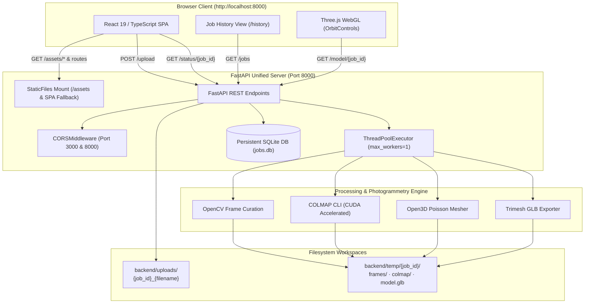

# GeoForge — Single-Pass Drone Video to 3D Model Generation System

[](https://www.sih.gov.in/)
[](https://www.sih.gov.in/)
[](https://ntro.gov.in/)
[]()
[]()

> **GeoForge** is an automated, web-native photogrammetry and 3D surface reconstruction system designed to transform continuous single-pass drone or mobile camera video into interactive, web-viewable 3D models.

---

## 1. Project Identity & Hackathon Context

- **Hackathon:** Smart India Hackathon (SIH) 2026
- **Problem Statement ID:** `SIH26158`
- **Problem Statement Title:** Single-Pass Drone Video to Accurate 3D Model Generation System
- **Organization:** National Technical Research Organisation (NTRO)
- **Category:** Software
- **Theme:** Robotics and Drones

---

## 2. Problem Being Solved

Traditional photogrammetric 3D reconstruction pipelines (e.g., manual command-line COLMAP, Agisoft Metashape, RealityCapture, WebODM) suffer from significant operational friction:

1. **Manual Ingestion & Pre-Processing:** Operators must manually extract video frames, filter out blurry images, and eliminate redundant stationary frames.
2. **Combinatorial Compute Explosion:** Video recorded at 30 or 60 FPS creates massive frame redundancy. Feeding all frames directly into Structure-from-Motion (SfM) causes quadratic matching explosions ($O(N^2)$ pairs) and out-of-memory (OOM) GPU crashes.
3. **Heavy Desktop Software Dependencies:** Reviewing 3D point clouds and meshes typically requires installing complex desktop CAD/GIS tools (CloudCompare, MeshLab, Blender).
4. **Steep Parameter Complexity:** Tuning SIFT feature counts, camera distortion models, and Poisson octree depths requires specialized computer vision expertise.

**GeoForge eliminates these barriers** by providing an automated, browser-accessible web application that handles the complete lifecycle: video ingestion, intelligent frame filtering, dense reconstruction, point cloud denoising, Poisson surface meshing, UV texture projection, and client-side WebGL 3D visualization.

---

## 3. Project Objectives

- **Automated Single-Pass Processing:** Accept raw drone flight footage (.mp4, .mov, .avi, .mkv) and automatically execute end-to-end 3D reconstruction without manual CLI intervention.
- **Intelligent Pre-Reconstruction Culling:** Automatically eliminate motion-blurred and visually redundant frames, reducing input images by 60% to 80% while preserving geometric coverage.
- **Fail-Fast Quality Assurance:** Validate camera registration early with a 30% quality gate, preventing hours of wasted GPU compute on unrecoverable scenes.
- **Watertight, Artifact-Free Meshes:** Apply Screened Poisson surface reconstruction with adaptive 7.0% boundary density trimming to eliminate bloated "bubble" artifacts.
- **Zero-Install Web Delivery:** Package reconstructed geometry into self-contained binary GLTF (`.glb`) files viewable on any modern web browser via Three.js.

---

## 4. How GeoForge Works (Pipeline Overview)

GeoForge processes video through an automated 8-stage photogrammetric pipeline:

```mermaid
flowchart LR
    Video["1. Drone Video<br/>(MP4/MOV/AVI/MKV)"] --> Extract["2. Frame Extraction<br/>(Target 2.0 FPS)"]
    Extract --> Sharp["3. Sharpness Filter<br/>(Laplacian Blur Var >= 100)"]
    Sharp --> Redundant["4. Redundancy Culling<br/>(Pixel Diff Delta >= 5.0)"]
    Redundant --> SfM["5. Sparse SfM<br/>(COLMAP OpenCV Model)"]
    SfM --> MVS["6. Dense MVS<br/>(PatchMatch Stereo)"]
    MVS --> Mesh["7. Clean & Mesh<br/>(Open3D Poisson Depth 11)"]
    Mesh --> GLB["8. Texture & GLB<br/>(Trimesh PBR + Three.js)"]
```



1. **Video Ingestion:** Operator uploads drone footage up to 4 GiB via the web interface.
2. **FPS-Aware Frame Extraction:** Video is sampled at a controlled target rate of 2.0 FPS using OpenCV (`cv2.VideoCapture`).
3. **Sharpness & Luminance Filtering:** Discards blurry frames using Laplacian variance ($\text{Var}(\nabla^2 I) \ge 100.0$) and eliminates underexposed/overexposed frames ($[30, 240]$ mean luminance).
4. **Redundancy Reduction:** Compares consecutive frames using mean absolute difference ($\Delta \ge 5.0$), preserving essential parallax while enforcing a 50% safety floor.
5. **COLMAP Structure-from-Motion (SfM):** Extracts 16,384 SIFT features per image, performs sequential feature matching (`overlap=15`), and executes single-model incremental mapping (`--Mapper.multiple_models 0`). Enforces a 30% camera registration gate.
6. **Dense Multi-View Stereo (MVS):** Computes per-view depth and normal maps using GPU-accelerated PatchMatch stereo and fuses agreeing pixels into a dense point cloud (`fused.ply`).
7. **Point Cloud Denoising & Poisson Meshing:** Open3D removes statistical outliers (`nb=20, std=2.0`), calculates surface normals, and reconstructs a watertight mesh using Screened Poisson meshing (`depth=11`) with 7.0% low-density boundary trimming.
8. **Texturing & GLB Packaging:** COLMAP `mesh_texturer` projects photographic color onto UV unwrapped geometry. Python `trimesh` and `pillow` assemble geometry and PBR materials into a self-contained `model.glb` for WebGL viewing.

---

## 5. Actual System Architecture

### 6.1 Unified Single-Port Architecture (Production)
In production or single-station evaluation, GeoForge operates as a **unified single-port service on `http://localhost:8000`**:
- The FastAPI backend serves all REST API endpoints (`/health`, `/ready`, `/upload`, `/status`, `/model`, `/download`, `/jobs`).
- The compiled React 19 SPA (`frontend/dist`) is served directly from the root with client-side SPA routing fallback (`/history`, `/upload`, `/how-it-works`).
- Single-click launcher [`start_geoforge.bat`](start_geoforge.bat) boots the virtual environment, verifies dependencies, compiles frontend assets if missing, opens the browser, and launches Uvicorn.



---

## 6. Technology Stack

### 6.1 Backend & Computer Vision Engine
| Technology | Exact Version | Architectural Role |
|---|---|---|
| **Python** | `3.10` – `3.12` (Tested: `3.12.3` 64-bit) | Core backend runtime |
| **FastAPI** | `^0.110.0` | Asynchronous REST API routing & validation |
| **Uvicorn** | `^0.28.0` | High-performance ASGI web server |
| **python-multipart** | `^0.0.9` | Streaming multipart/form-data video upload parsing |
| **OpenCV (`cv2`)** | `^4.9.0` | Video frame extraction, Laplacian blur, and redundancy math |
| **NumPy** | `^1.26.0` / `^2.0` | High-performance array operations and metric calculations |
| **Open3D** | `^0.18.0` / `^0.19.0` | Statistical outlier removal and Screened Poisson surface reconstruction |
| **Trimesh** | `^4.2.0` | 3D mesh scene assembly and binary GLB packaging |
| **Pillow (`PIL`)** | `^10.2.0` | PBR diffuse texture atlas binding and image loading |
| **COLMAP** | `3.8+` (Tested: `4.1.1` CUDA 12.x) | C++ Structure-from-Motion and Multi-View Stereo CLI suite |

### 6.2 Frontend Web Client
| Technology | Exact Version | Architectural Role |
|---|---|---|
| **React** | `^19.0.1` | Declarative UI component tree and state machine |
| **Three.js** | `^0.185.1` | WebGL 3D model viewport, lighting, and camera OrbitControls |
| **Vite** | `^6.2.3` | Ultra-fast frontend bundler and Hot Module Replacement (HMR) server |
| **TypeScript** | `~5.8.2` | Static type checking and safety (`tsc --noEmit`) |
| **Tailwind CSS** | `^4.1.14` | Modern utility-first responsive styling |
| **Lucide React** | `^0.546.0` | Clean SVG iconography across all user interfaces |
| **Motion** | `^12.23.24` | Smooth transitions and state animations |

---

## 7. Actual Verified Features

| Feature Domain | Verified Capability | Source Code Location |
|---|---|---|
| **Video Ingestion** | Drag-and-drop file upload with format check (`.mp4, .mov, .avi, .mkv`) and 4 GiB size enforcement. | [`backend/main.py`](backend/main.py) |
| **Intelligent Frame Curation** | Target 2.0 FPS sampling, adaptive Laplacian blur rejection ($\ge 100.0$), mean luminance gating ($[30, 240]$), and 50% safety floor redundancy culling. | [`backend/frame_filtering.py`](backend/frame_filtering.py), [`backend/redundancy_filter.py`](backend/redundancy_filter.py) |
| **Robust Photogrammetry** | 16,384 SIFT keypoints, sequential matching (`overlap=15`), OPENCV 8-parameter camera model, single-model enforcement (`--Mapper.multiple_models 0`), and fail-fast 30% registration gate. | [`backend/reconstruction.py`](backend/reconstruction.py) |
| **Mesh Quality & Trimming** | Statistical outlier denoising (`nb=20, std=2.0`), Screened Poisson meshing (`depth=11`), and 7.0% boundary density trimming. | [`backend/reconstruction.py`](backend/reconstruction.py) |
| **3D Web Inspection** | Interactive Three.js WebGL viewport with auto-bounding box centering, ambient/directional three-point lighting, orbit/pan/zoom controls, wireframe mode, and ground grid. | [`frontend/src/components/ThreeDViewer.tsx`](frontend/src/components/ThreeDViewer.tsx) |
| **Persistent SQLite Job Store** | Atomic `jobs.db` database logging job parameters, timestamps, progress stages, metadata, and automatic recovery of interrupted jobs. | [`backend/database.py`](backend/database.py) |
| **Job History Web View** | Full client-side audit history viewer (`/history`) showing previous reconstructions, download links, and direct model inspection. | [`frontend/src/pages/HistoryPage.tsx`](frontend/src/pages/HistoryPage.tsx), [`frontend/src/App.tsx`](frontend/src/App.tsx) |
| **Unified Single-Server Mount** | Compiled React SPA served directly by FastAPI with `spa_fallback` routing, eliminating separate dev server requirements. | [`backend/main.py`](backend/main.py) |
| **Turnkey Launch Script** | One-click Windows batch launcher with venv detection, dependency checks, automated build, and browser launching. | [`start_geoforge.bat`](start_geoforge.bat) |
| **Concurrency Guard** | Single-job GPU concurrency ceiling (`ThreadPoolExecutor(max_workers=1)`). Returns HTTP 503 if saturated. | [`backend/main.py`](backend/main.py) |
| **Path Traversal Protection** | Strict `uuid.UUID(job_id)` validation on `/model/{job_id}`, `/download/{job_id}`, and `/status/{job_id}`. Upload filename sanitization via `Path(file.filename).name`. | [`backend/main.py`](backend/main.py) |

---

## 8. Application Interface Screenshots

> *Note: Screen mockups below depict the active React 19 web interface running at `http://localhost:3000`.*

```text
+---------------------------------------------------------------------------------------+
|  GeoForge               [ How it Works ]  [ Features ]  [ Upload ]  [ Start Recon ]   |
|                                                                                       |
|      Transform Drone Video into Accurate 3D Models in Minutes                         |
|      Single-pass aerial video to dense, textured 3D models with web viewing.          |
|                                                                                       |
|      +-------------------------------------------------------------------------+      |
|      |               Drag and drop your drone video here                       |      |
|      |               Supports MP4, MOV, AVI, MKV up to 4 GiB                   |      |
|      |                                                                         |      |
|      |                     [ Select Video File ]                               |      |
|      +-------------------------------------------------------------------------+      |
|                                                                                       |
|      [x] Target Overlap >= 70%   [x] Oblique 45-60 deg   [x] Smooth Orbit Flight       |
+---------------------------------------------------------------------------------------+
                              Upload & Landing View
```

```text
+---------------------------------------------------------------------------------------+
|  Reconstruction in Progress                                          Job: 3c99d500... |
|                                                                                       |
|  [========================================>                          ]  65%           |
|                                                                                       |
|  Stage 6 / 10: Dense Multi-View Stereo (PatchMatch MVS Fusion)                        |
|                                                                                       |
|  Active Worker Output:                                                                |
|  > Running PatchMatchStereo with max_image_size=2400                                  |
|  > Stereo fusion complete: 1,420,891 points fused into colmap/dense/fused.ply         |
|  > Open3D: statistical outlier removal removed 24,110 noise points                    |
|                                                                                       |
|  [ Cancel Job ]                                                                       |
+---------------------------------------------------------------------------------------+
                           Live Processing & Telemetry View
```

```text
+---------------------------------------------------------------------------------------+
|  [<- Back to Dashboard]             GeoForge 3D Viewport              [ Download GLB ]|
|  +---------------------------------------------------------------------------------+  |
|  |                                                                                 |  |
|  |                                      /\                                         |  |
|  |                                     /  \                                        |  |
|  |                                    /____\                                       |  |
|  |                                   |  []  |                                      |  |
|  |                                   |  []  |                                      |  |
|  |                           +-------+------+-------+                              |  |
|  |                          /                       \                              |  |
|  |                     ----+-------------------------+---- (Ground Reference Grid) |  |
|  |                                                                                 |  |
|  |  [ Orbit: Left Click ]   [ Pan: Right Click ]   [ Zoom: Scroll ]  [x] Wireframe |  |
|  +---------------------------------------------------------------------------------+  |
|  Summary: 1,396,781 Points | 480,120 Faces | 114 Images Registered | Time: 12m 44s    |
+---------------------------------------------------------------------------------------+
                             Three.js WebGL 3D Model Viewer
```

---

## 9. Installation & Startup Instructions

### 9.1 Prerequisites
- **Operating System:** Windows 10/11 64-bit (Primary tested platform) or Ubuntu 22.04 LTS.
- **Python:** Python 3.10 to 3.12 64-bit (Verified on Python 3.12.8).
- **Node.js:** Node.js 18+ (Verified on Node 22.14.0) with npm.
- **COLMAP Photogrammetry Suite:** COLMAP 3.8+ (CUDA build recommended).
  - Default Windows path: `C:\Users\<username>\AppData\Local\Programs\COLMAP\bin\colmap.exe` or `C:\bin\colmap.exe`.
  - Override via environment variable: `$env:COLMAP_EXE = "C:\path\to\colmap.exe"`.
- **GPU Hardware:** NVIDIA GPU with $\ge 6\text{ GB}$ VRAM strongly recommended for dense PatchMatch stereo matching.

---

### 9.2 Turnkey Single-Click Execution (Recommended)
GeoForge provides an automated, one-click launcher for Windows:

```powershell
# From project root:
.\start_geoforge.bat
```
This turnkey script automatically:
1. Validates and activates the Python `.venv` environment.
2. Verifies core dependencies (`fastapi`, `uvicorn`, `cv2`, `open3d`, `trimesh`, `pillow`).
3. Compiles the React frontend production bundle if missing.
4. Detects and reports COLMAP and FFmpeg binaries.
5. Automatically opens your default web browser to `http://localhost:8000`.
6. Launches the unified FastAPI ASGI server serving both the web application and photogrammetric API.

---

### 9.3 Manual & Development Startup

#### Backend (Port 8000)
```powershell
# 1. Activate virtual environment
.\.venv\Scripts\Activate.ps1

# 2. Start FastAPI server
python -m uvicorn main:app --app-dir backend --reload --port 8000
```
- **Health Verification:** Open `http://127.0.0.1:8000/health` (Expected: `{"status": "healthy"}`).
- **Interactive API Documentation:** Open `http://127.0.0.1:8000/docs` (FastAPI Swagger UI).

#### Frontend Development Server (Port 3000, Optional with HMR)
If actively developing React UI components:
```powershell
cd frontend
npm install
npm run dev
```
Navigate your browser to `http://localhost:3000`. In development mode, Vite automatically proxies API calls to `http://localhost:8000`.

---

## 10. Configuration & Environment Variables

| Variable Name | Component | Default Value | Description |
|---|---|---|---|
| `COLMAP_EXE` | Backend | `C:\bin\colmap.exe` | Absolute filesystem path to the compiled COLMAP CLI executable. |
| `ALLOWED_ORIGINS` | Backend | `http://localhost:3000,...` | Comma-separated list of allowed client origins configured in FastAPI `CORSMiddleware`. |
| `VITE_API_URL` | Frontend | `http://127.0.0.1:8000` | Backend API URL used by the React client. Set in `frontend/.env.local`. |

---

## 11. Output Deliverables & Storage Layout

When a reconstruction finishes, artifacts are located in `backend/temp/{job_id}/`:

```text
backend/
├── uploads/
│   └── {job_id}_{original_filename}          # Stored raw input video
└── temp/
    └── {job_id}/
        ├── frames/                           # Raw extracted JPEGs (target 2.0 FPS)
        ├── selected_frames/                  # Frames passing blur & luminance filters
        ├── final_frames/                     # Keyframes passing redundancy reduction
        └── colmap/
            ├── database.db                   # SQLite SIFT feature and match database
            ├── sparse/0/                     # cameras.bin, images.bin, points3D.bin
            ├── dense/
            │   ├── fused.ply                 # Raw dense MVS fused point cloud
            │   ├── fused_cleaned.ply         # Outlier-cleaned point cloud (Open3D)
            │   └── poisson_mesh.ply          # Screened Poisson reconstructed surface mesh
            └── textured/
                ├── model.ply                 # Textured surface mesh
                ├── model.obj + model.png     # UV-unwrapped OBJ with texture atlas
                └── model.glb                 # Final binary GLTF model served at /model/{job_id}
```

---

## 12. Known Limitations & Technical Boundaries

In strict compliance with technical honesty, the following prototype boundaries are documented:

1. **Unscaled Local Coordinates:** Monocular video photogrammetry recovers geometry up to an unknown scale factor $\lambda$. The prototype model is defined in arbitrary relative coordinates without geodetic CRS (WGS84) positioning.
2. **Non-Survey Grade Assurance:** The v0.5 prototype is engineered for rapid 3D situational awareness, visualization, and inspection—not legal cadastral surveying or sub-millimeter metrology.
3. **In-Memory Job State:** The active job store (`_jobs`) resides in server process memory. Restarting FastAPI clears active polling tracking, though generated `.glb` models remain intact on disk.
4. **Single-Node Concurrency Ceiling:** The backend enforces a limit of 2 concurrent worker threads (`MAX_CONCURRENT_RECONSTRUCTIONS = 2`) to prevent GPU VRAM exhaustion. Additional uploads receive HTTP 503 until an active run finishes.

---

## 13. Master Documentation Directory Guide

All comprehensive technical deep dives, mathematical proofs, and architectural guides are maintained in [`docs/`](docs/):

| Document | Primary Scope |
|---|---|
| [`docs/GEOFORGE_MASTER_CONTEXT.md`](docs/GEOFORGE_MASTER_CONTEXT.md) | 20-section master technical reference knowledge base. |
| [`docs/ARCHITECTURE.md`](docs/ARCHITECTURE.md) | Multi-tier system architecture, call graph, and workspace topology. |
| [`docs/PRD.md`](docs/PRD.md) | 15 Functional Requirements (`FR-001`–`FR-015`) and 8 Non-Functional Requirements. |
| [`docs/FEATURE_STATUS.md`](docs/FEATURE_STATUS.md) | 5-tier classification taxonomy with line-by-line source citations. |
| [`docs/RECONSTRUCTION_PIPELINE.md`](docs/RECONSTRUCTION_PIPELINE.md) | Mathematical formulas for blur, luminance, redundancy, and 13-stage photogrammetry pipeline. |
| [`docs/COLMAP.md`](docs/COLMAP.md) | SIFT extraction, sequential matching, vocabulary tree paths, and single-model SfM flags. |
| [`docs/OPEN3D.md`](docs/OPEN3D.md) | Statistical outlier removal (`nb=20, std=2.0`), Poisson meshing, and 7.0% boundary trimming. |
| [`docs/MESH_AND_GLB.md`](docs/MESH_AND_GLB.md) | UV texture mapping, Trimesh scene concatenation, Pillow PBR material attachment, and GLB export. |
| [`docs/API.md`](docs/API.md) | Code-verified REST API specification and exact JSON request/response schemas. |
| [`docs/JOB_MANAGEMENT.md`](docs/JOB_MANAGEMENT.md) | 4-state lifecycle, HTTP 503 capacity guard, and 27-metric execution results. |
| [`docs/SETUP.md`](docs/SETUP.md) | Verified prerequisites, step-by-step installation, and smoke test protocol. |
| [`docs/CONFIGURATION.md`](docs/CONFIGURATION.md) | All active environment variables, configuration files, and processing parameters. |
| [`docs/DEPLOYMENT.md`](docs/DEPLOYMENT.md) | Decoupled deployment architecture, hardware sizing, Nginx reverse proxy, and cloud scaling. |
| [`docs/SECURITY.md`](docs/SECURITY.md) | Comprehensive security audit separating verified protections from potential vulnerabilities. |
| [`docs/SECURITY_AND_ACCURACY_NOTES.md`](docs/SECURITY_AND_ACCURACY_NOTES.md) | Metric accuracy disclaimers, scale ambiguity, drone video privacy, and SIH demonstration rules. |
| [`docs/TESTING.md`](docs/TESTING.md) | Test scripts, cURL API integration tests, module verification, and 10-scenario failure matrix. |
| [`docs/TROUBLESHOOTING.md`](docs/TROUBLESHOOTING.md) | Diagnostic decision tree and practical step-by-step solutions for 12 real-world errors. |
| [`docs/ROADMAP.md`](docs/ROADMAP.md) | 5-phase engineering roadmap covering accuracy, speed, VRAM bounds, large uploads, and GIS exports. |
| [`docs/MASTER_DOCUMENTATION_INDEX.md`](docs/MASTER_DOCUMENTATION_INDEX.md) | Canonical catalog of all 34 active master documentation files. |

---

## 14. Future Development Roadmap

- **Phase 1 (Immediate / Prototype Hardening):** Reconcile frontend `.mkv` support, adjust "READY" download badges on `CompletePage.tsx`, and add disk space validation.
- **Phase 2 (Near-Term / Persistence & Telemetry):** Migrate from in-memory `_jobs` to SQLite/PostgreSQL, implement Server-Sent Events (SSE) for live stage progress, and add job checkpoint resumption.
- **Phase 3 (Medium-Term / Metric Scale & Calibration):** Ingest EXIF/GPS telemetry from companion `.srt` tracks to recover metric scale ($\pm 5\%$), upgrade camera calibration to 8-parameter `OPENCV` model, and establish repeatable ground-truth laser benchmarks.
- **Phase 4 (Long-Term / Cloud Architecture & GIS Deliverables):** Decouple API from GPU workers using Celery and RabbitMQ, implement chunked resumable upload (Tus protocol), and add native LAS/GeoTIFF orthomosaic exporters.
- **Phase 5 (Enterprise / Defense Hardening):** Ephemeral Docker sandboxing, multi-tenant RBAC, cryptographic chain of custody, and air-gapped zero-telemetry defense bundles.

---

## 15. Contribution & Quality Guidelines

Contributions must adhere to the engineering standards defined in [`docs/DEVELOPMENT_WORKFLOW.md`](docs/DEVELOPMENT_WORKFLOW.md) and [`AGENTS.md`](AGENTS.md):

1. **Verify Before Proposing:** Inspect the actual Python and TypeScript source code before asserting feature existence.
2. **Preserve Documentation Truth:** When updating code symbols, parameters, or endpoints, update the corresponding documentation in `docs/` and log entries in `docs/CHANGELOG.md`.
3. **No Machine Paths:** Never commit developer-specific personal machine paths (`C:\Users\...`). Use relative paths and environment variables (`COLMAP_EXE`, `VITE_API_URL`).
4. **Mandatory Static Verification:** Ensure all changes pass static analysis:
   ```powershell
   # Frontend static type check
   cd frontend; npm run lint
   
   # Backend bytecode validation
   cd backend; python -m py_compile main.py reconstruction.py frame_processing.py frame_filtering.py redundancy_filter.py convert_to_glb.py
   ```
