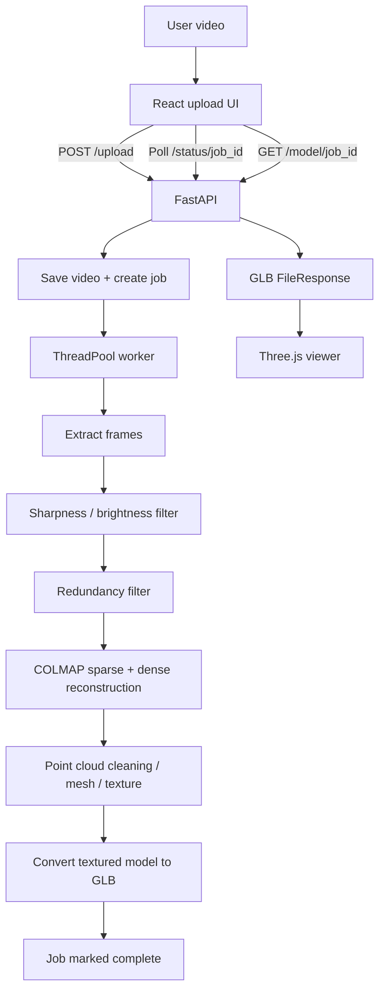

# 03 — System architecture

## High-level components
- **Browser frontend:** React 19 + TypeScript + Vite. Owns navigation, upload interaction, job polling, error display, and Three.js model viewing.
- **FastAPI backend:** Receives uploaded videos, creates jobs, orchestrates preprocessing and reconstruction, tracks status in process memory, and serves GLB.
- **OpenCV preprocessing:** Extracts frames and evaluates quality/redundancy.
- **COLMAP:** Photogrammetric feature extraction/matching, camera registration, dense reconstruction, and meshing/texturing steps.
- **Open3D:** Used in reconstruction helpers for point-cloud cleaning and Poisson mesh processing where available.
- **Trimesh/Pillow:** Converts textured geometry and image into GLB.
- **Local filesystem:** Stores uploads and per-job intermediate/output artifacts.

## Logical flow

## Runtime topology
Local development is expected to use Vite on port 3000 and FastAPI on port 8000. Frontend API base defaults to `http://127.0.0.1:8000`, overridden by `VITE_API_URL`.

## State and durability
Job metadata is stored in the backend process-level `_jobs` dictionary. This means restart durability is not established. Files are placed under backend upload/temp/output folders. Verify actual cleanup behavior before relying on retention guarantees.

## Trust boundaries
The uploaded video is untrusted input. It is processed by OpenCV and external COLMAP executables. Treat file parsing, resource exhaustion, and subprocess invocation as security and reliability concerns.
