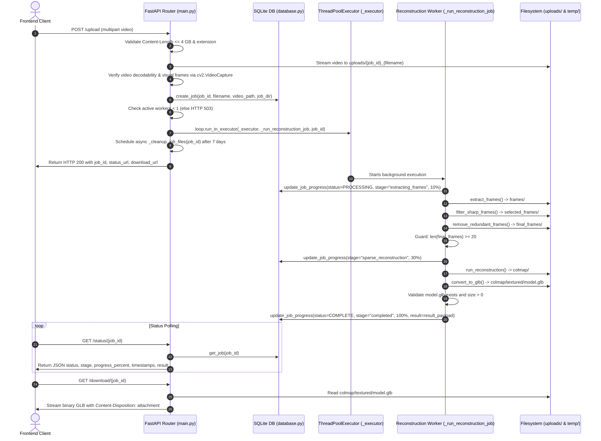

# Backend Architecture & Service Specification — GeoForge

> **Document:** `docs/BACKEND.md`  
> **Status:** Code-Verified Backend Specification (Phase 3 Verified)  
> **Target Version:** GeoForge v1.0.0 (SIH 2026 / NTRO Edition)  
> **Source Verification Date:** 2026-11-11  
> **Related Documents:** [`docs/API.md`](file:///c:/Users/adity/Downloads/geoforge-main/geoforge-main/docs/API.md), [`docs/JOB_MANAGEMENT.md`](file:///c:/Users/adity/Downloads/geoforge-main/geoforge-main/docs/JOB_MANAGEMENT.md), [`docs/ARCHITECTURE.md`](file:///c:/Users/adity/Downloads/geoforge-main/geoforge-main/docs/ARCHITECTURE.md)

---

## 1. Application Entry Point & Initialization

The backend application entry point is `backend/main.py:50-54`:
```python
app = FastAPI(
    title="GeoForge Drone Reconstruction API",
    description="Single-Pass Drone Video to 3D Model Generation Backend",
    version="1.0.0"
)
```

### 1.1 Server Execution Command
Executed via Uvicorn from the `backend/` directory:
```powershell
cd backend
python -m uvicorn main:app --reload --port 8000
```
- Listens on `http://127.0.0.1:8000`.
- OpenAPI documentation: `http://127.0.0.1:8000/docs` (Swagger UI) and `http://127.0.0.1:8000/redoc`.

### 1.2 Startup Lifecycle & Database Recovery (`backend/main.py:128-134`)
On backend startup, the FastAPI application executes:
```python
@app.on_event("startup")
def startup_event():
    database.init_db()
    recovered = database.recover_interrupted_jobs()
    logger.info(f"GeoForge backend started. SQLite job store ready (recovered {recovered} interrupted jobs).")
```
- Initializes the persistent SQLite database `backend/jobs.db`.
- Applies automatic schema migrations (such as adding `completed_at`).
- Automatically transitions any jobs left in `"processing"` state from an abrupt server crash or restart to `"failed"`, recording an explanatory diagnostic message.

### 1.3 CORS Configuration (`backend/main.py:62-75`)
CORS is configured via Starlette `CORSMiddleware`:
- Default allowed origins:
  `["http://localhost:3000", "http://127.0.0.1:3000", "http://localhost:3001", "http://127.0.0.1:3001", "http://localhost:5173", "http://127.0.0.1:5173"]`
- Configurable at runtime via the `ALLOWED_ORIGINS` environment variable (comma-separated list).
- Enables `allow_credentials=True`, `allow_methods=["*"]`, `allow_headers=["*"]`.

---

## 2. Directory Layout & Storage Management

All paths are resolved relative to `BASE_DIR = Path(__file__).resolve().parent` (`backend/`):

| Directory Variable | Physical Path | Lifecycle & Content |
|---|---|---|
| `UPLOAD_DIR` | `backend/uploads/` | Stores uploaded raw videos named `{job_id}_{original_filename}`. Retained for 7 days. |
| `TEMP_DIR` | `backend/temp/` | Stores per-job isolated processing workspaces under `{job_id}/`. Retained for 7 days. |
| `OUTPUT_DIR` | `backend/output/` | General static output root directory. |
| `DB_PATH` | `backend/jobs.db` | Persistent SQLite database storing full job history across restarts. |

### 2.1 Workspace Structure (`backend/temp/{job_id}/`)
- `frames/`: Raw frames extracted by OpenCV at 2.0 FPS (`frame_XXXXXX.jpg`).
- `selected_frames/`: Frames surviving Laplacian variance blur and luminance filtering.
- `final_frames/`: Keyframes surviving redundancy filtering (sent to COLMAP).
- `colmap/`: COLMAP database, sparse SfM, dense MVS depth maps, and Open3D meshes.
- `colmap/textured/`: Houses `model.ply`, `model.obj`, `model.png`, and the final deliverable `model.glb`.

---

## 3. Configuration Constants Reference (`backend/main.py:81-95`)

| Constant Name | Type | Value | Code Purpose |
|---|---|---|---|
| `MAX_UPLOAD_BYTES` | `int` | `4 * 1024 * 1024 * 1024` (4 GiB) | Maximum allowed upload size enforced via `Content-Length`. |
| `MIN_FRAMES_FOR_RECONSTRUCTION`| `int` | `20` | Minimum frame count required before invoking COLMAP. |
| `JOB_RETENTION_SECONDS` | `int` | `7 * 24 * 60 * 60` (604,800 s) | Retention period before automated file deletion. |
| `MAX_CONCURRENT_RECONSTRUCTIONS`| `int` | `1` | Strict concurrency limit protecting RTX 3050 (6 GB VRAM) and 16 GB host RAM. |
| `_executor` | `ThreadPoolExecutor` | `max_workers=1` | Dedicated thread pool for heavy reconstruction tasks. |

---

## 4. Job Orchestration & Execution Flow



---

## 5. Endpoints Reference Summary

| Endpoint | Method | Functionality | Response Codes |
|---|---|---|---|
| `/` | `GET` | Service identity and status | `200` |
| `/health` | `GET` | Fast liveness probe + diagnostic info | `200` |
| `/ready` | `GET` | Deep subsystem readiness check | `200`, `503` |
| `/upload` | `POST` | Video streaming, OpenCV validation & queuing | `200`, `400`, `413`, `503` |
| `/status/{job_id}` | `GET` | Comprehensive stage and metrics polling | `200`, `400`, `404` |
| `/model/{job_id}` | `GET` | Stream GLB model for WebGL viewer | `200`, `400`, `404`, `500` |
| `/model/{job_id}` | `HEAD` | Probe GLB availability & byte size | `200`, `400`, `404` |
| `/download/{job_id}`| `GET` | Download GLB file as browser attachment | `200`, `400`, `404` |
| `/jobs/{job_id}/cancel`| `POST` | Cancel queued or active job | `200`, `400`, `404` |

---

## 6. Error Handling & Robustness

### 6.1 Persistent Job Recovery
In previous versions, an in-memory job dictionary (`_jobs`) was lost upon server restart. GeoForge now persists all job state in SQLite (`backend/jobs.db`). When the backend restarts:
- `database.recover_interrupted_jobs()` finds all jobs stuck in `"processing"`.
- Sets their status to `"failed"`.
- Appends the diagnostic message: `"Reconstruction was interrupted by a server restart. Please upload again."`
- Client polling receives this status immediately and presents a clean restart prompt.

### 6.2 Pre-Ingestion OpenCV Decodability Gate
Non-video files renamed with `.mp4` extensions or 0-byte uploads are intercepted immediately during `POST /upload` before occupying worker queues:
- File size $= 0$: HTTP 400 `"Uploaded file is empty."`
- `cv2.VideoCapture.isOpened() == False`: HTTP 400 `"Uploaded file is not a valid or readable video."`
- Total visual frames $\le 0$: HTTP 400 `"Video contains no decodable visual frames."`

### 6.3 Safe Path Resolution
Model streaming via `GET /model/{job_id}` and `GET /download/{job_id}` uses `_resolve_glb(job_id)`:
- Validates `job_id` against RFC 4122 v4 UUID format.
- Resolves candidate paths using `.resolve()`.
- Verifies that resolved paths strictly reside within `TEMP_DIR` or `OUTPUT_DIR`, completely preventing directory traversal attacks.
