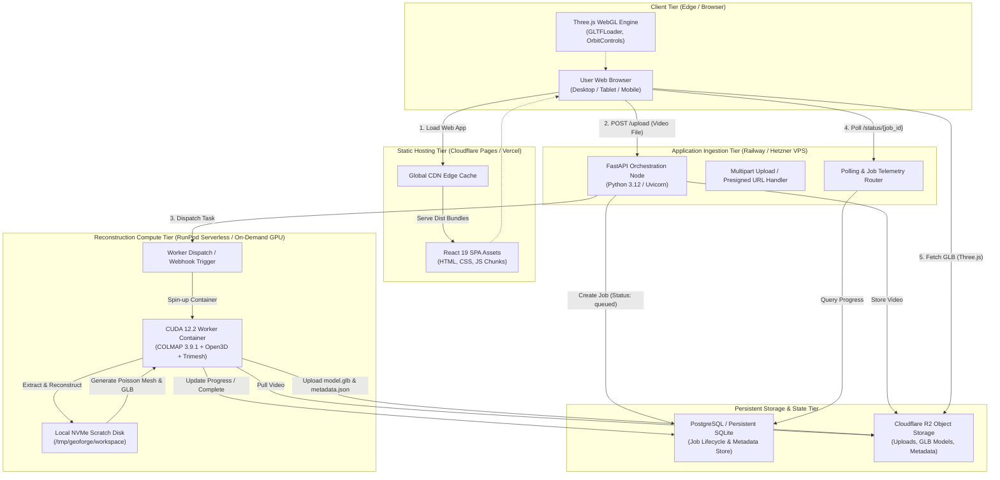
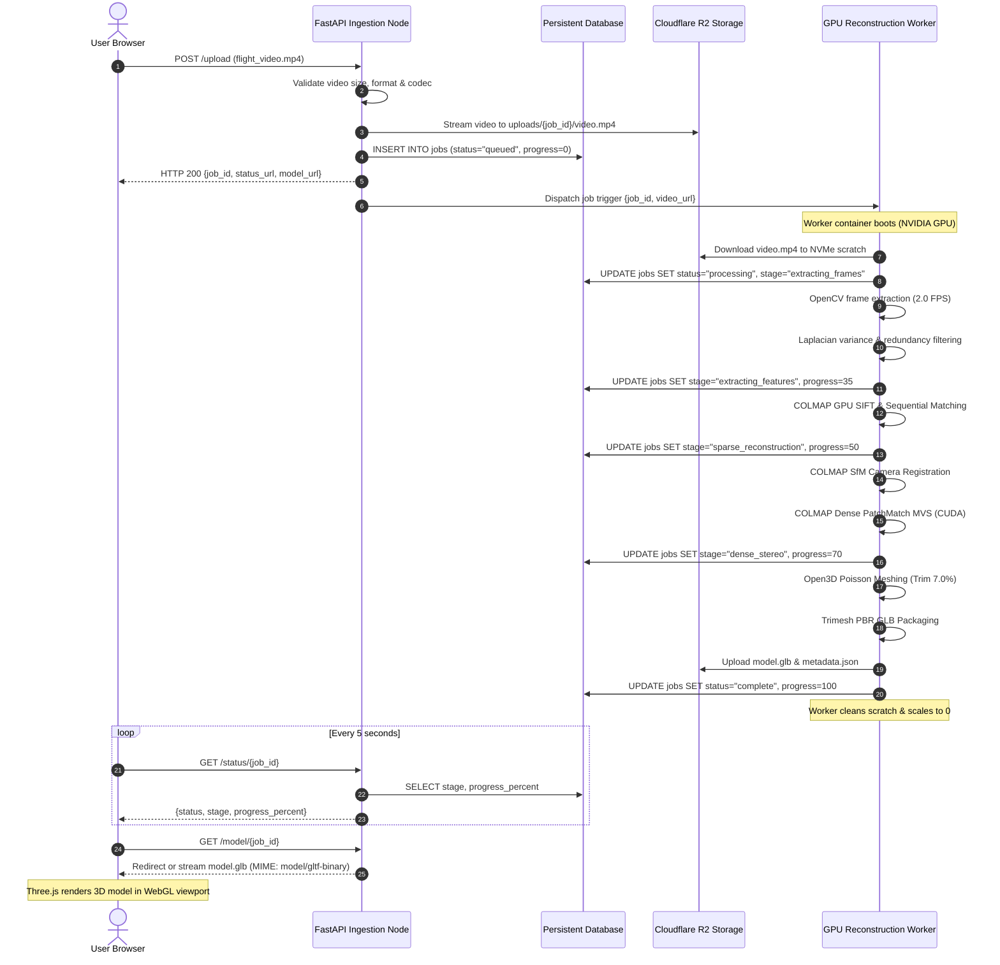

# GeoForge Cloud Architecture & System Topology Specification

> **Document:** `CLOUD_ARCHITECTURE.md`  
> **Status:** Architecture Specification Contract (Phase 8 Planning)  
> **Target Version:** GeoForge v1.1.0 Cloud Architecture  
> **Author:** Antigravity Engineering Team  
> **Last Verified:** 2026-11-14  
> **Related Documents:** [`docs/PHASE_8_DEPLOYMENT_STRATEGY.md`](PHASE_8_DEPLOYMENT_STRATEGY.md), [`docs/DEPLOYMENT_PROVIDER_COMPARISON.md`](DEPLOYMENT_PROVIDER_COMPARISON.md), [`docs/PRODUCTION_ENVIRONMENT_CONFIGURATION.md`](PRODUCTION_ENVIRONMENT_CONFIGURATION.md)

---

## 1. System Topology Overview

GeoForge's cloud architecture decouples the user-facing web tier, the persistent state store, and the compute-heavy GPU reconstruction worker. This guarantees that:
- The web interface remains fast, responsive, and available 24/7.
- Long-running photogrammetric reconstructions (4–15 minutes) never block or degrade API response times.
- Compute costs are incurred strictly while processing video frames.
- Reconstructed 3D GLB models and historical jobs persist reliably across process restarts, deployments, and worker scaling events.



---

## 2. Component-by-Component Specifications

### 2.1 Frontend Client Tier
- **Framework:** React 19, TypeScript, Tailwind CSS v4, Lucide React, Three.js (`^0.185.1`).
- **Build Output:** Static HTML, JavaScript, and CSS bundle (`frontend/dist/`).
- **Hosting Target:** Cloudflare Pages (Recommended) or Vercel / Netlify.
- **Environment Configuration:**
  - `VITE_API_URL`: Points to the deployed backend API (e.g. `https://api.geoforge.app`).
  - When unset, defaults safely to local development (`http://127.0.0.1:8000`).
- **Key Client Responsibilities:**
  - Render responsive navigation: `HomePage`, `HowItWorksPage`, `UploadPage`, `ProcessingPage`, `CompletePage`, `HistoryPage`, and `ResultPage`.
  - Provide chunked multipart upload progress feedback.
  - Implement adaptive exponential polling (`/status/{job_id}`: `[3s, 5s, 10s, 20s, 30s]`).
  - Render interactive 3D models with OrbitControls, directional lighting, mesh statistics inspector, and direct binary `.glb` download.

### 2.2 Application Ingestion Tier (FastAPI Backend)
- **Framework:** FastAPI 0.162.4 on Python 3.12.8, managed by Uvicorn.
- **Hosting Target:** Railway, Hetzner Cloud (CX23 VPS), or Render Web Service.
- **Key Endpoints:**
  - `GET /health`: Liveness probe reporting overall service status.
  - `GET /ready`: Readiness probe verifying database connectivity, object storage accessibility, and worker queue availability.
  - `POST /upload`: Validates video format, file size, and decodability; persists video to storage; initializes database record; and dispatches the task.
  - `GET /status/{job_id}`: High-frequency polling endpoint returning current stage, progress percentage, stage message, and model URLs.
  - `GET /jobs`: Retrieves paginated history of past reconstructions.
  - `GET /model/{job_id}`: Direct stream or signed redirect to the binary GLB model.
  - `GET /download/{job_id}`: Attachment file download with `Content-Disposition`.
  - `GET /metadata/{job_id}`: Complete 17-stage photogrammetric telemetry report.
  - `POST /jobs/{job_id}/cancel`: Aborts active reconstruction.

### 2.3 Persistent State Tier (Database)
- **Current Baseline:** Local SQLite `jobs.db` via `backend/database.py`.
- **Cloud Migration Strategy:**
  - **Option 1 (Simplest):** SQLite on a persistent cloud storage volume (e.g., Railway Persistent Volume or Hetzner VPS volume). Zero code changes required.
  - **Option 2 (Production Scalable):** Hosted PostgreSQL via Supabase or Neon.
    - Preserves exact 14-column schema (`job_id`, `filename`, `status`, `stage`, `progress_percent`, `stage_message`, `video_path`, `job_dir`, `model_path`, `result_json`, `error_message`, `created_at`, `updated_at`, `completed_at`).
    - Standard `asyncpg` or `psycopg3` driver replacing `sqlite3.connect`.
    - Enables multiple API instances to share identical state.

### 2.4 Durable Storage Tier (Object Storage)
- **Engine:** S3-Compatible Object Storage (**Cloudflare R2** recommended; AWS S3 or MinIO as fallbacks).
- **Why Cloudflare R2 is Authoritative:**
  - **Zero Data Egress Fees ($0.00/GB):** Drone videos (100–500 MB) and 3D GLBs (5–25 MB) downloaded repeatedly incur massive bandwidth costs on AWS S3 ($0.09/GB egress). Cloudflare R2 charges **$0.00** for all downloads.
  - **Free Tier:** 10 GB storage, 1M Class A operations (writes), 10M Class B operations (reads) per month.
- **Storage Layout Hierarchy:**
  ```text
  geoforge-data/
  ├── uploads/
  │   └── {job_id}/
  │       └── video.mp4
  ├── models/
  │   └── {job_id}/
  │       ├── model.glb
  │       ├── texture.png
  │       └── metadata.json
  └── pointclouds/
      └── {job_id}/
          └── fused.ply          (Optional archive tier)
  ```

### 2.5 Compute Tier (Reconstruction Worker)
- **Container Environment:** Ubuntu 22.04 LTS + NVIDIA CUDA 12.2 Runtime + COLMAP 3.9.1 Headless CLI + Python 3.12 + Open3D + Trimesh.
- **Hosting Target:** **RunPod Serverless GPU** (or RunPod / Vast.ai On-Demand Pod).
- **Worker Execution Flow:**
  1. Worker is invoked via HTTP webhook or queue message with `{job_id, video_url}`.
  2. Downloads `video.mp4` to fast local NVMe scratch disk (`/tmp/{job_id}/`).
  3. Executes `frame_processing.py` (2.0 FPS frame extraction).
  4. Executes `frame_filtering.py` (Laplacian sharpness & exposure filtering).
  5. Executes `redundancy_filter.py` (pixel difference deduplication).
  6. Executes `reconstruction.py`:
     - SIFT feature extraction (`colmap feature_extractor --SiftExtraction.use_gpu 1`).
     - Sequential matching (`colmap sequential_matcher`).
     - Sparse SfM mapper (`colmap mapper`).
     - Sparse quality gate verification.
     - Image undistortion (`colmap image_undistorter`).
     - Dense stereo estimation (`colmap patch_match_stereo --PatchMatchStereo.gpu_index 0`).
     - Stereo fusion (`colmap stereo_fusion`).
     - Point cloud cleaning (`open3d.geometry.PointCloud.remove_statistical_outlier`).
     - Poisson surface meshing (`open3d.geometry.TriangleMesh.create_from_point_cloud_poisson`).
     - Density trimming (7.0% boundary trim).
     - KDTree vertex color mapping (`scipy.spatial.cKDTree`).
  7. Executes `convert_to_glb.py` to compile binary GLB.
  8. Uploads `model.glb` and `metadata.json` to Object Storage.
  9. Updates database status to `complete` (progress: 100%).
  10. Cleans local scratch directory and shuts down container.

---

## 3. End-to-End Network & Data Flow

The following sequence diagram specifies the interaction lifecycle of a reconstruction job from initial browser drag-and-drop to 3D WebGL rendering:



---

## 4. Failure Modes, Timeouts & Self-Healing

| Failure Scenario | Detection Mechanism | Automated Recovery / Mitigation |
|---|---|---|
| **GPU Worker OOM (VRAM Exhaustion)** | NVIDIA driver CUDA error during `patch_match_stereo` | Worker catches CUDA error, downsamples `PATCHMATCH_MAX_IMAGE_SIZE` from 1200 to 800, and retries dense stereo. If still failing, logs clear diagnostic. |
| **Video Ingestion Disconnect** | Stream timeout or broken socket in `POST /upload` | Temporary upload chunk is unlinked; no orphan job record is created in database. |
| **Worker Crash / Node Eviction** | Job remains in `processing` status without heartbeat for $> 15\text{ minutes}$ | API watchdog daemon detects stalled job, marks record `failed`, and logs: `Reconstruction worker timed out or node restarted.` |
| **Browser Network Drop During Upload** | Client XHR abort | Frontend shows immediate retry button with exponential backoff. |
| **Sparse Reconstruction Failure (<30% Registered)** | Sparse quality check in `reconstruction.py:1222` | Worker halts dense phase early, updates DB status to `failed` with diagnostic: `Insufficient visual features or overlap in drone frames.` Prevents wasted GPU spend. |

