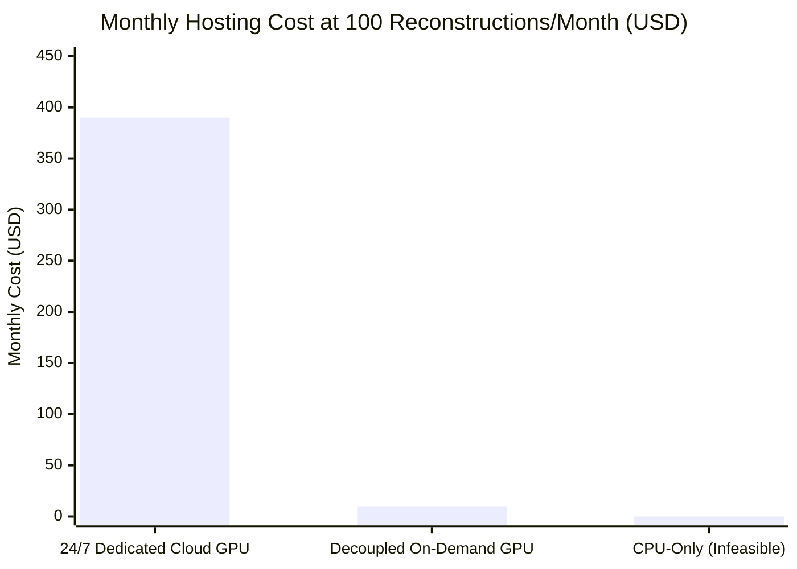

# GeoForge Cloud Cost Estimation & Financial Modeling (USD & INR)

> **Document:** `CLOUD_COST_ESTIMATES.md`  
> **Status:** Authoritative Cost Model (Phase 8 Planning)  
> **Target Version:** GeoForge v1.1.0 Cloud Architecture  
> **Currency Conversion Baseline:** $1.00\text{ USD} = ₹88.00\text{ INR}$ (Mid-market baseline with transaction margin)  
> **Author:** Antigravity Engineering Team  
> **Last Verified:** 2026-11-14  
> **Related Documents:** [`docs/PHASE_8_DEPLOYMENT_STRATEGY.md`](PHASE_8_DEPLOYMENT_STRATEGY.md), [`docs/DEPLOYMENT_PROVIDER_COMPARISON.md`](DEPLOYMENT_PROVIDER_COMPARISON.md)

---

## 1. Unit Economics: Cost of an Individual 3D Reconstruction

To provide rigorous financial planning, we first calculate the exact physical cost to process a single drone video into a verified 3D GLB model based on the Phase 7 benchmark.

### 1.1 Benchmark Unit Parameters (Empirically Verified in Phase 7)
- **Input Video:** 1080p / 720p drone orbit video (`38.87 MB`, 300 frames, 15s duration).
- **Extracted Frames:** 30 frames at 2.0 FPS (all 30 retained post-filtering).
- **Processing Time:** **265.65 seconds** (~4.43 minutes) on an NVIDIA RTX GPU (CUDA SIFT + PatchMatch MVS).
- **Output Artifacts:** `4.10 MB` binary GLB model + `761-byte` texture + `10 KB` metadata report.
- **Estimated Viewer Downloads:** Each generated model is viewed and downloaded 3 times across browser sessions (~12.3 MB data transfer out).

### 1.2 Step-by-Step Unit Cost Breakdown

| Pipeline Stage / Resource | Resource Provider & Rate | Consumption per Job | Cost per Job (USD) | Cost per Job (INR) |
|---|---|---|---|---|
| **Video Upload Ingress** | Cloudflare R2 / Railway (Free ingress) | 38.87 MB transferred in | **$0.0000** | **₹0.00** |
| **GPU Compute (PatchMatch & SIFT)** | RunPod Serverless ($0.58 / worker-hour) | 265.65 seconds ($0.000161/sec) | **$0.0428** | **₹3.77** |
| **Object Storage (Video + GLB)** | Cloudflare R2 ($0.015 / GB-month) | ~45 MB stored for 30 days | **$0.0006** | **₹0.05** |
| **Model Download Egress** | Cloudflare R2 ($0.00 / GB egress) | ~12.3 MB downloaded | **$0.0000** | **₹0.00** |
| **Database Transaction** | Supabase Postgres / Railway SQLite | 6 state update queries | **$0.0000** | **₹0.00** |
| **API Orchestration** | Railway API Node (0.5 vCPU shared) | ~0.5 CPU-seconds dispatch | **$0.0001** | **₹0.01** |
| **TOTAL COST PER RECONSTRUCTION** | — | — | **$0.0435** | **₹3.83** |

> [!NOTE]
> **Single Reconstruction Rule-of-Thumb:**  
> One full photogrammetric 3D reconstruction costs approximately **4.4 cents USD** or **under ₹4.00 INR** when using on-demand GPU infrastructure and Cloudflare R2 zero-egress storage.

---

## 2. Infrastructure Comparison: Always-Running vs. On-Demand vs. CPU

Understanding the financial disparity between compute models is essential before provisioning cloud instances:



| Deployment Model | Hardware Spec | Pricing Mechanism | Monthly Idle Cost (0 Jobs) | Monthly Cost at 100 Jobs | Monthly Cost at 500 Jobs |
|---|---|---|---|---|---|
| **Model A: Always-Running GPU VM** | AWS `g4dn.xlarge` (T4 16GB) or GCP `g2` | $0.53/hr continuous | **$380.00** (~₹33,440) | **$385.00** (~₹33,880) | **$410.00** (~₹36,080) |
| **Model B: Decoupled On-Demand GPU** | Railway CPU API + RunPod Serverless GPU | $5 base API + $0.043/job | **$5.00** (~₹440) | **$9.35** (~₹823) | **$26.75** (~₹2,354) |
| **Model C: CPU-Only Cloud VM** | Hetzner 8-Core CPU (CX42) | $18.00/mo continuous | $18.00 (~₹1,584) | **FAILED (Dense MVS requires CUDA)** | **FAILED** |

> [!CAUTION]
> **Financial Trap Warning:**  
> Leaving an always-on GPU virtual machine running 24/7 costs over **₹33,000 every single month** regardless of whether anyone visits the site. The decoupled on-demand architecture reduces this to **₹440 to ₹820 per month** ($\approx 97.5\%\text{ cost reduction}$).

---

## 3. Three Comprehensive Usage Scenarios

### 3.1 Scenario 1: Personal Development & Verification
- **Usage Profile:** Single-user testing, validation, and demonstrations.
- **Monthly Workload:** 15 reconstructions (~1 video every 2 days).
- **Data Footprint:** 600 MB uploads, 65 MB GLBs, 500 MB temporary scratch.

| Cost Component | Provider / Tier | Monthly Cost (USD) | Monthly Cost (INR) | Cost Nature |
|---|---|---|---|---|
| Frontend SPA Hosting | Cloudflare Pages (Free Tier) | $0.00 | ₹0.00 | Fixed |
| Backend API Server | Railway Hobby Plan ($5 base credit) | $5.00 | ₹440.00 | Fixed |
| Database | Supabase Postgres (Free Tier) | $0.00 | ₹0.00 | Fixed |
| Object Storage | Cloudflare R2 (Under 10 GB free tier) | $0.00 | ₹0.00 | Variable (Free) |
| GPU Reconstruction | RunPod Serverless (15 jobs @ $0.0435) | $0.65 | ₹57.20 | Variable |
| Bandwidth / Egress | Cloudflare Free Egress | $0.00 | ₹0.00 | Variable (Free) |
| **SCENARIO 1 TOTAL** | — | **$5.65 / month** | **₹497.20 / month** | — |

---

### 3.2 Scenario 2: Small Public Demonstration & Peer Review
- **Usage Profile:** GeoForge is shared with colleagues, faculty, and peer reviewers.
- **Monthly Workload:** 75 reconstructions (~2 to 3 videos per day).
- **Data Footprint:** 3.0 GB uploads, 320 MB GLBs, 150 downloads.

| Cost Component | Provider / Tier | Monthly Cost (USD) | Monthly Cost (INR) | Cost Nature |
|---|---|---|---|---|
| Frontend SPA Hosting | Cloudflare Pages (Free Tier) | $0.00 | ₹0.00 | Fixed |
| Backend API Server | Railway Hobby Plan (Usage covered by $5 credit) | $5.00 | ₹440.00 | Fixed |
| Database | Supabase Postgres (Free Tier) | $0.00 | ₹0.00 | Fixed |
| Object Storage | Cloudflare R2 (Under 10 GB free tier) | $0.00 | ₹0.00 | Variable (Free) |
| GPU Reconstruction | RunPod Serverless (75 jobs @ $0.0435) | $3.26 | ₹286.88 | Variable |
| Bandwidth / Egress | Cloudflare Free Egress | $0.00 | ₹0.00 | Variable (Free) |
| **SCENARIO 2 TOTAL** | — | **$8.26 / month** | **₹726.88 / month** | — |

---

### 3.3 Scenario 3: Limited Public Beta (Controlled Access)
- **Usage Profile:** Open public beta with daily active users and drone community testers.
- **Monthly Workload:** 400 reconstructions (~13 to 14 videos per day).
- **Data Footprint:** 16.0 GB uploads, 1.7 GB GLBs, 1,200 downloads.

| Cost Component | Provider / Tier | Monthly Cost (USD) | Monthly Cost (INR) | Cost Nature |
|---|---|---|---|---|
| Frontend SPA Hosting | Cloudflare Pages (Free Tier) | $0.00 | ₹0.00 | Fixed |
| Backend API Server | Railway Hobby Plan + minor CPU overage | $6.50 | ₹572.00 | Fixed + Var |
| Database | Supabase Postgres (Free Tier, 400 rows << 500 MB) | $0.00 | ₹0.00 | Fixed |
| Object Storage | Cloudflare R2 (17.7 GB stored: 7.7 GB billed @ $0.015) | $0.12 | ₹10.56 | Variable |
| GPU Reconstruction | RunPod Serverless (400 jobs @ $0.0435) | $17.40 | ₹1,531.20 | Variable |
| Bandwidth / Egress | Cloudflare Free Egress (Zero egress charge on R2) | $0.00 | ₹0.00 | Variable (Free) |
| **SCENARIO 3 TOTAL** | — | **$24.02 / month** | **₹2,113.76 / month** | — |

---

## 4. Cost Controls, Hard Spending Limits & Safety Mechanisms

To guarantee that costs never spiral out of control during public testing, the following automated safeguards will be enforced:

1. **Railway Hard Spending Cap:** Configure a strict **$10.00 monthly spending limit** in the Railway billing dashboard. Once reached, workloads halt rather than generating debt.
2. **RunPod Prepaid Balance Model:** RunPod operates strictly on a prepaid credit balance. Depositing **$10.00 to $15.00** guarantees zero overdraft possibility; once credits are exhausted, the serverless queue rejects new tasks with clean 503 errors.
3. **Daily Job Rate Limiting:** Enforce a maximum ceiling of **25 reconstructions per day** in the FastAPI orchestrator. Once reached, `POST /upload` returns:
   ```json
   {"detail": "Daily public processing quota reached (25/25). Quota resets at 00:00 UTC."}
   ```
4. **Automatic Storage Lifecycle Expiration:** Configure Cloudflare R2 lifecycle rules to **auto-delete raw uploaded video files after 14 days**, retaining only the lightweight final GLB model (`model.glb`, ~4 MB) and `metadata.json`. This ensures storage costs never accumulate linearly.

