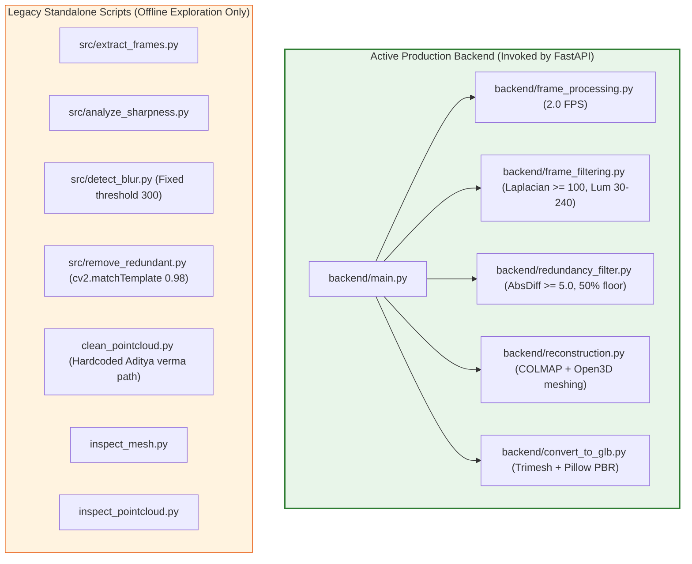

# Codebase Map & Directory Guide — GeoForge

> **Document:** `docs/CODEBASE_MAP.md`  
> **Status:** Canonical Verified Codebase Topology  
> **Target Version:** GeoForge v1.0.0 (SIH 2026 / NTRO Edition)  
> **Related Documents:** [`docs/ARCHITECTURE.md`](file:///c:/Users/adity/Downloads/geoforge-main/geoforge-main/docs/ARCHITECTURE.md), [`docs/RECONSTRUCTION_PIPELINE.md`](file:///c:/Users/adity/Downloads/geoforge-main/geoforge-main/docs/RECONSTRUCTION_PIPELINE.md), [`docs/CODE_AND_FEATURE_MATRIX.md`](file:///c:/Users/adity/Downloads/geoforge-main/geoforge-main/docs/CODE_AND_FEATURE_MATRIX.md)

---

## 1. Complete Repository Layout

```text
geoforge-main/
│
├── AGENTS.md                                # AI coding assistant operating rules and constraints
├── README.md                                # Master project overview and quick start guide
│
├── docs/                                    # Master Technical Documentation Pack (Canonical)
│   ├── GEOFORGE_MASTER_CONTEXT.md           # 20-section master technical knowledge base
│   ├── DOCUMENTATION_MIGRATION_PLAN.md      # Approved migration and consolidation blueprint
│   ├── DOCUMENTATION_MIGRATION_REPORT.md    # Source-code audit and discrepancies analysis
│   ├── MASTER_DOCUMENTATION_INDEX.md        # Comprehensive index of all documentation files
│   ├── PRD.md                               # Product Requirements Document (FR/NFR tables)
│   ├── ARCHITECTURE.md                      # System architecture and workspace topology
│   ├── FEATURE_STATUS.md                    # Code-verified feature inventory
│   ├── RECONSTRUCTION_PIPELINE.md           # 8-stage photogrammetric reconstruction spec
│   ├── COLMAP.md                            # COLMAP CLI integration and parameters
│   ├── OPEN3D.md                            # Open3D point cloud denoising & Poisson meshing
│   ├── MESH_AND_GLB.md                      # Texturing, Trimesh PBR, and GLB export
│   ├── API.md                               # Complete FastAPI REST API specification
│   ├── JOB_MANAGEMENT.md                    # ThreadPool worker lifecycle & retention
│   ├── FRONTEND.md                          # React/TypeScript/Three.js architecture
│   ├── BACKEND.md                           # FastAPI service guide and configuration
│   ├── SETUP.md                             # Local development setup and smoke test guide
│   ├── TECH_STACK.md                        # Complete verified technology stack
│   ├── SOFTWARE_INVENTORY.md                # Software packages and external binary catalog
│   ├── TESTING.md                           # 10-scenario acceptance test matrix
│   ├── CODEBASE_MAP.md                      # (This file) Repository directory map
│   ├── DEVELOPMENT_WORKFLOW.md              # 11-step coding protocol and PR checklist
│   ├── CODE_AND_FEATURE_MATRIX.md           # Feature-to-code symbol mapping
│   ├── CONFIGURATION.md                     # Configuration constants reference
│   ├── DECISIONS.md                         # Architecture Decision Records (ADRs)
│   ├── DEPLOYMENT.md                        # Deployment patterns & Docker specifications
│   ├── GLOSSARY.md                          # Photogrammetry and computer vision terms
│   ├── CHANGELOG.md                         # Chronological project development log
│   ├── TROUBLESHOOTING.md                   # Error resolution and troubleshooting guide
│   ├── UI_UX_DESIGN.md                      # Frontend UI/UX design specifications
│   ├── PHOTOGRAMMETRY_FUNDAMENTALS.md       # Core mathematical principles of SfM and MVS
│   ├── SECURITY.md                          # Security vulnerabilities and mitigations
│   └── SECURITY_AND_ACCURACY_NOTES.md       # Operational bounds and accuracy disclaimers
│
├── doc old/                                 # Historical documentation archive (26 files, read-only)
│
├── backend/                                 # Active FastAPI Backend & Reconstruction Service
│   ├── main.py                              # REST API endpoints, CORS, job queue, cleanup
│   ├── reconstruction.py                    # Pipeline orchestration: COLMAP, Open3D, meshing
│   ├── frame_processing.py                  # OpenCV VideoCapture frame extraction (2.0 FPS)
│   ├── frame_filtering.py                   # Laplacian variance blur & luminance filter
│   ├── redundancy_filter.py                 # Mean absolute difference redundancy reduction
│   ├── convert_to_glb.py                    # Trimesh & Pillow PBR material GLB export
│   ├── check_3d.py                          # 3D diagnostic inspection utility
│   ├── colmap_test.py                       # COLMAP CLI executable environment probe
│   ├── uploads/                             # Uploaded video storage (<job_id>.<ext>)
│   └── temp/                                # Per-job transient workspaces (<job_id>/)
│
├── frontend/                                # React 19 + TypeScript + Vite + Three.js Client
│   ├── package.json                         # Node dependencies and build scripts
│   ├── vite.config.ts                       # Vite build configuration and Tailwind integration
│   ├── tsconfig.json                        # TypeScript compiler options
│   ├── .env.example                         # Environment configuration template
│   └── src/
│       ├── App.tsx                          # Root state machine, view routing, layout
│       ├── main.tsx                         # React 19 DOM root mount
│       ├── index.css                        # Global CSS and Tailwind directives
│       ├── types.ts                         # Client TypeScript interfaces
│       ├── services/
│       │   └── api.ts                       # Axios/Fetch backend API client
│       ├── components/
│       │   ├── Header.tsx                   # Top navigation bar
│       │   ├── Footer.tsx                   # Technical footer with version info
│       │   ├── DiagnosticsAccordion.tsx     # Technical error disclosure
│       │   ├── ErrorView.tsx                # Error display card
│       │   └── ThreeDViewer.tsx             # Interactive Three.js WebGL viewport
│       └── pages/
│           ├── HomePage.tsx                 # Hero landing page
│           ├── HowItWorksPage.tsx           # Flight capture guidelines
│           ├── UploadPage.tsx               # Drag-and-drop video upload
│           ├── ProcessingPage.tsx           # Progress tracking screen
│           ├── CompletePage.tsx             # Reconstruction success screen
│           └── ResultPage.tsx               # Dedicated 3D viewer view
│
├── src/                                     # Standalone / Legacy Scripts (NOT used by API)
│   ├── extract_frames.py                    # Legacy frame extraction (reads ../input/drone_video.mp4)
│   ├── analyze_sharpness.py                 # Offline sharpness distribution analyzer
│   ├── detect_blur.py                       # Legacy blur filter (threshold 300, writes ../good_frames)
│   └── remove_redundant.py                  # Legacy template matching (matchTemplate >= 0.98)
│
├── clean_pointcloud.py                      # Standalone Open3D point cloud denoising utility
├── inspect_mesh.py                          # Standalone mesh polygon and vertex inspector
└── inspect_pointcloud.py                    # Standalone PLY point cloud property inspector
```

---

## 2. Active Pipeline vs. Legacy Script Demarcation

A common point of confusion is the existence of similarly named scripts in both `backend/` and `src/`. The following table clarifies which modules are active in the production application:



---

## 3. Key Backend Symbols and Roles

| Symbol | File | Signature / Type | Description |
|---|---|---|---|
| `app` | `backend/main.py` | `FastAPI` instance | Top-level ASGI web service with CORS and error handlers. |
| `upload_video` | `backend/main.py` | `async def (UploadFile, BackgroundTasks)` | Validates upload, saves video, enqueues worker, returns `job_id`. |
| `get_job_status` | `backend/main.py` | `def (job_id: str)` | Returns current execution state and full diagnostic metrics. |
| `get_model` | `backend/main.py` | `def (job_id: str)` | Serves binary `model.glb` via `FileResponse`. |
| `run_reconstruction_pipeline` | `backend/reconstruction.py` | `def (image_dir, workspace_dir)` | Orchestrates COLMAP SfM, MVS, Open3D Poisson meshing, texturing. |
| `check_sparse_reconstruction_quality` | `backend/reconstruction.py` | `def (sparse_model_dir, num_input_images)` | Parses binary `images.bin` / `points3D.bin`; enforces 30% quality gate. |
| `extract_frames` | `backend/frame_processing.py` | `def (video_path, output_dir, target_fps=2.0)` | Samples video at 2.0 FPS and writes raw JPEGs. |
| `filter_sharp_frames` | `backend/frame_filtering.py` | `def (input_dir, output_dir, threshold=100.0)` | Applies Laplacian variance and $[30, 240]$ luminance filters. |
| `remove_redundant_frames` | `backend/redundancy_filter.py` | `def (input_dir, output_dir, difference_threshold=5.0)` | Applies `cv2.absdiff` with strict 50% safety retention floor. |
| `convert_to_glb` | `backend/convert_to_glb.py` | `def (model_path, texture_path, output_path)` | Loads OBJ/PLY with Trimesh, binds Pillow PBR texture, exports GLB. |

