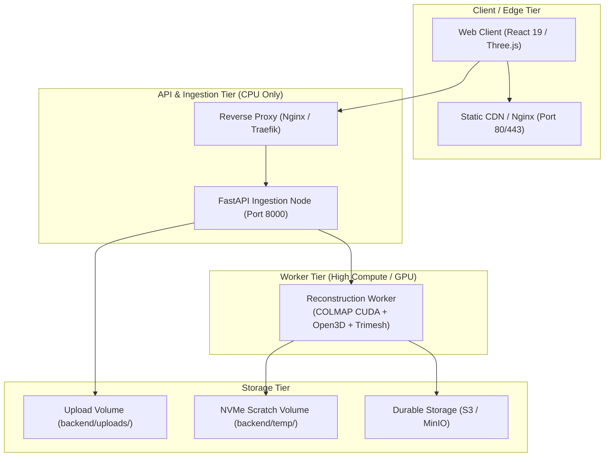
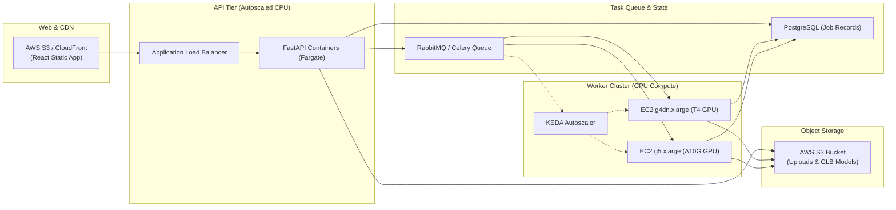

# Deployment Strategy & Infrastructure Guide — GeoForge

> **Document:** `docs/DEPLOYMENT.md`  
> **Status:** Code-Verified Deployment Specification (Phase 7 Integration Verified)  
> **Target Version:** GeoForge v1.0.0 (SIH 2026 / NTRO Edition)  
> **Last Verified:** 2026-11-14  
> **Related Documents:** [`docs/ARCHITECTURE.md`](ARCHITECTURE.md), [`docs/SETUP.md`](SETUP.md), [`docs/SECURITY.md`](SECURITY.md), [`docs/INTEGRATION_VERIFICATION_REPORT.md`](INTEGRATION_VERIFICATION_REPORT.md)

---

## 1. Architectural Deployment Responsibilities

### 1.1 Single-Station Turnkey Deployment (Field / Hackathon Edition)
For rapid field station evaluations, air-gapped command centers, and NTRO demonstration environments, GeoForge supports a **unified single-server deployment**:
- **Single Port:** The entire application runs on `http://localhost:8000` (or `0.0.0.0:8000` for LAN access).
- **FastAPI StaticFiles Mount:** Compiled React production assets in `frontend/dist/assets` are mounted under `/assets`.
- **Client SPA Fallback:** Non-API GET requests fall through to `frontend/dist/index.html`, allowing seamless client routing (`/history`, `/upload`, `/how-it-works`) without external web server dependencies (e.g. Nginx).
- **Automated Startup:** One-click launcher [`start_geoforge.bat`](../start_geoforge.bat) handles venv activation, dependency verification, asset compilation, and browser launching.

### 1.2 Enterprise Decoupled Deployment
For high-scale multi-user production, the operational workloads are decoupled into edge and worker tiers:



---

## 2. Hardware & Infrastructure Requirements

### 2.1 GPU Requirements (Critical Bottleneck)
- **Architecture:** NVIDIA GPU with Compute Capability $\ge 6.0$ (Pascal, Turing, Ampere, Ada Lovelace, Hopper).
- **CUDA Runtime:** CUDA 11.8, 12.2, or 12.4 with compatible NVIDIA host drivers ($\ge 535.x$ on Linux, $\ge 550.x$ on Windows).
- **VRAM Sizing:**
  - **$< 4\text{ GB}$ VRAM:** High risk of CUDA Out-Of-Memory (OOM) during PatchMatch stereo matching at full image size ($2400\text{ px}$). Requires downsampling image size to $1200\text{ px}$.
  - **$6\text{--}8\text{ GB}$ VRAM:** Nominal baseline for 1080p drone footage reconstruction (`PATCHMATCH_MAX_IMAGE_SIZE = 2400`).
  - **$\ge 12\text{ GB}$ VRAM (Recommended):** Required for 4K video reconstructions or processing batches exceeding 200 keyframes concurrently.
- **CPU Fallback:** While SIFT extraction and feature matching can execute on CPU (`--SiftExtraction.use_gpu 0`), COLMAP PatchMatch dense stereo matching is **strictly GPU-accelerated**. Running dense MVS without a GPU falls back to slow CPU stereopsis ($10\text{--}30\times$ slower, often exceeding 2 hours per job).

### 2.2 Host CPU & RAM Requirements
- **Host CPU:** Minimum 4 physical cores; recommended 8–16 cores ($x86\_64$). OpenCV frame extraction, multi-threaded SIFT keypoint filtering, and Laplacian variance calculations heavily leverage multi-core CPU parallelism.
- **System RAM:**
  - Minimum: $16\text{ GB}$.
  - Recommended: $32\text{ GB}$.
  - Peak RAM consumption occurs during Open3D Screened Poisson reconstruction (`depth=11`). If a point cloud exceeds $5\text{M}$ points, Poisson octree generation can allocate $6\text{--}10\text{ GB}$ of host RAM.

### 2.3 Storage & I/O Requirements
- **Disk Type:** Fast NVMe SSD storage is mandatory. COLMAP generates thousands of temporary files, depth maps (`.photometric.bin`, `.geometric.bin`), and intermediate point clouds. Traditional rotational HDDs introduce severe I/O bottlenecks.
- **Storage Quota per Job:**
  - Raw video: Up to $4\text{ GiB}$.
  - Extracted & selected frames: $200\text{--}800\text{ MB}$.
  - COLMAP database & sparse files: $50\text{--}150\text{ MB}$.
  - Dense depth maps & fused cloud: $2\text{--}8\text{ GB}$.
  - Textured OBJ & final GLB: $30\text{--}150\text{ MB}$.
  - **Total Scratch Space per Job:** Estimate **$10\text{--}15\text{ GB}$** per 3-minute 1080p/4K video.

---

## 3. Network, Upload & Reverse Proxy Constraints

When deploying GeoForge behind a reverse proxy (e.g., Nginx, Traefik, or Caddy), configure upload ceilings and timeouts appropriately:

### 3.1 Nginx Configuration Example
```nginx
server {
    listen 80;
    server_name geoforge.internal;

    # Accommodate 4 GiB video uploads
    client_max_body_size 4096M;

    # Extend timeouts for large file streaming
    client_body_timeout 600s;
    proxy_read_timeout 600s;
    proxy_connect_timeout 600s;
    proxy_send_timeout 600s;

    # Serve compiled frontend static assets
    location / {
        root /var/www/geoforge/frontend/dist;
        index index.html;
        try_files $uri $uri/ /index.html;
    }

    # Proxy API and WebSocket requests to FastAPI
    location /api/ {
        proxy_pass http://127.0.0.1:8000/;
        proxy_set_header Host $host;
        proxy_set_header X-Real-IP $remote_addr;
        proxy_set_header X-Forwarded-For $proxy_add_x_forwarded_for;
        proxy_set_header X-Forwarded-Proto $scheme;
    }
}
```

### 3.2 Cloudflare & CDN Caveat
Free and standard Cloudflare proxy tiers enforce a strict **100 MB request body limit**. Uploading multi-gigabyte drone videos through an active Cloudflare proxy will trigger HTTP 413 errors before reaching FastAPI. For production cloud deployments:
- Configure DNS in "DNS Only" (grey-clouded) mode for upload endpoints.
- Or migrate to client-side chunked upload via presigned S3 URLs (detailed in Phase 4 of [`docs/ROADMAP.md`](file:///c:/Users/adity/Downloads/geoforge-main/geoforge-main/docs/ROADMAP.md)).

---

## 4. COLMAP Deployment Considerations

### 4.1 Linux & Containerized Environments
On Linux hosts and Docker containers:
1. **Compilation:** Build COLMAP from source with CUDA support:
   ```bash
   cmake .. -DCMAKE_BUILD_TYPE=Release -DCUDA_ENABLED=ON -DGUI_ENABLED=OFF
   make -j$(nproc)
   sudo make install
   ```
2. **Headless Execution:** GeoForge invokes COLMAP CLI subcommands (`feature_extractor`, `sequential_matcher`, `mapper`, `patch_match_stereo`, `stereo_fusion`). No X11 display or GUI server is required.
3. **Binary Path:** Set `export COLMAP_EXE=/usr/local/bin/colmap` in the worker environment.
4. **GPU Passthrough:** In Docker or Kubernetes, ensure NVIDIA Container Toolkit (`nvidia-container-toolkit`) is installed and configure runtime with GPU access:
   ```bash
   docker run --gpus all -it geoforge-worker
   ```

---

## 5. Long-Running Job Management

### 5.1 Current Prototype Concurrency Model
- The current implementation (`backend/main.py:89`) uses an internal `ThreadPoolExecutor(max_workers=2)` attached to the FastAPI process.
- **Capacity Guard:** If more than 2 jobs are queued or executing simultaneously, `POST /upload` immediately raises HTTP 503 Service Unavailable:
  ```json
  {"detail": "Server is busy. Maximum concurrent reconstructions reached. Please try again shortly."}
  ```
- **Asynchronous Response:** The upload endpoint returns immediately with `{job_id, status: "queued"}`. The browser is never kept on an open HTTP connection during the 15-minute reconstruction; instead, it polls `GET /status/{job_id}`.

### 5.2 Server Restart Vulnerability
Because `_jobs` is stored in process RAM:
- Stopping or restarting the backend process destroys job status and the in-memory cancellation handles.
- Completed models remain on the disk in `backend/temp/{job_id}/colmap/textured/model.glb`, but cannot be queried via `/status/{job_id}` unless persisted to a database.

---

## 6. Tested vs. Proposed Deployment Methods

### 6.1 Tested Deployment Method (Verified in Development)
The only deployment configuration physically verified in the current codebase is:
- **Environment:** Single-node Windows 11 Workstation.
- **Compute:** Local host running NVIDIA RTX GPU with CUDA 12.x.
- **COLMAP:** Binary executable at `C:\bin\colmap.exe`.
- **Backend:** Uvicorn ASGI server running on `127.0.0.1:8000`.
- **Frontend:** Vite development server running on `0.0.0.0:3000`.
- **Storage:** Local NTFS filesystem (`backend/uploads/` and `backend/temp/`).
- **Operational Status:** Fully verified for single-operator interactive testing.

---

### 6.2 Proposed Deployment Method 1: Local Docker Compose (Single Host)
*Status: Architecture Proposed — Not Yet Containerized in Source Tree*

Enables reproducible deployment on Linux workstations or field laptops:
- **Frontend Container:** Lightweight Alpine Nginx image serving `frontend/dist/`.
- **Backend Container:** Ubuntu 22.04 base with CUDA 12.2 runtime, compiled headless COLMAP, Python 3.12, and OpenCV.
- **Shared Volumes:** Named Docker volumes for `/app/uploads` and `/app/temp`.
- **Requirements:** Docker Engine $\ge 24.0$ with NVIDIA Container Toolkit.

---

### 6.3 Proposed Deployment Method 2: Cloud-Native Scalable Architecture
*Status: Architecture Proposed for v2.0 Enterprise*

Designed for defense multi-tenant deployments and commercial cloud scaling:


- **API Tier:** Stateless FastAPI instances on cheap CPU compute (AWS Fargate / GCP Cloud Run).
- **Task Broker:** Celery with RabbitMQ or Redis distributing jobs to worker pools.
- **Worker Tier:** GPU worker nodes running on Spot instances (`g4dn.xlarge` or `g5.xlarge`), autoscaling from zero based on queue depth.
- **Storage:** Durable object storage (AWS S3 or MinIO) with 30-day lifecycle expiration on raw frames.
