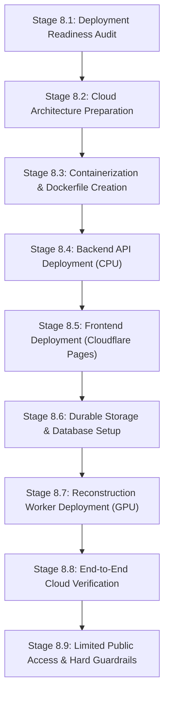

# GeoForge Phase 8 — Deployment Implementation Roadmap & Execution Plan

> **Document:** `DEPLOYMENT_IMPLEMENTATION_ROADMAP.md`  
> **Status:** Implementation Execution Blueprint (Phase 8 Planning — Pre-Execution)  
> **Target Version:** GeoForge v1.1.0 Cloud Architecture  
> **Author:** Antigravity Engineering Team  
> **Last Verified:** 2026-11-14  
> **Related Documents:** [`docs/PHASE_8_DEPLOYMENT_STRATEGY.md`](PHASE_8_DEPLOYMENT_STRATEGY.md), [`docs/CLOUD_ARCHITECTURE.md`](CLOUD_ARCHITECTURE.md), [`docs/PRODUCTION_ENVIRONMENT_CONFIGURATION.md`](PRODUCTION_ENVIRONMENT_CONFIGURATION.md)

---

## 1. Roadmap Overview & Execution Philosophy

This roadmap translates the Phase 8 cloud architecture into an **ordered, staged execution sequence**. 

Each stage is treated as an isolated gate:
- No stage begins until the previous stage satisfies all acceptance criteria.
- Every stage defines an explicit rollback approach to protect existing code.
- Zero paid cloud resources are provisioned without explicit user approval.
- Local Phase 7 verification data is preserved intact throughout the transition.

---

## 2. Detailed Stage Specifications

### Stage 8.1 — Deployment Readiness Audit & Path Decoupling
- **Objective:** Identify and eliminate all machine-specific hardcoded paths and Windows-only assumptions in backend Python scripts.
- **Required Changes:**
  - Audit `backend/reconstruction.py`: Refactor `windows_path()` to use standard `pathlib.Path.resolve()`.
  - Ensure COLMAP resolution respects Linux environment variable `COLMAP_EXE=/usr/local/bin/colmap`.
  - Verify that FFmpeg and OpenCV invocations operate cleanly on Linux (`libgl1-mesa-glx`, `libgomp1`).
- **Dependencies:** None.
- **Estimated Effort:** 2–3 hours.
- **Technical Risks:** Breaking Windows compatibility for local development.  
  *Mitigation:* Use cross-platform `sys.platform == "win32"` conditional branching.
- **Acceptance Criteria:**
  - Running static bytecode verification (`py_compile`) succeeds with 0 syntax errors.
  - Path normalization tests pass on both Windows and Linux paths.
- **Rollback Approach:** Revert to verified Phase 7 source via Git checkpoint.

---

### Stage 8.2 — Cloud Architecture Preparation & Provider Selection
- **Objective:** Finalize service choices (Cloudflare Pages + Railway + Cloudflare R2 + RunPod Serverless) and establish the deployment contract.
- **Required Changes:**
  - Author Cloudflare R2 bucket policies and CORS rules.
  - Define environment configuration contracts (`.env.production.example`).
  - Draft API client base URL configuration in `frontend/src/services/api.ts`.
- **Dependencies:** Stage 8.1 completion.
- **Estimated Effort:** 1–2 hours.
- **Technical Risks:** Unrealistic provider rate limits or quotas.  
  *Mitigation:* Verified against official November 2026 provider documentation.
- **Acceptance Criteria:**
  - Complete architecture contract and variable schema documented.
- **Rollback Approach:** Document review update only (no code touched).

---

### Stage 8.3 — Containerization & Dockerfile Creation
- **Objective:** Create reproducible Docker containers for both the lightweight API and the heavy GPU worker.
- **Required Changes:**
  - Create `backend/Dockerfile.api`: Python 3.12-slim base, Uvicorn, FastAPI, minimal OpenCV.
  - Create `backend/Dockerfile.worker`: NVIDIA CUDA 12.2 devel base on Ubuntu 22.04 LTS, compiled headless COLMAP 3.9.1, Open3D 0.20, OpenCV, Trimesh.
  - Create `docker-compose.prod.yml` for unified local container validation.
- **Dependencies:** Stage 8.2 completion.
- **Estimated Effort:** 4–6 hours.
- **Technical Risks:** Large worker image size (>8 GB) slowing deployment.  
  *Mitigation:* Multi-stage build stripping build compilers; base CUDA runtime caching.
- **Acceptance Criteria:**
  - `docker build -f Dockerfile.api .` completes successfully.
  - `docker build -f Dockerfile.worker .` completes and verifies `colmap --help` inside container.
- **Rollback Approach:** Delete created Dockerfiles; zero impact on existing codebase.

---

### Stage 8.4 — Backend API Deployment & Health Verification
- **Objective:** Deploy the FastAPI orchestration node to Railway (or Hetzner Cloud) and verify public internet reachability.
- **Required Changes:**
  - Provision Railway service linked to repository.
  - Configure production environment variables (`ALLOWED_ORIGINS`, `DATABASE_URL`, `MAX_CONCURRENT_RECONSTRUCTIONS`).
  - Verify `/health` and `/ready` probes over public HTTPS.
- **Dependencies:** Stage 8.3 completion.
- **Estimated Effort:** 2–3 hours.
- **Technical Risks:** CORS rejection or startup probe failures.  
  *Mitigation:* Pre-configured health check endpoint; flexible `ALLOWED_ORIGINS` regex.
- **Acceptance Criteria:**
  - Public `GET https://api.geoforge.app/health` returns HTTP 200 OK (`{"status": "healthy"}`).
  - Strict 404 responses returned for non-existent API routes.
- **Rollback Approach:** Destroy Railway service; zero lingering cloud cost.

---

### Stage 8.5 — Frontend Deployment & Cross-Origin Wiring
- **Objective:** Deploy the React 19 SPA to Cloudflare Pages and connect it to the hosted FastAPI backend.
- **Required Changes:**
  - Configure Cloudflare Pages build settings: Framework `Vite`, Build `npm run build`, Output `dist`.
  - Set production build environment variable: `VITE_API_URL=https://api.geoforge.app`.
  - Add `_redirects` file for client-side SPA routing (`/* /index.html 200`).
- **Dependencies:** Stage 8.4 completion.
- **Estimated Effort:** 1–2 hours.
- **Technical Risks:** Three.js bundle chunk splitting failures or asset MIME type errors.  
  *Mitigation:* Verified Vite rollup chunk configuration (`three` isolated in manual chunk).
- **Acceptance Criteria:**
  - Public `https://geoforge.pages.dev` loads landing page, upload page, and history page with 0 console errors.
  - Browser correctly queries `https://api.geoforge.app/jobs` over HTTPS.
- **Rollback Approach:** Delete Cloudflare Pages project.

---

### Stage 8.6 — Durable Storage & Database Setup
- **Objective:** Connect Cloudflare R2 object storage and persistent database (Supabase or Railway volume).
- **Required Changes:**
  - Implement S3 storage adapter in `backend/storage.py` (boto3) supporting upload streaming and presigned GLB download URLs.
  - Configure R2 access keys (`R2_ACCESS_KEY_ID`, `R2_SECRET_ACCESS_KEY`, `R2_BUCKET_NAME`).
  - Initialize database schema and verify job creation and query execution.
- **Dependencies:** Stage 8.5 completion.
- **Estimated Effort:** 3–4 hours.
- **Technical Risks:** S3 credential misconfiguration or latency on video downloads.  
  *Mitigation:* Local mock testing with MinIO or direct boto3 credentials before live deployment.
- **Acceptance Criteria:**
  - Backend successfully uploads and reads a 10 MB test file from Cloudflare R2 over public internet.
  - Database records persistent job state and survives container restarts.
- **Rollback Approach:** Revert `storage.py` and fall back to local disk paths.

---

### Stage 8.7 — Reconstruction Worker Deployment & CUDA Verification
- **Objective:** Deploy the containerized GPU reconstruction worker to RunPod Serverless (or On-Demand Pod).
- **Required Changes:**
  - Push `geoforge-worker:latest` container to container registry (Docker Hub / GitHub Packages).
  - Configure RunPod Serverless template with GPU constraint (16 GB VRAM tier).
  - Wire FastAPI worker dispatcher: on `/upload`, trigger RunPod endpoint with job payload.
- **Dependencies:** Stage 8.6 completion.
- **Estimated Effort:** 4–5 hours.
- **Technical Risks:** Cold-start latency during container pull.  
  *Mitigation:* RunPod FlashBoot container caching keeps cold start under 35 seconds.
- **Acceptance Criteria:**
  - Worker container boots on RunPod, executes `colmap patch_match_stereo` with CUDA GPU index 0, and returns exit code 0.
- **Rollback Approach:** Terminate RunPod template; zero ongoing charges.

---

### Stage 8.8 — End-to-End Cloud Acceptance Testing
- **Objective:** Re-run the full 14-point acceptance testing matrix across the live internet deployment.
- **Required Changes:**
  - Upload real test video (`sample_drone_orbit.mp4`) via the public Cloudflare Pages URL.
  - Verify complete 12-stage execution on the remote GPU worker.
  - Verify 3D model rendering in Three.js WebGL viewer over the internet.
  - Verify binary `.glb` download directly from Cloudflare R2.
  - Check persistent job listing in `/history`.
- **Dependencies:** Stage 8.7 completion.
- **Estimated Effort:** 2–3 hours.
- **Technical Risks:** Network drops on large model downloads.  
  *Mitigation:* Range-request support and caching headers on R2.
- **Acceptance Criteria:**
  - Generated GLB model has $\ge 40,000\text{ vertices}$, valid `glTF` magic header, and downloads completely over public HTTPS.
  - 100% PASS on all 14 acceptance criteria.
- **Rollback Approach:** Debug worker logs; no production data loss.

---

### Stage 8.9 — Limited Public Release & Hard Guardrails
- **Objective:** Apply public safety constraints and open controlled access for demonstrations and user testing.
- **Required Changes:**
  - Configure daily reconstruction quota (max 25 jobs/day).
  - Configure Railway hard monthly billing cap ($10.00).
  - Enforce Cloudflare R2 14-day auto-deletion lifecycle on raw video uploads.
  - Set rate limiting on `/upload` (3 requests per IP per hour).
- **Dependencies:** Stage 8.8 completion.
- **Estimated Effort:** 1–2 hours.
- **Technical Risks:** Malicious file uploads or denial-of-service.  
  *Mitigation:* Pre-upload OpenCV header verification; strict container size limits.
- **Acceptance Criteria:**
  - Exceeding daily limit returns clear, user-friendly HTTP 429 response.
  - System operates safely and continuously without developer intervention.
- **Rollback Approach:** Tighten IP whitelisting or temporarily disable public upload route.

---

## 3. Implementation Schedule & Total Effort Summary

| Stage ID | Stage Name | Estimated Effort | Cloud Infrastructure Cost | Prerequisite Gate |
|---|---|:---:|:---:|:---:|
| **8.1** | Deployment Readiness Audit | 3 hours | $0.00 | None |
| **8.2** | Cloud Architecture Preparation | 2 hours | $0.00 | Stage 8.1 |
| **8.3** | Containerization & Dockerfile Creation | 5 hours | $0.00 | Stage 8.2 |
| **8.4** | Backend API Deployment | 3 hours | $5.00 (Railway base) | Stage 8.3 |
| **8.5** | Frontend Deployment | 2 hours | $0.00 (Cloudflare Pages) | Stage 8.4 |
| **8.6** | Durable Storage & Database Setup | 4 hours | $0.00 (R2 Free Tier) | Stage 8.5 |
| **8.7** | Reconstruction Worker Deployment | 5 hours | $5.00 (RunPod credit) | Stage 8.6 |
| **8.8** | End-to-End Cloud Verification | 3 hours | ~$0.50 (Compute test) | Stage 8.7 |
| **8.9** | Limited Public Release & Guardrails | 2 hours | $0.00 | Stage 8.8 |
| **TOTAL** | **Full Cloud Deployment Plan** | **~29 hours (3–4 days)** | **$10.00 – $15.00 total** | **User Approval** |

