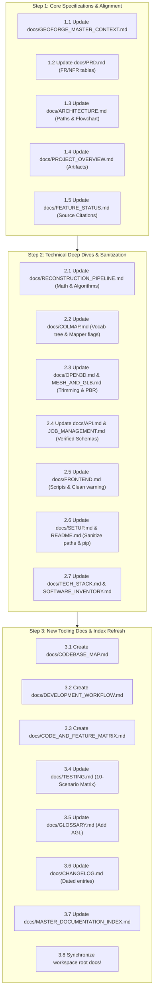

# GeoForge — Documentation Migration & Consolidation Plan

> **Document:** `docs/DOCUMENTATION_MIGRATION_PLAN.md`  
> **Status:** Final Migration Plan (Awaiting User Approval Before Execution)  
> **Target Version:** GeoForge v1.0.0 (SIH 2026 / NTRO Edition)  
> **Scope:** Comprehensive, file-by-file blueprint to migrate and consolidate `doc old/` (26 files) into `docs/` (31 files), verified against live source code in `backend/`, `frontend/`, `src/`, and root utilities.

---

## 1. Executive Migration Strategy

The goal of this migration plan is to establish **`docs/` as the single, authoritative, technically rigorous documentation system** for GeoForge without losing any critical architectural, algorithmic, or operational knowledge from `doc old/`.

### Guiding Principles:
1. **Preserve `doc old/` Intact:** `doc old/` will remain completely untouched as an immutable historical reference.
2. **Zero Code Modification:** No source code, scripts, or application configurations will be altered during this documentation consolidation.
3. **Fact-Based Source Verification:** Every technical claim, parameter floor, and API schema transferred must be verified against actual code in `backend/` and `frontend/`.
4. **Eliminate Placeholders & Provisional Disclaimers:** Upgrade provisional documentation to verified documentation supported by code evidence.
5. **Eliminate Hardcoded Machine Paths:** Remove all instances of developer-specific paths (`C:\Users\Aditya verma\Desktop\Drone3DProject\...`) from `docs/` and `README.md`.
6. **No Duplicate Documentation:** Consolidate redundant topics into single canonical documents and reference them cleanly via `docs/MASTER_DOCUMENTATION_INDEX.md`.

---

## 2. File-by-File Migration Matrix

The table below defines the exact source document in `doc old/`, the destination in `docs/`, the unique technical knowledge to transfer, and the definitive action.

| # | Old Document (`doc old/`) | Target Document in `docs/` | Action | Specific Information to Migrate | Priority |
|---|---|---|:---:|---|:---:|
| 1 | `00_PROJECT_OVERVIEW.md` | `docs/PROJECT_OVERVIEW.md` | **MERGE** | Intermediate deliverable artifact names (`fused.ply`, `poisson_mesh.ply`, `model.ply`, `model.glb`), user journey sequence. | High |
| 2 | `01_PRD.md` | `docs/PRD.md` | **MERGE** | Complete 15-item functional requirements table (`FR-001`–`FR-015`), 8 Non-Functional Requirements table (`NFR-001`–`NFR-008`), exact acceptance gates, and scope boundaries. | High |
| 3 | `02_FEATURES_AND_STATUS.md` | `docs/FEATURE_STATUS.md` | **MERGE** | Source code citations (`backend/main.py`, `frame_processing.py`, `convert_to_glb.py`, `ThreeDViewer.tsx`) mapped to verified feature statuses. | High |
| 4 | `03_ARCHITECTURE.md` | `docs/ARCHITECTURE.md` | **MERGE** | Mermaid pipeline flowchart, correct workspace directory topology (`backend/uploads/` and `backend/temp/<job_id>/`), replacing inaccurate `data/jobs/`. | High |
| 5 | `04_CODEBASE_MAP.md` | `docs/CODEBASE_MAP.md` *(New)* | **CREATE** | Full directory tree and vital demarcation between active `backend/` pipeline and legacy/manual root `src/` scripts. | High |
| 6 | `05_TECH_STACK.md` | `docs/TECH_STACK.md` & `docs/SOFTWARE_INVENTORY.md` | **MERGE** | Exact package versions from `package.json` (`React ^19.0.1`, `Three.js ^0.185.1`, `Tailwind ^4.1.14`, `Vite ^6.2.3`), and unused package notes (`@google/genai`, `express`). | Medium |
| 7 | `06_END_TO_END_WORKFLOW.md` | `docs/RECONSTRUCTION_PIPELINE.md` | **MERGE** | Exact function call signatures (`extract_frames(target_fps=2.0)`, `filter_sharp_frames(threshold=100.0)`, `remove_redundant_frames(difference_threshold=5.0)`, minimum 20 frame guard). | High |
| 8 | `07_FRAME_PREPROCESSING.md` | `docs/RECONSTRUCTION_PIPELINE.md` | **MERGE** | Mathematical algorithms for Laplacian variance blur, mean brightness range $[30, 240]$, mean absolute pixel difference (`cv2.absdiff`), adaptive blur threshold logic, 50% redundancy safety floor, and contrast with `src/`. | High |
| 9 | `08_RECONSTRUCTION_AND_COLMAP.md` | `docs/COLMAP.md` | **MERGE** | Vocabulary tree candidate paths (5 locations), single-model mapper flag (`--Mapper.multiple_models 0`), binary model selection logic (`find_best_model`), binary model parsing (`struct.unpack`), 30% registration gate. | High |
| 10 | `09_POINTCLOUD_MESH_TEXTURE_GLB.md`| `docs/OPEN3D.md` & `docs/MESH_AND_GLB.md` | **MERGE** | Open3D statistical outlier removal (`nb_neighbors=20, std_ratio=2.0`), Screened Poisson meshing (`depth=11`) with 7.0% density boundary trimming (`POISSON_TRIM = 7.0`), Trimesh scene concatenation, Pillow PBR material attachment. | High |
| 11 | `10_API_CONTRACT.md` | `docs/API.md` | **UPDATE** | Upgrade from provisional to verified API contract; document exact JSON schemas for `/status/{job_id}` and frontend client helpers (`getModelGlbUrl`). | High |
| 12 | `11_FRONTEND_UI.md` | `docs/FRONTEND.md` | **MERGE** | Complete npm script catalog (`dev`, `build`, `lint`, `clean`), the `npm run clean` Windows syntax error warning, and Three.js viewer verification points. | Medium |
| 13 | `12_BACKEND_JOB_LIFECYCLE.md` | `docs/JOB_MANAGEMENT.md` & `docs/BACKEND.md` | **MERGE** | Complete dictionary schema of `job.result` returned by pipeline and served by `/status/{job_id}`, ThreadPoolExecutor concurrency guard (HTTP 503), 7-day retention delay. | High |
| 14 | `13_SETUP_AND_RUN.md` | `docs/SETUP.md` & `README.md` | **UPDATE** | Portable startup commands, single-command pip installation string (`python -m pip install fastapi uvicorn python-multipart opencv-python numpy open3d trimesh pillow`), eliminating personal machine paths. | High |
| 15 | `14_CONFIGURATION.md` | `docs/CONFIGURATION.md` | **ALREADY COVERED** | No action required; verify pipeline constants match code. | Low |
| 16 | `15_TESTING_ACCEPTANCE.md` | `docs/TESTING.md` | **MERGE** | 10-row scenario-versus-expected outcome acceptance test matrix. | High |
| 17 | `16_ERRORS_TROUBLESHOOTING.md` | `docs/TROUBLESHOOTING.md` | **ALREADY COVERED** | Fully covered and expanded in `docs/TROUBLESHOOTING.md`. | Low |
| 18 | `17_SECURITY_PRIVACY_PERFORMANCE.md`| `docs/SECURITY.md` | **ALREADY COVERED** | Fully covered in `docs/SECURITY.md` and `docs/SECURITY_AND_ACCURACY_NOTES.md`. | Low |
| 19 | `18_DEPLOYMENT.md` | `docs/DEPLOYMENT.md` | **ALREADY COVERED** | Fully covered and expanded in `docs/DEPLOYMENT.md`. | Low |
| 20 | `19_ROADMAP.md` | `docs/ROADMAP.md` | **ALREADY COVERED** | Fully covered in `docs/ROADMAP.md`. | Low |
| 21 | `20_GLOSSARY.md` | `docs/GLOSSARY.md` | **MERGE** | Add definition for `AGL` (Above Ground Level). | Low |
| 22 | `21_CHANGELOG.md` | `docs/CHANGELOG.md` | **MERGE** | Merge dated changelog entries from 2026-11-06 and 2026-11-11 into `docs/CHANGELOG.md`. | Medium |
| 23 | `22_DOCUMENTATION_STATUS.md` | `doc old/22_DOCUMENTATION_STATUS.md` | **HISTORICAL** | Retain in `doc old/` as the baseline audit record of the original archive inspection. | Low |
| 24 | `23_DEVELOPMENT_WORKFLOW.md` | `docs/DEVELOPMENT_WORKFLOW.md` *(New)*| **CREATE** | 11-step coding protocol and PR acceptance checklist for AI agents and developers. | High |
| 25 | `24_API_AND_FEATURE_MATRIX.md` | `docs/CODE_AND_FEATURE_MATRIX.md` *(New)*| **CREATE** | Function-level verification matrix mapping user features to backend/frontend source code symbols. | High |
| 26 | `GEOFORGE_MASTER_CONTEXT.md` (40 KB)| `docs/GEOFORGE_MASTER_CONTEXT.md` | **UPDATE** | Authoritative 20-section master knowledge base replacing the 84-line stub. | Critical |

---

## 3. Detailed Information to Extract from `doc old/`

The following specific sections and data points must be extracted and migrated:

### 3.1 Requirements & Specifications (`01_PRD.md`)
- **Functional Requirements Table:**
  - `FR-001` (Multipart video upload, extension allowlist)
  - `FR-002` (4 GiB size enforcement via `Content-Length`, HTTP 413)
  - `FR-003` (UUID job creation and in-memory store)
  - `FR-004` (2.0 FPS target frame extraction)
  - `FR-005` (Laplacian variance blur filtering, threshold 100.0, adaptive lowering)
  - `FR-006` (Mean absolute difference redundancy filtering, threshold 5.0, 50% safety floor)
  - `FR-007` (COLMAP SIFT extraction, sequential matching, single-model SfM)
  - `FR-008` (Textured mesh and GLB packaging)
  - `FR-009` (`GET /status/{job_id}` polling contract)
  - `FR-010` (`GET /model/{job_id}` and `HEAD /model/{job_id}`)
  - `FR-011` (Three.js WebGL viewer with orbit/pan/zoom)
  - `FR-012` (Capture guidance in UI)
  - `FR-013` (Diagnostics accordion and technical error reporting)
  - `FR-014` (Durable jobs across server restarts — unverified gap)
  - `FR-015` (Live stage progress telemetry — unverified gap)
- **Non-Functional Requirements Table:**
  - `NFR-001` (`ThreadPoolExecutor` non-blocking worker)
  - `NFR-002` (Concurrency limit `MAX_CONCURRENT_RECONSTRUCTIONS = 2`)
  - `NFR-003` (Clear logs and actionable UI messages)
  - `NFR-004` (`VITE_API_URL` frontend override)
  - `NFR-005` (`ALLOWED_ORIGINS` CORS configuration)
  - `NFR-006` (`JOB_RETENTION_SECONDS = 604800` / 7 days)
  - `NFR-007` (Subprocess and untrusted upload security)
  - `NFR-008` (Reproducible backend environment)

### 3.2 Algorithmic Logic & Mathematical Formulas (`07_FRAME_PREPROCESSING.md`)
- **Laplacian Variance Blur Filter:**
  $$\text{Sharpness} = \text{Var}(\nabla^2 I_{\text{gray}})$$
  Default threshold: `100.0`. Adaptive percentile rule: if rejection ratio $> 0.40$, lower threshold to 40th percentile, bounded by `ABSOLUTE_MIN_SHARPNESS = 20.0`.
- **Brightness Filter:**
  $$\text{Brightness} = \frac{1}{N} \sum_{i,j} I_{\text{gray}}(i,j)$$
  Bounds: $[30.0, 240.0]$.
- **Redundancy Reduction:**
  $$\Delta(I_1, I_2) = \frac{1}{N} \sum_{i,j} |I_{\text{gray},1}(i,j) - I_{\text{gray},2}(i,j)|$$
  Threshold: `5.0`. Safety floor: never remove more than $50\%$ of frames (`MAX_REMOVAL_RATIO = 0.50`).
- **Demarcation from `src/`:** Document explicitly that `src/detect_blur.py` (threshold 300) and `src/remove_redundant.py` (`matchTemplate` 0.98) are standalone exploration scripts, not active API pipeline modules.

### 3.3 Photogrammetric & Geometric Details (`08_`, `09_`)
- **COLMAP Settings:**
  - Camera model: `OPENCV` (8 parameters: $f_x, f_y, c_x, c_y, k_1, k_2, p_1, p_2$).
  - SIFT features: `16,384` keypoints per image (doubled from default).
  - Matching: `sequential_matcher` with `overlap = 15`.
  - Loop detection: Search paths across 5 vocabulary tree candidate locations (`vocab_tree_flickr100K_words256K.bin`, etc.).
  - Single-model constraint: `--Mapper.multiple_models 0`.
  - Sparse quality gate: Binary parsing of `images.bin` and `points3D.bin`; reject if registration ratio $< 30\%$ (`MIN_REGISTRATION_RATIO = 0.30`).
  - PatchMatch Stereo: `max_image_size = 2400`, `num_iterations = 7`, `geom_consistency = 1`, GPU accelerated.
  - Stereo fusion: `min_num_pixels = 3`, `max_reproj_error = 2.0` $\to$ `dense/fused.ply`.
- **Open3D Refinement:**
  - Outlier cleaning: `pcd.remove_statistical_outlier(nb_neighbors=20, std_ratio=2.0)` $\to$ `fused_cleaned.ply`.
  - Normal estimation: `radius=0.1, max_nn=30` with consistent tangent plane orientation ($k=15$).
  - Screened Poisson meshing: `depth=11` with NumPy percentile density trimming (bottom 7.0% trimmed) to eliminate boundary bloating.
  - Fallback: Native COLMAP `poisson_mesher` if Open3D is unavailable.
- **GLB Serialization:**
  - Trimesh scene concatenation, Pillow texture loading, PBR material attachment (`PBRMaterial`), and binary export to `model.glb`.

### 3.4 Complete Schema of `job.result` (`12_BACKEND_JOB_LIFECYCLE.md`)
Document the full JSON structure returned upon job completion:
- Input stats: `total_video_frames`, `frames_extracted`, `video_fps`, `video_resolution`, `video_duration_seconds`.
- Curation stats: `sharp_frames_kept`, `blurry_frames_removed`, `brightness_frames_removed`, `final_frames`, `redundant_frames_removed`.
- Reconstruction stats: `registered_images`, `registration_ratio`, `sparse_points`, `dense_cloud_points`, `cleaned_cloud_points`, `outliers_removed`, `mesh_vertices`, `mesh_faces`, `quality_warnings`.
- Output paths & URLs: `dense_point_cloud`, `poisson_mesh`, `textured_model`, `texture`, `glb_model`, `glb_size_mb`, `model_url`, `pipeline_status`.

---

## 4. New Documents Requiring Substantial Corrections

The following existing files in `docs/` contain errors, outdated disclaimers, or hardcoded paths that must be corrected:

1. **`docs/ARCHITECTURE.md`:**
   - **Correction:** Section 4 proposes a fictional workspace path: `data/jobs/<job_id>/input/...`. Replace this with the verified architecture from `backend/main.py`: `backend/uploads/` for raw videos and `backend/temp/<job_id>/` (containing `frames/`, `selected_frames/`, `final_frames/`, `colmap/`) for workspaces.
   - **Addition:** Add the Mermaid end-to-end flowchart.
2. **`docs/SETUP.md` & `README.md`:**
   - **Correction:** Remove hardcoded paths `cd "C:\Users\Aditya verma\Desktop\Drone3DProject\backend"` and `frontend`. Replace with portable relative commands (`cd backend`, `cd frontend`).
   - **Addition:** Add the verified one-line pip install command:
     ```powershell
     python -m pip install fastapi uvicorn python-multipart opencv-python numpy open3d trimesh pillow
     ```
3. **`docs/API.md`:**
   - **Correction:** Remove "provisional" caveats. Mark all six endpoints (`/`, `/health`, `/upload`, `/status/{job_id}`, `/model/{job_id}`, and `HEAD /model/{job_id}`) as verified.
   - **Addition:** Document frontend helper functions (`getModelGlbUrl`, `uploadDroneVideo`, `getJobStatus`) and error response payloads.
4. **`docs/PRD.md`:**
   - **Correction:** Replace generic requirements with the quantified `FR-001`–`FR-015` and `NFR-001`–`NFR-008` tables.
5. **`docs/FEATURE_STATUS.md`:**
   - **Correction:** Replace vague "Previously identified - Inspect package.json" with verified source citations and file references.
6. **`docs/GEOFORGE_MASTER_CONTEXT.md`:**
   - **Correction:** Replace the 84-line stub with the authoritative 20-section master knowledge base.
7. **`docs/FRONTEND.md`:**
   - **Addition:** Document npm script definitions and add the Windows incompatibility warning for `npm run clean`.
8. **`docs/TESTING.md`:**
   - **Addition:** Add the 10-scenario acceptance test matrix.
9. **`docs/CHANGELOG.md`:**
   - **Correction:** Replace blank template with historical changelogs (2026-11-06 and 2026-11-11) plus the consolidation changelog.

---

## 5. Missing Documentation to Create in `docs/`

Three high-value standalone documents will be authored in `docs/` during migration:

1. **`docs/CODEBASE_MAP.md`:**
   - Visual directory layout of the complete repository (`backend/`, `frontend/`, `src/`, root utilities).
   - Clear architectural boundary between active FastAPI pipeline and legacy `src/` scripts.
   - Responsibilities of standalone inspection utilities (`clean_pointcloud.py`, `inspect_mesh.py`, `inspect_pointcloud.py`, `backend/check_3d.py`).
2. **`docs/DEVELOPMENT_WORKFLOW.md`:**
   - 11-step coding protocol for contributors and AI agents.
   - Guardrails against destructive file modifications and premature cleanups.
   - Mandatory Pull Request (PR) checklist.
3. **`docs/CODE_AND_FEATURE_MATRIX.md`:**
   - Tabular mapping connecting user-facing features to backend Python symbols (`main.py: home()`, `reconstruction.py: run_reconstruction()`), frontend components (`ThreeDViewer.tsx`, `UploadPage.tsx`), and exact verification commands.

---

## 6. Documents That Will Remain Historical

- **`doc old/22_DOCUMENTATION_STATUS.md`:** Retained in `doc old/` as historical audit evidence.
- **The Entire `doc old/` Directory:** Kept completely intact and untouched to guarantee zero historical data loss.

---

## 7. Duplicate Sections to Consolidate

To prevent fragmentation and conflicting advice:
1. **Reconstruction Pipeline Stages:**
   - Currently described redundantly across `ARCHITECTURE.md`, `RECONSTRUCTION_PIPELINE.md`, and `COLMAP.md`.
   - **Consolidation:** `docs/RECONSTRUCTION_PIPELINE.md` becomes the single source of truth for the 17-stage sequence. `ARCHITECTURE.md` will link to it, and `COLMAP.md` will focus strictly on COLMAP CLI arguments and tuning.
2. **Security & Privacy Guidance:**
   - Overlapping between `SECURITY.md` and `SECURITY_AND_ACCURACY_NOTES.md`.
   - **Consolidation:** `docs/SECURITY.md` will own technical infrastructure security (file size limits, CORS, path traversal, process isolation). `docs/SECURITY_AND_ACCURACY_NOTES.md` will own photogrammetric accuracy validation, metric scale limits, and drone privacy ethics.
3. **Troubleshooting Steps:**
   - Overlap between `SETUP.md` and `TROUBLESHOOTING.md`.
   - **Consolidation:** `docs/SETUP.md` will focus strictly on the happy-path startup sequence. All recovery procedures (`python -m uvicorn`, ground-plane dominance, COLMAP missing) will be housed exclusively in `docs/TROUBLESHOOTING.md`.

---

## 8. Phased Execution Sequence (Upon User Approval)

The consolidation will be executed in three safe, sequential steps:



---

## 9. Verification & Quality Gates

Before declaring the migration complete, the following gates must pass:
1. **Zero Dead Links:** Every relative link in `docs/MASTER_DOCUMENTATION_INDEX.md` and cross-references resolves to an existing file.
2. **Code Truth Consistency:** Every parameter, formula, path, and endpoint matches the live source files in `backend/` and `frontend/`.
3. **No Personal Machine Paths:** Grep across all files in `docs/` confirms zero instances of `C:\Users\Aditya verma` or `Drone3DProject`.
4. **Historical Preservation:** Verification that `doc old/` contains all 26 original files intact.

---

*Plan authored in accordance with Phase 1 instructions. Awaiting user review and explicit approval before applying changes.*

