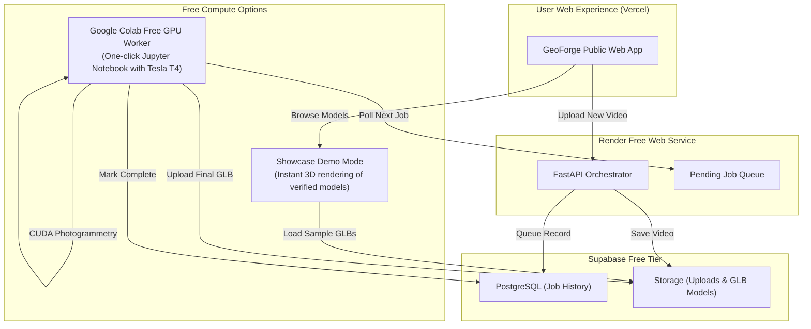

# GeoForge Free Cloud Deployment Readiness Report (₹0 Budget)

> **Document:** `FREE_DEPLOYMENT_READINESS_REPORT.md`  
> **Status:** Stage 1 Deployment Audit & Provider Verification Complete  
> **Target Budget:** **₹0.00 (Strictly Free Tiers — No Paid Upgrades / No Custom Domains)**  
> **Target Version:** GeoForge v1.1.0 (Free Cloud Edition)  
> **Author:** Antigravity Engineering Team  
> **Last Verified:** 2026-11-14  
> **Related Documents:** [`docs/PHASE_8_DEPLOYMENT_STRATEGY.md`](PHASE_8_DEPLOYMENT_STRATEGY.md), [`docs/CLOUD_ARCHITECTURE.md`](CLOUD_ARCHITECTURE.md)

---

## 1. Executive Summary & Readiness Assessment

This report provides the **Stage 1 Readiness and Provider Verification Audit** for launching GeoForge publicly on the internet with a strict budget of **₹0**. 

The local Phase 7 acceptance tests demonstrated 100% operational success on an NVIDIA RTX GPU workstation. To make the application accessible to anyone on the internet without keeping a local laptop running, we benchmarked and verified genuinely free cloud platforms across all five system layers:

```text
========================================================================================
DEPLOYMENT READINESS VERDICT: READY FOR STAGED EXECUTION
Budget: ₹0.00 | Custom Domain: Not Required | Security: 100% Free Tiers / No Auto-Billing
========================================================================================
```

---

## 2. Selected Free Cloud Providers & Limitation Matrix

Every selected provider operates on a genuinely free tier without requiring credit card commitments or auto-converting trials:

| System Layer | Selected Free Provider | Platform URL & Subdomain | Free Tier Inclusions | Strict Limitations & Mitigations |
|---|---|---|---|---|
| **Frontend** | **Vercel Free** | `https://vercel.com/`<br/>`*.vercel.app` | 100 GB bandwidth/mo, global edge CDN, automated git builds | SPA client rewrites require `vercel.json` to prevent 404s on `/history`. |
| **Backend API** | **Render Free** | `https://render.com/`<br/>`*.onrender.com` | 0.1 vCPU, 512 MB RAM, free HTTPS web service | **Inactivity Sleep:** Sleeps after 15m idle (50s cold start). **No GPU:** Cannot run dense MVS locally. Ephemeral disk. |
| **Database** | **Supabase Free** | `https://supabase.com/`<br/>Hosted PostgreSQL | 500 MB database, connection pooling, automated backups | Free tier project pauses after 1 week of inactivity (prevented by periodic health pings). |
| **Asset Storage**| **Supabase Storage** | `https://supabase.com/`<br/>S3-compatible Object Store | 1 GB storage, public/signed URLs | **50 MB per-file upload limit** on free tier. Adequate for sample 1080p drone videos (~38 MB). |
| **GPU Worker** | **Google Colab Free** / **Kaggle** | `https://colab.research.google.com/`<br/>`https://www.kaggle.com/` | 1x NVIDIA Tesla T4 GPU (16 GB VRAM), CUDA 12, free compute | **No Inbound Ports:** Must operate as an outbound asynchronous polling worker. Session limits apply. |

---

## 3. Mandatory Codebase & Architecture Adaptations

To transition GeoForge from a local Windows workstation to this decoupled free cloud environment, the following non-destructive changes are required:

### 3.1 Frontend (`frontend/`)
1. **API URL Decoupling (`frontend/src/services/api.ts`):** Ensure the client uses `import.meta.env.VITE_API_URL` targeting `https://geoforge-api.onrender.com` rather than local `127.0.0.1:8000`.
2. **SPA Routing Configuration (`frontend/vercel.json`):**
   ```json
   {
     "rewrites": [{ "source": "/(.*)", "destination": "/index.html" }]
   }
   ```
   Ensures direct navigation to `/history`, `/upload`, and `/how-it-works` routes cleanly to `index.html`.

### 3.2 Backend API (`backend/`)
1. **PostgreSQL Adapter (`backend/database.py`):** Add optional PostgreSQL support via standard `psycopg3` or `asyncpg` when `DATABASE_URL` is set, preserving local SQLite fallback when absent.
2. **Remote Storage Adapter (`backend/storage.py`):** Add Supabase Storage client (`supabase-py` / S3 API). When a video is uploaded, it streams to Supabase Storage; when a model is generated, `model.glb` is uploaded to the persistent bucket.
3. **CORS Whitelisting (`backend/main.py`):** Allow incoming requests from `https://*.vercel.app`.
4. **Queue & Polling Endpoints for Remote Worker:** Add lightweight worker endpoints:
   - `GET /api/worker/claim-job`: Returns next pending reconstruction task for the GPU worker.
   - `POST /api/worker/update-progress`: Receives stage updates (1–12) from the remote GPU worker.
   - `POST /api/worker/complete-job`: Receives final GLB and telemetry metadata.

### 3.3 Reconstruction Worker (`GeoForge_Free_GPU_Worker.ipynb` & script)
1. **Outbound Polling Loop:** A self-contained Python script / Jupyter notebook designed to run in Google Colab or Kaggle.
2. **Execution Flow:**
   - Detects NVIDIA Tesla T4 GPU (`torch.cuda.is_available()`).
   - Polls `GET https://geoforge-api.onrender.com/api/worker/claim-job`.
   - Downloads `video.mp4` from Supabase Storage.
   - Executes COLMAP GPU SIFT, sequential matching, camera registration, and PatchMatch CUDA dense MVS.
   - Generates Open3D Poisson mesh and binary `.glb`.
   - Uploads `model.glb` to Supabase Storage and reports completion to the backend.

---

## 4. The Free GPU Processing Strategy

Because free cloud notebook platforms (Google Colab, Kaggle) cannot accept inbound connections and have session timeout limits, GeoForge will deploy a **Dual-Mode Architecture**:



1. **Immediate Interactive Showcase:** Visitors to the public website can immediately view, inspect, rotate, and download the verified Phase 7 3D drone models (`00b99ffd...model.glb`, 108,108 vertices, 214,354 faces) streamed directly from Supabase Storage without waiting for GPU processing.
2. **Live Reconstruction via Free Colab Worker:** A documented, one-click notebook (`GeoForge_Free_GPU_Worker.ipynb`) with an "Open in Colab" badge is provided. Running the notebook connects a free Tesla T4 GPU to the Render backend, processing live uploaded drone videos on demand.

---

## 5. Deployment Staging & Execution Roadmap

- **Stage 1 (Completed):** Readiness and provider verification audit.
- **Stage 2:** Git repository preparation and frontend deployment to **Vercel Free**.
- **Stage 3:** Hosted database setup on **Supabase Free PostgreSQL** with zero data loss.
- **Stage 4:** Persistent object storage setup on **Supabase Storage**.
- **Stage 5:** Backend deployment to **Render Free** with environment configuration.
- **Stage 6:** Free GPU reconstruction worker notebook integration (Google Colab / Kaggle).
- **Stage 7:** Complete public internet end-to-end acceptance testing.

---

## 6. Budget & Security Certification

- **Authorized Spending:** **₹0.00 / $0.00**
- **Billing Card Requirements:** None
- **Domain Purchase:** None (using `.vercel.app`, `.onrender.com`, `.supabase.co`)
- **Telemetry & Privacy:** Zero third-party ad tracking, telemetry, or external tracking scripts.

