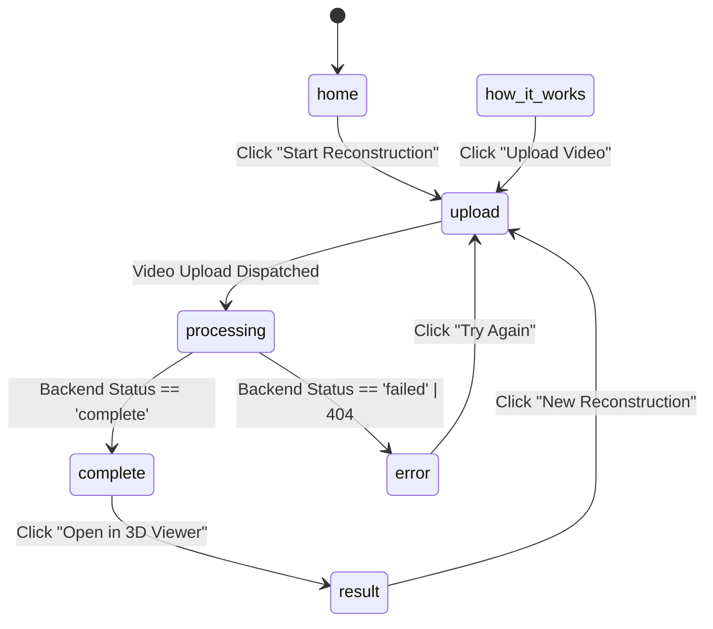

# Frontend Architecture & UI Specification — GeoForge

> **Document:** `docs/FRONTEND.md`  
> **Status:** Code-Verified Frontend Specification (Phase 3 Verified)  
> **Target Version:** GeoForge v1.0.0 (SIH 2026 / NTRO Edition)  
> **Source Verification Date:** 2026-11-11  
> **Related Documents:** [`docs/API.md`](file:///c:/Users/adity/Downloads/geoforge-main/geoforge-main/docs/API.md), [`docs/MESH_AND_GLB.md`](file:///c:/Users/adity/Downloads/geoforge-main/geoforge-main/docs/MESH_AND_GLB.md), [`docs/ARCHITECTURE.md`](file:///c:/Users/adity/Downloads/geoforge-main/geoforge-main/docs/ARCHITECTURE.md)

---

## 1. Application Architecture & Tech Stack

The GeoForge client is a Single Page Application (SPA) built using React 19 and Vite.

- **Framework:** React `^19.0.1` (`react`, `react-dom`)
- **TypeScript:** `~5.8.2` with strict typing enabled
- **Build Tool:** Vite `^6.2.3` with `@vitejs/plugin-react ^5.0.4`
- **Styling:** Tailwind CSS `^4.1.14` with `@tailwindcss/vite`
- **3D Graphics:** Three.js `^0.185.1` with `GLTFLoader`
- **Iconography & Motion:** Lucide React `^0.546.0` and Motion `^12.23.24`
- **Dev Server Port:** Default port `3000` (listening on `0.0.0.0`)

---

## 2. Page & Component Structure (`frontend/src/`)

```text
frontend/src/
├── App.tsx                     # Top-level state coordinator, routing, polling lifecycle
├── main.tsx                    # React 19 DOM root mount point
├── types.ts                    # Canonical TypeScript interfaces (ReconstructionJob, etc.)
├── index.css                   # Tailwind styling and WebGL canvas rules
├── services/
│   └── api.ts                  # Backend API integration layer (XHR upload, fetch polling)
├── components/
│   ├── Header.tsx              # Top navigation bar, status indicator, NTRO branding
│   ├── Footer.tsx              # System metadata, version, copyright
│   ├── ThreeDViewer.tsx        # Interactive Three.js WebGL model viewport
│   ├── DiagnosticsAccordion.tsx# Expandable technical failure diagnosis
│   └── ErrorView.tsx           # Standard error presentation card
└── pages/
    ├── HomePage.tsx            # Hero presentation and workflow overview
    ├── HowItWorksPage.tsx      # Flight capture instructions (overlap, altitude, lighting)
    ├── UploadPage.tsx          # Drag-and-drop video upload view
    ├── ProcessingPage.tsx      # Multi-stage progress tracking and log streaming
    ├── CompletePage.tsx        # Reconstruction success summary with download triggers
    └── ResultPage.tsx          # Dedicated 3D model viewport page
```

---

## 3. State-Machine Routing (`App.tsx:29-47`)

The application avoids heavy client router libraries in favor of a clean, state-driven view coordinator:

```typescript
type AppRoute =
  | 'home'
  | 'how-it-works'
  | 'upload'
  | 'processing'
  | 'complete'
  | 'result'
  | 'error';
```



---

## 4. Video Upload Workflow

1. **User Selection (`UploadPage.tsx`):**
   - Drag-and-drop or file picker accepts video files.
   - Enforces client-side extension check: `.mp4`, `.mov`, `.avi`.
   - Displays file metadata (name and human-readable byte size).
2. **Pre-Upload Initialization (`App.tsx:147-216`):**
   - Allocates a temporary client-side tracking ID: `GF-${Date.now().toString(36).toUpperCase()}`.
   - Initializes `ReconstructionJob` state in `currentJob`.
   - Transitions immediately to `currentRoute = 'processing'`.
3. **Multipart Streaming (`api.ts:40-275`):**
   - Uses `XMLHttpRequest` (XHR) instead of `fetch` to enable native `xhr.upload.onprogress` tracking.
   - Updates `uploadProgress` percentage in the UI in real time.
   - On completion (`xhr.status 200..299`), extracts the confirmed server `job_id`.

---

## 5. Polling & Processing Interface (`App.tsx:273-385`)

### Exponential Back-Off Polling Strategy
To minimize unnecessary HTTP traffic during long photogrammetry runs, polling intervals increase progressively:
```typescript
const POLL_DELAYS_MS = [3000, 5000, 10000, 20000, 30000];
```
- Starts polling every 3 seconds, increasing to 5s, 10s, 20s, and capping at 30 seconds.
- Stored in a React ref (`pollIntervalRef`) so timers can be cleanly cleared on component unmount or error without causing extra re-renders.

### Stage Simulation (`ProcessingPage.tsx`)
- The backend status API exposes coarse states (`queued`, `processing`, `complete`, `failed`).
- The frontend advances a 10-stage visual indicator (`TOTAL_STAGES = 10`) during each polling tick, providing visual feedback to the user while COLMAP runs.

---

## 6. Three-Dimensional Model Viewer (`ThreeDViewer.tsx`)

The viewer component embeds a full-featured Three.js WebGL canvas:
- **Geometry Ingestion:** Uses Three.js `GLTFLoader` with automatic error handling via `onModelLoadError`.
- **Dynamic Camera Auto-Framing:**
  - Computes axis-aligned bounding box via `THREE.Box3().setFromObject(model)`.
  - Centers geometry at origin $(0, 0, 0)$.
  - Positions perspective camera at $1.5 \times$ the bounding sphere radius looking directly at center.
- **Lighting Setup:**
  - Ambient Light: Hex `#ffffff`, intensity `0.6`.
  - Directional Sun Light: Hex `#ffffff`, intensity `0.8`, positioned at $(10, 20, 15)$.
  - Secondary Fill Light: Hex `#ffffff`, intensity `0.3`, positioned at $(-10, -10, -10)$.
- **Interactive Controls:** OrbitControls with damping enabled (`enableDamping = true`, factor `0.05`), distance limits, and screen-space panning.
- **Viewport Tools:**
  - Tool Modes: Rotate, Pan, Zoom.
  - Toggles: Wireframe mode (`material.wireframe = true`), Ground Grid Helper (`THREE.GridHelper`), Coordinate Axes (`THREE.AxesHelper`), Fullscreen toggle.
- **Resource Disposal:** On unmount, recursively traverses the scene graph, disposing of geometries, materials, texture maps, and calls `renderer.dispose()` to prevent WebGL memory leaks.

---

## 7. Environment Variables & URL Normalization

- **`VITE_API_URL`:** Configures the backend base URL (defaults to `http://127.0.0.1:8000`).
- **URL Normalization Helper (`getModelGlbUrl` in `api.ts:331-407`):**
  Accepts either a bare UUID, relative path (`/model/{id}`), or absolute URL (`http://.../model/{id}`) and safely produces a single clean model retrieval URL, preventing double-prefix bugs like `/model//model/{id}`.
