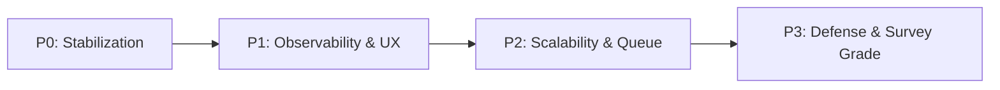

# GeoForge — Master Project Context and Knowledge Base

> **Document Type:** Master Architectural Context & Technical Knowledge Base  
> **Target Version:** GeoForge v1.0.0 (SIH 2026 / NTRO Edition)  
> **Source Repository Inspection Date:** November 2026  
> **Status:** Authoritative Repository Source of Truth  
> **Reference Problem Statement:** SIH26158 — Single-Pass Drone Video to Accurate 3D Model Generation System

---

## 1. Project Identity & Problem Statement

### 1.1 Project Identity
- **Project Name:** GeoForge
- **Type:** Automated Drone/Handheld Video-to-3D Model Reconstruction System
- **Hackathon:** Smart India Hackathon 2026 (SIH 2026)
- **Problem Statement ID:** `SIH26158`
- **Problem Statement Title:** Single-Pass Drone Video to Accurate 3D Model Generation System
- **Organisation:** National Technical Research Organisation (NTRO)
- **Category:** Software
- **Theme:** Robotics and Drones

### 1.2 Problem Statement & Purpose
The primary purpose of GeoForge is to transform continuous, single-pass aerial drone video (or handheld mobile video) into an accurate, interactive, textured 3D digital twin of real-world structures, buildings, campuses, and terrain. 

Traditional photogrammetry software (e.g., RealityCapture, Pix4D, Agisoft Metashape) assumes:
1. High-resolution, still-frame aerial surveys with structured 70–80% lateral and longitudinal overlap.
2. Manual photo curation and exclusion of blurry/overexposed shots.
3. Complex, desktop-installed software suites requiring deep technical expertise.

In tactical, disaster-response, and reconnaissance operations managed by organizations like the **National Technical Research Organisation (NTRO)**, operators often obtain **continuous, single-pass video footage** captured under variable flight paths, lighting conditions, and camera speeds. GeoForge bridges this critical gap by providing an **automated, web-based, end-to-end photogrammetry pipeline**:
- Operators simply drop a video file into the web UI.
- The server automatically decompresses, samples, filters, sharpens, and de-duplicates frames.
- A high-performance Structure-from-Motion (SfM) and Multi-View Stereo (MVS) pipeline reconstructs camera poses, dense depth maps, and a textured 3D mesh.
- The result is packaged into a web-optimized binary glTF (`.glb`) and delivered instantly to a browser-based 3D viewer.

### 1.3 Dual-Use and Commercial Vision
Beyond defense and intelligence surveillance (NTRO), GeoForge carries strong dual-use and commercial potential across:
- **Disaster Response & Damage Assessment:** Rapid 3D mapping of collapsed infrastructure, floods, or landslides.
- **Campus & Facility Management:** Low-cost 3D asset generation for universities, industrial complexes, and infrastructure projects.
- **Civilian Surveying & Construction:** Site progress tracking using consumer drones without costly subscription photogrammetry services.

---

## 2. Project Objectives

1. **Fully Automated Ingestion & Curation:** Eliminate manual frame extraction and curation by integrating intelligent computer vision filters for blur, brightness, and visual redundancy.
2. **Robust Single-Pass Drone Photogrammetry:** Tailor feature extraction, matching, and camera bundle adjustment specifically to drone flight characteristics (high altitude, planar and oblique perspective changes, repetitive textures).
3. **Outlier-Free Dense Geometry:** Clean dense point clouds using statistical outlier removal and surface-trim Poisson meshes to prevent boundary "bloating" and floating artifacts.
4. **Zero-Client Compute:** Execute all photogrammetric and geometric processing on high-performance server hardware (GPU-accelerated), requiring only a standard modern web browser with WebGL support on the client device.
5. **Clear Operational Observability:** Provide actionable diagnostics, error breakdowns, and capture recommendations whenever reconstruction fails due to poor footage or insufficient baseline overlap.

---

## 3. Current Architecture

### 3.1 High-Level Architecture Pattern
GeoForge follows a **decoupled client-server architecture**:
- **Presentation Layer (Frontend):** React 19 + TypeScript Single Page Application (SPA) bundled via Vite. Manages video upload with chunked progress reporting, status polling, error presentation, and browser-based 3D model interaction with Three.js.
- **Service Orchestration Layer (Backend):** Python FastAPI application providing asynchronous REST API endpoints. Dispatches long-running reconstruction jobs to an internal `ThreadPoolExecutor` worker pool.
- **Core Processing Engines:**
  - **OpenCV (`cv2`):** Video decoding, FPS-aware frame sampling, Laplacian variance blur detection, mean brightness scoring, and pixel-level absolute difference redundancy filtering.
  - **COLMAP (CLI):** SIFT feature detection, GPU feature extraction, sequential image matching with vocabulary tree loop detection, single-model SfM mapping, image undistortion, PatchMatch Multi-View Stereo (MVS), depth map fusion, and mesh texturing.
  - **Open3D (`o3d`):** Statistical outlier removal on dense point clouds, normal estimation, and Screened Poisson surface reconstruction with density-percentile trimming (with automatic fallback to COLMAP's built-in `poisson_mesher`).
  - **Trimesh & Pillow (`PIL`):** Textured PLY mesh parsing, PBR material binding, UV coordinate assignment, and binary glTF (`.glb`) serialization.

```mermaid
flowchart TD
    subgraph Client["Client (Browser / React 19)"]
        UI[User Interface]
        UploadHook["XHR Upload (Progress Bar)"]
        Poller["Status Poller (Back-off Cadence)"]
        ThreeViewer["Three.js 3D Viewer (GLTFLoader)"]
    end

    subgraph Server["Backend Server (FastAPI / Python)"]
        API["FastAPI Endpoints (/upload, /status, /model)"]
        JobStore["In-Memory Job Store (_jobs dict)"]
        Executor["ThreadPoolExecutor (max_workers=2)"]
    end

    subgraph Pipeline["Reconstruction Pipeline"]
        Extract["1. Frame Extraction (OpenCV, 2 FPS)"]
        SharpFilter["2. Sharpness & Exposure Filter (Laplacian >= 100)"]
        Redundancy["3. Redundancy Filter (AbsDiff >= 5.0)"]
        COLMAP_SfM["4. COLMAP SIFT Extraction & Sequential Match"]
        COLMAP_Map["5. COLMAP SfM Mapper (Single Model)"]
        Gate["6. Sparse Quality Gate (Reg Ratio >= 30%)"]
        Undistort["7. Image Undistortion"]
        PatchMatch["8. PatchMatch Stereo Depth Estimation (GPU)"]
        StereoFusion["9. Stereo Fusion (fused.ply)"]
        Cleaning["10. Point Cloud Cleaning (Open3D Outlier Filter)"]
        Poisson["11. Poisson Meshing & Density Trimming"]
        Texturing["12. Mesh Texturing (COLMAP mesh_texturer)"]
        GLBConvert["13. GLB Serialization (Trimesh + Pillow)"]
    end

    UI --> UploadHook
    UploadHook -->|POST /upload| API
    API --> JobStore
    API -->|Submit Task| Executor
    Executor --> Pipeline
    Pipeline --> Extract --> SharpFilter --> Redundancy --> COLMAP_SfM --> COLMAP_Map --> Gate
    Gate --> Undistort --> PatchMatch --> StereoFusion --> Cleaning --> Poisson --> Texturing --> GLBConvert
    GLBConvert -->|Store model.glb| JobStore
    Poller -->|GET /status/{job_id}| API
    API -->|Poll Response| Poller
    Poller -->|On Complete| ThreeViewer
    ThreeViewer -->|GET /model/{job_id}| API
```

### 3.2 Workspace & Directory Topology
The backend establishes three primary operational directories:
- `backend/uploads/`: Stores raw uploaded videos named `{job_id}_{original_filename}`.
- `backend/temp/{job_id}/`: Dedicated per-job workspace containing intermediate subdirectories:
  - `frames/`: Extracted raw JPEG frames from the video.
  - `selected_frames/`: Frames surviving sharpness and exposure filtering.
  - `final_frames/`: Frames surviving redundancy reduction (passed directly to COLMAP).
  - `colmap/`: Dedicated COLMAP workspace containing `database.db`, `sparse/`, `dense/`, `mesh/`, and `textured/` (where `model.glb` is generated).
- `backend/output/`: Directory initialized on server startup for permanent exports.

---

## 4. Complete Technology Inventory

| Layer | Technology | Version (Observed/Manifest) | Purpose | Verification Status |
|---|---|---|---|---|
| **Frontend Framework** | React | `^19.0.1` | User interface and component state management | Verified in `frontend/package.json` |
| **Frontend DOM** | React DOM | `^19.0.1` | DOM renderer for React | Verified in `frontend/package.json` |
| **Language (FE)** | TypeScript | `~5.8.2` | Static type safety | Verified in `frontend/package.json` |
| **Bundler & Dev Server**| Vite | `^6.2.3` | Build tool and development server (port 3000) | Verified in `frontend/package.json` |
| **Styling** | Tailwind CSS | `^4.1.14` | Utility-first styling via `@tailwindcss/vite` | Verified in `frontend/package.json` |
| **Icons & Animation** | Lucide React / Motion | `^0.546.0` / `^12.23.24` | Iconography and UI transitions | Verified in `frontend/package.json` |
| **3D Rendering** | Three.js | `^0.185.1` | WebGL 3D scene, lighting, camera controls, GLTFLoader | Verified in `frontend/package.json` |
| **Unused FE Packages** | `@google/genai`, `express` | `^2.4.0`, `^4.21.2` | Included in package.json; unused in core reconstruction | Verified in `frontend/package.json` |
| **Backend Framework** | FastAPI | (Unpinned manifest) | High-performance asynchronous REST API | Verified in `backend/main.py` imports |
| **ASGI Server** | Uvicorn | (Unpinned manifest) | ASGI web server | Verified in setup scripts / docs |
| **Computer Vision** | OpenCV (`opencv-python`)| (Unpinned manifest) | Video frame decoding, blur detection, brightness, absdiff | Verified in `backend/*.py` imports |
| **Scientific Computing**| NumPy | (Unpinned manifest) | Array manipulation, median/percentile thresholds | Verified in `backend/*.py` imports |
| **3D Point/Mesh Library**| Open3D | `0.19.0` (Historical) | Outlier removal, normal estimation, Poisson meshing | Verified in `backend/reconstruction.py` |
| **Geometry & Export** | Trimesh | (Unpinned manifest) | PLY mesh loading, scene flattening, UV verification, GLB export | Verified in `backend/convert_to_glb.py` |
| **Image Processing** | Pillow (`PIL`) | (Unpinned manifest) | Texture image loading and PBR material attachment | Verified in `backend/convert_to_glb.py` |
| **Photogrammetry** | COLMAP | `4.1.1 CUDA` (Historical) | Structure from Motion (SfM) and Multi-View Stereo (MVS) | Verified in `backend/reconstruction.py` |

> [!WARNING] Dependency Manifest Gap
> The backend repository lacks a formal `requirements.txt` or `pyproject.toml`. All backend dependencies are currently inferred from Python imports across `main.py`, `reconstruction.py`, `frame_processing.py`, `frame_filtering.py`, `redundancy_filter.py`, and `convert_to_glb.py`.

---

## 5. Complete Reconstruction Workflow

The complete end-to-end reconstruction workflow comprises 17 distinct operational stages:

```
[Drone Video File]
       │
       ▼ (Stage 1: HTTP Multipart Upload)
  FastAPI POST /upload -> UUID Job Creation & Upload Validation
       │
       ▼ (Stage 2: FPS-Aware Extraction)
  OpenCV Frame Extraction (Target: 2.0 FPS, JPEG Quality: 95)
       │
       ▼ (Stage 3: Sharpness & Exposure Curation)
  Laplacian Variance (Threshold >= 100.0) + Brightness Filtering (30-240)
       │
       ▼ (Stage 4: Redundancy Culling)
  Mean Absolute Difference Filtering (Threshold >= 5.0, Max Removal: 50%)
       │
       ▼ (Stage 5: Minimum Frame Guard)
  Verification: Count >= 20 Frames (Throws RuntimeError if lower)
       │
       ▼ (Stage 6: Feature Extraction)
  COLMAP feature_extractor (SIFT, OPENCV 8-parameter Camera Model, 16,384 Features, GPU)
       │
       ▼ (Stage 7: Sequential Feature Matching)
  COLMAP sequential_matcher (Overlap: 15, Vocab Tree Loop Detection)
       │
       ▼ (Stage 8: Sparse Reconstruction / SfM)
  COLMAP mapper (Force Single Model: multiple_models=0, Bundle Adjustment Refinements: 5)
       │
       ▼ (Stage 9: Sparse Model Quality Gate)
  Binary Model Parser (Images Registered >= 30% required; Warnings if < 70% or < 1,000 pts)
       │
       ▼ (Stage 10: Image Undistortion)
  COLMAP image_undistorter (Prepares undistorted frames & sparse camera poses)
       │
       ▼ (Stage 11: PatchMatch Stereo)
  COLMAP patch_match_stereo (Dense depth maps, max_image_size: 2400, 7 iterations, GPU)
       │
       ▼ (Stage 12: Stereo Fusion)
  COLMAP stereo_fusion (Min Pixels: 3, Max Reprojection Error: 2.0 -> dense/fused.ply)
       │
       ▼ (Stage 13: Point Cloud Cleaning)
  Open3D Statistical Outlier Removal (nb_neighbors=20, std_ratio=2.0 -> fused_cleaned.ply)
       │
       ▼ (Stage 14: Screened Poisson Surface Meshing)
  Open3D create_from_point_cloud_poisson (Depth=11) + 7% Density Percentile Trim
       │
       ▼ (Stage 15: Mesh Texturing)
  COLMAP mesh_texturer (Projects undistorted drone frames onto Poisson mesh)
       │
       ▼ (Stage 16: GLB Serialization)
  Trimesh + Pillow convert_to_glb (Binds UVs & PBR material, outputs binary model.glb)
       │
       ▼ (Stage 17: Interactive Visualization)
  Frontend Poller detects Complete -> Three.js GLTFLoader renders model in WebGL
```

---

## 6. COLMAP Integration Deep Dive

COLMAP serves as the core photogrammetric SfM/MVS engine. The integration in `backend/reconstruction.py` incorporates several optimizations:

### 6.1 Subprocess Execution Architecture
- Executable resolved from `COLMAP_EXE` environment variable, defaulting to `C:\bin\colmap.exe`.
- Direct invocation via `subprocess.Popen(cmd, shell=False, stdout=subprocess.PIPE, stderr=subprocess.STDOUT)`.
- **Space-Safe Path Handling:** Avoiding `cmd.exe /c` or batch wrappers (`COLMAP.bat`) allows seamless execution when Windows user paths contain spaces (e.g. `C:\Users\Aditya verma\...`).
- Real-time live log streaming: Captures stdout/stderr line-by-line into the Python logger with prefix `[COLMAP]`.
- Exit-code verification: Captures the trailing 120 lines on failure for diagnostic reporting.

### 6.2 Photogrammetric Parameters
1. **Feature Extraction:**
   - `--ImageReader.camera_model OPENCV`: Specifies an 8-parameter camera model ($f_x, f_y, c_x, c_y, k_1, k_2, p_1, p_2$) capturing both radial and tangential distortion, essential for wide-angle drone lenses.
   - `--ImageReader.single_camera 1`: Enforces identical intrinsic calibration across all frames.
   - `--SiftExtraction.max_num_features 16384`: Doubled from COLMAP's default 8,192 to resolve repetitive aerial textures (foliage, roofing).
   - `--SiftExtraction.estimate_affine_shape 1` and `--SiftExtraction.domain_size_pooling 1`: Enhances feature repeatability across oblique drone angles.
2. **Sequential Feature Matching:**
   - `--SequentialMatching.overlap 15`: Matches each frame against 15 adjacent frames.
   - **Vocabulary Tree Loop Detection:** Searches for vocabulary trees in 5 known candidate paths (`vocab_tree_flickr100K_words256K.bin`, etc.). Enables loop closure when the drone circles back over previously surveyed ground.
3. **Single-Model SfM Enforcement:**
   - `--Mapper.multiple_models 0`: Prevents COLMAP from fragmenting the scene into disconnected sub-models. Forces all registered images into a single coordinate system.
   - Bundle adjustment: 50 global iterations and 5 refinement passes for high pose accuracy.
4. **Binary Model Parsing & Quality Gate:**
   - Functions `read_sparse_model_stats` inspects `cameras.bin`, `images.bin`, and `points3D.bin` using binary unpack (`struct.unpack("<Q", f.read(8))`).
   - Rejects the job if registered images ratio $< 30\%$ (`MIN_REGISTRATION_RATIO = 0.30`).
5. **Dense Depth & Fusion:**
   - `--PatchMatchStereo.max_image_size 2400`: Balances high depth resolution against 6 GB VRAM limits.
   - `--PatchMatchStereo.num_iterations 7`: Enhances depth consistency.
   - `--StereoFusion.min_num_pixels 3` and `--StereoFusion.max_reproj_error 2.0`: Retains peripheral scene points while rejecting high-error noise.

---

## 7. Open3D Integration Deep Dive

Open3D (`o3d`) executes geometric refinement on point clouds and polygonal meshes:

1. **Statistical Outlier Removal (`clean_point_cloud`):**
   - Ingests `fused.ply` generated by COLMAP stereo fusion.
   - Invokes `pcd.remove_statistical_outlier(nb_neighbors=20, std_ratio=2.0)`.
   - Eliminates floating points, atmospheric noise, and isolated visual artifacts.
   - Emits cleaned point cloud `dense/fused_cleaned.ply`.
2. **Screened Poisson Surface Reconstruction (`poisson_mesh_with_trimming`):**
   - Calculates normals if absent: `estimate_normals(radius=0.1, max_nn=30)` with consistent tangent plane orientation `orient_normals_consistent_tangent_plane(k=15)`.
   - Executes Poisson reconstruction: `o3d.geometry.TriangleMesh.create_from_point_cloud_poisson(pcd, depth=11, linear_fit=True)`.
   - **Density-Based Boundary Trimming:** Computes vertex density distribution via NumPy (`np.percentile(densities_np, 7.0)`). Trims the bottom 7% lowest-density triangles to eradicate hallucinated boundary "bloat".
   - Cleans mesh topology: `remove_degenerate_triangles()` and `remove_unreferenced_vertices()`.
3. **Resilient Degradation:**
   - If Open3D is not installed, `clean_point_cloud` copies `fused.ply` to `fused_cleaned.ply` directly.
   - `poisson_mesh_with_trimming` returns `None`, causing `run_reconstruction` to fall back to COLMAP's native `poisson_mesher` CLI command with `--PoissonMeshing.depth 11 --PoissonMeshing.trim 7.0`.

---

## 8. OpenCV Integration Deep Dive

OpenCV (`cv2`) handles video ingestion and frame curation in `backend/`:

1. **Frame Extraction (`frame_processing.py`):**
   - Calculates dynamic frame interval based on input FPS: `effective_interval = max(1, int(round(fps / target_fps)))` (target: 2.0 FPS).
   - Writes JPEG frames using compression parameter `[cv2.IMWRITE_JPEG_QUALITY, 95]`.
   - Reports video metadata: total frame count, FPS, resolution (width/height), and duration.
2. **Blur Detection & Exposure Filtering (`frame_filtering.py`):**
   - Sharpness calculated via Laplacian variance: `cv2.Laplacian(gray, cv2.CV_64F).var()`.
   - Default threshold: `100.0` (calibrated for drone footage, down from historical 300).
   - **Adaptive Threshold Floor:** If more than 40% of frames would be rejected (`MAX_BLUR_REJECTION_RATIO = 0.40`), it dynamically lowers the threshold to the 40th percentile of the video's sharpness distribution, bounded by `ABSOLUTE_MIN_SHARPNESS = 20.0`.
   - Exposure filtering: Calculates grayscale mean `gray.mean()`. Rejects underexposed frames ($< 30.0$) and blown-out overexposed frames ($> 240.0$).
3. **Redundancy Reduction (`redundancy_filter.py`):**
   - Computes pixel-wise mean absolute difference: `cv2.absdiff(gray1, gray2).mean()`.
   - Default threshold: `5.0`. Frames with difference $< 5.0$ compared to the last kept frame are dropped.
   - **Safety Floor (`MAX_REMOVAL_RATIO = 0.50`):** Automatically lowers difference threshold if culling would remove $> 50\%$ of frames, preserving stereo camera baseline.
4. **Standalone Scripts in `src/`:**
   - Note: Root scripts `src/detect_blur.py`, `src/analyze_sharpness.py`, and `src/remove_redundant.py` are legacy test utilities using fixed thresholds (blur threshold 300; `cv2.matchTemplate` normalized correlation threshold 0.98). They are separate from the active backend modules.

---

## 9. Backend Implementation

FastAPI handles job coordination in `backend/main.py`:

### 9.1 REST Endpoints
- `GET /`: Returns service metadata, online status, and API version (`1.0.0`).
- `GET /health`: Returns `{"status": "healthy"}` for load balancer / uptime probes.
- `POST /upload`:
  - Multipart form handler (`file: UploadFile = File(...)`).
  - Validates `content-length` header $\le$ 4 GiB (`MAX_UPLOAD_BYTES = 4 * 1024 * 1024 * 1024`).
  - Validates extension against allowlist: `{".mp4", ".mov", ".avi", ".mkv"}`.
  - Generates UUID `job_id`.
  - Saves file to disk via streaming buffer `shutil.copyfileobj`.
  - **Queue Concurrency Guard:** Rejects with HTTP 503 if active running jobs $\ge$ 2 (`MAX_CONCURRENT_RECONSTRUCTIONS = 2`).
  - Dispatches `_run_reconstruction_job` onto `ThreadPoolExecutor(max_workers=2)`.
  - Dispatches background asyncio cleanup task `_cleanup_job_files` with a 7-day delay.
  - Returns HTTP 200 with `job_id`, `status_url`, and `model_url`.
- `GET /status/{job_id}`:
  - Validates UUID syntax.
  - If job not in memory, returns `{"status": "failed", "error": "Job not found. The server may have been restarted..."}` (avoids 404 retry loops).
  - Returns `queued`, `processing`, `complete` (with full `result` object), or `failed` (with `error` string).
- `GET /model/{job_id}`:
  - Validates UUID syntax.
  - Resolves `TEMP_DIR / job_id / "colmap" / "textured" / "model.glb"`.
  - Serves file via FastAPI `FileResponse` with MIME type `model/gltf-binary` and `Cache-Control: no-cache`.
- `HEAD /model/{job_id}`:
  - Verifies model existence and non-zero byte size without transferring the binary payload.

### 9.2 In-Memory Job Store & Concurrency
- Job metadata resides in Python dictionary `_jobs: dict`.
- **Durability Limitation:** Server process restart clears all in-memory jobs.
- Thread safety: Fast dictionary updates occur inside the worker thread upon stage completion or exception catch.

---

## 10. Frontend Implementation

### 10.1 UI Architecture & Routing
The frontend is built with React 19 and implements an in-memory route state (`currentRoute` in `App.tsx`):
- `'home'`: Landing hero, architecture explanation, quick upload CTA.
- `'how-it-works'`: Visual guide explaining photogrammetry and capture recommendations.
- `'upload'`: Drag-and-drop video upload zone with client-side file extension checking.
- `'processing'`: Active job telemetry, elapsed timer, 10-step progress visualization, cancel/retry controls.
- `'complete'`: Success summary, generated deliverables checklist, CTA to open 3D viewer or download GLB.
- `'result'`: Interactive Three.js 3D viewport with collapsible Model Inspector sidebar (Model Info, Layers, Telemetry tabs).
- `'error'`: Comprehensive diagnostic display (`ErrorView.tsx` and `DiagnosticsAccordion.tsx`).

### 10.2 API Service & Polling Mechanism
Implemented in `frontend/src/services/api.ts` and `frontend/src/App.tsx`:
- Base URL determined by `import.meta.env.VITE_API_URL`, falling back to `http://127.0.0.1:8000`.
- Upload via raw `XMLHttpRequest` to track `xhr.upload.onprogress` for 0–100% progress reporting.
- Status Polling uses exponential back-off delays: `POLL_DELAYS_MS = [3000, 5000, 10000, 20000, 30000]`.
- Stored interval in React ref `pollIntervalRef` to guarantee clean unmounting and error cancellation.

---

## 11. 3D Viewer Implementation

The 3D viewer in `frontend/src/components/ThreeDViewer.tsx` is an interactive WebGL canvas powered by Three.js:

1. **Model Loading:**
   - Uses `three/examples/jsm/loaders/GLTFLoader.js`.
   - Supports backend model URL `/model/{job_id}` with fallback to `/video_model.glb`.
   - Computes bounding box (`THREE.Box3().setFromObject(gltf.scene)`).
   - Centers the model at the scene origin $(0, 0, 0)$ and aligns the lowest geometry coordinate with ground plane ($y = 0$).
2. **Camera & Controls:**
   - Perspective camera ($FOV = 45^\circ$, near $0.1$, far $2000$).
   - Custom mouse/pointer event listeners for Orbit (Left Click + Drag), Pan (Right Click / Two Fingers), and Zoom (Wheel / Pinch).
   - Toolbar actions: Reset Camera View, Toggle Fullscreen, Zoom In/Out.
3. **Lighting & Environment:**
   - Ambient light (intensity $0.6$).
   - Main directional sunlight (intensity $1.2$, positioned obliquely).
   - Fill directional light (intensity $0.4$).
   - CAD ground plane grid helper (`THREE.GridHelper`) with custom dark styling.
4. **Lifecycle & Memory Management:**
   - Listens to container resize via `ResizeObserver`.
   - On component unmount, thoroughly disposes geometries, materials, textures, and invokes `renderer.dispose()` and `renderer.forceContextLoss()`.

---

## 12. APIs and Data Flow

### 12.1 Detailed API Contract

#### `POST /upload`
- **Request:** `multipart/form-data`, field `file`.
- **Headers:** `Content-Length` (enforced $\le 4\text{ GiB}$).
- **Response (200 OK):**
```json
{
  "status": "accepted",
  "message": "Video uploaded. Reconstruction is running in the background.",
  "job_id": "3c99d500-1fe8-4504-a5e6-8d129d2bbdea",
  "filename": "flight_survey.mp4",
  "status_url": "/status/3c99d500-1fe8-4504-a5e6-8d129d2bbdea",
  "status_absolute": "http://127.0.0.1:8000/status/3c99d500-1fe8-4504-a5e6-8d129d2bbdea",
  "model_url": "/model/3c99d500-1fe8-4504-a5e6-8d129d2bbdea",
  "model_absolute": "http://127.0.0.1:8000/model/3c99d500-1fe8-4504-a5e6-8d129d2bbdea",
  "poll_interval_seconds": 30
}
```

#### `GET /status/{job_id}`
- **Response (Processing):**
```json
{
  "job_id": "3c99d500-1fe8-4504-a5e6-8d129d2bbdea",
  "status": "processing",
  "filename": "flight_survey.mp4"
}
```
- **Response (Complete):**
```json
{
  "job_id": "3c99d500-1fe8-4504-a5e6-8d129d2bbdea",
  "status": "complete",
  "filename": "flight_survey.mp4",
  "result": {
    "total_video_frames": 1441,
    "frames_extracted": 1441,
    "video_fps": 30.0,
    "video_resolution": "3840x2160",
    "video_duration_seconds": 48.0,
    "sharp_frames_kept": 1375,
    "blurry_frames_removed": 66,
    "brightness_frames_removed": 0,
    "final_frames": 688,
    "redundant_frames_removed": 687,
    "registered_images": 688,
    "registration_ratio": 1.0,
    "sparse_points": 45210,
    "dense_cloud_points": 3875704,
    "cleaned_cloud_points": 3810200,
    "outliers_removed": 65504,
    "mesh_vertices": 482100,
    "mesh_faces": 960400,
    "quality_warnings": [],
    "dense_point_cloud": ".../colmap/dense/fused.ply",
    "poisson_mesh": ".../colmap/mesh/poisson_mesh.ply",
    "textured_model": ".../colmap/textured/model.ply",
    "texture": ".../colmap/textured/texture.png",
    "glb_model": ".../colmap/textured/model.glb",
    "glb_size_mb": 42.5,
    "model_url": "/model/3c99d500-1fe8-4504-a5e6-8d129d2bbdea",
    "pipeline_status": "complete"
  }
}
```
- **Response (Failed / Not Found):**
```json
{
  "status": "failed",
  "job_id": "3c99d500-1fe8-4504-a5e6-8d129d2bbdea",
  "error": "Only 12 frames passed filtering. At least 20 are needed for a useful reconstruction."
}
```

#### `GET /model/{job_id}`
- **Response:** Binary stream with `Content-Type: model/gltf-binary`, `Content-Disposition: attachment; filename="model.glb"`.

---

## 13. Configuration & Environment

### 13.1 Environment Variables
| Variable | Component | Default Value | Description |
|---|---|---|---|
| `VITE_API_URL` | Frontend | `http://127.0.0.1:8000` | Base URL used by frontend API client |
| `ALLOWED_ORIGINS` | Backend | `http://localhost:3000,...` | Comma-separated CORS allowed origins |
| `COLMAP_EXE` | Backend | `C:\bin\colmap.exe` | Absolute path to COLMAP executable binary |
| `DISABLE_HMR` | Frontend (Vite) | `false` | Disables Vite Hot Module Reloading for stability |

### 13.2 Key Pipeline Constants
| Setting | Source Location | Value | Purpose |
|---|---|---|---|
| `MAX_UPLOAD_BYTES` | `backend/main.py` | 4 GiB | Maximum declared upload size |
| `MIN_FRAMES_FOR_RECONSTRUCTION` | `backend/main.py` | 20 | Minimum surviving frames required for SfM |
| `MAX_CONCURRENT_RECONSTRUCTIONS` | `backend/main.py` | 2 | Maximum simultaneous worker threads |
| `JOB_RETENTION_SECONDS` | `backend/main.py` | 7 Days | Delay before automatic job disk deletion |
| `DEFAULT_TARGET_FPS` | `frame_processing.py` | 2.0 FPS | Target video sampling rate |
| `DEFAULT_SHARPNESS_THRESHOLD` | `frame_filtering.py` | 100.0 | Laplacian variance floor for blur |
| `MAX_BLUR_REJECTION_RATIO` | `frame_filtering.py` | 0.40 | Percentile trigger for adaptive blur threshold |
| `DEFAULT_DIFFERENCE_THRESHOLD` | `redundancy_filter.py` | 5.0 | Mean absdiff floor for redundancy |
| `MAX_REMOVAL_RATIO` | `redundancy_filter.py` | 0.50 | Max fraction of frames allowed to be culled |
| `CAMERA_MODEL` | `reconstruction.py` | `"OPENCV"` | 8-parameter camera model |
| `MAX_NUM_FEATURES` | `reconstruction.py` | 16,384 | Max SIFT keypoints per image |
| `SEQUENTIAL_OVERLAP` | `reconstruction.py` | 15 | Matching window of neighboring frames |
| `PATCHMATCH_MAX_IMAGE_SIZE` | `reconstruction.py` | 2,400 px | Resolution cap for dense stereo VRAM |
| `POISSON_DEPTH` | `reconstruction.py` | 11 | Octree depth for Poisson meshing |
| `POISSON_TRIM` | `reconstruction.py` | 7.0% | Percentile trim of low-density mesh boundaries |

---

## 14. Existing Limitations

1. **In-Memory Volatile Job State:** Jobs are maintained in Python process memory (`_jobs: dict`). Restarting Uvicorn causes all active and completed jobs to be lost immediately.
2. **Header-Only Upload Size Validation:** `POST /upload` validates file size via HTTP header `Content-Length`. If the header is missing or spoofed, size is not enforced until after streaming to disk.
3. **No Resumable Uploads:** Large 4 GiB video files cannot be resumed if interrupted by a network blip.
4. **Arbitrary Scale & Orientation (Lack of Georeferencing):** Generated models exist in arbitrary COLMAP local coordinates. There is no automated extraction of drone GPS flight logs or EXIF tags to produce real-world UTM coordinates, true-north orientation, or metric 1:1 scale.
5. **No True Orthomosaic or LAS Generation:** Despite UI badges, the backend only generates PLYs and a GLB. It does not produce georeferenced GeoTIFF orthomosaics or classified LAS point clouds.
6. **Simulated Progress Granularity:** The frontend status poller increments its own stage counter ($1 \to 8$) on a client timer rather than reflecting true backend pipeline events.
7. **Single-Node Compute Bottleneck:** Running two concurrent reconstructions on a 6 GB GPU (RTX 3050) can cause severe VRAM or out-of-memory (OOM) failures during PatchMatch Stereo.

---

## 15. Known Bugs & Discrepancies

1. **Allowed File Extensions Inconsistency:**
   - Backend `main.py:382`: Accepts `{".mp4", ".mov", ".avi", ".mkv"}`.
   - Frontend `UploadPage.tsx:22`: Rejects `.mkv`, only permitting `['mp4', 'mov', 'avi']`.
2. **Aspirational UI Deliverables:**
   - `CompletePage.tsx:78-100`: Displays "Dense Point Cloud (LAS) - READY", "Orthomosaic Map (GeoTIFF) - READY", and "3D Surface Mesh (OBJ/MTL) - READY". These files are neither produced nor served by the backend.
3. **Hardcoded Metrics in Result Inspector:**
   - `ResultPage.tsx:128-188`: The "Model Info" tab displays hardcoded text `"12,000+ Points"` and `"High Photogrammetry"` rather than reading actual point and vertex statistics from `job.result`.
   - The "Layers" and "Telemetry" tabs contain non-functional visual toggles.
4. **Hardcoded User Paths in Maintenance Scripts:**
   - Several standalone scripts (`convert_to_glb.py:226`, `check_3d.py:11`, `clean_pointcloud.py:3`, `inspect_mesh.py:3`, `inspect_pointcloud.py:3`) contain developer machine paths: `C:\Users\Aditya verma\Desktop\Drone3DProject\...`.
5. **Windows Incompatible Clean Script:**
   - `frontend/package.json:10`: `"clean": "rm -rf dist server.js"` relies on Unix shell syntax, failing on native Windows Command Prompt.
6. **Frontend Unused Dependencies:**
   - `frontend/package.json`: Contains `@google/genai` and `express` which are unreferenced in the core reconstruction pipeline.

---

## 16. Current Development Status

- **Codebase Completeness:** Full source code for both frontend and backend is present in the repository under `geoforge-main/geoforge-main/`.
- **Environment State:** 
  - Python 3.15.2 is present in the environment; however, backend packages (`fastapi`, `opencv-python`, `open3d`, `trimesh`, `pillow`) and external binaries (`colmap.exe`, `node`) are not pre-installed in the current execution shell.
  - The core architecture is validated via direct source code analysis.
- **Repository Structure:** The repository features a root directory containing a nested `geoforge-main/` folder holding all source code and documentation.

---

## 17. Planned Improvements Roadmap



### Phase P0: Core Stabilization (Immediate)
- **Dependency Pinning:** Author and validate `backend/requirements.txt` with tested package versions.
- **Extension Synchronization:** Update `frontend/src/pages/UploadPage.tsx` to support `.mkv` matching the backend allowlist.
- **Path Sanitization:** Remove hardcoded personal machine paths from scripts, parameterizing them via CLI arguments or environment variables.
- **Windows Clean Script:** Replace `rm -rf` in `frontend/package.json` with a cross-platform rimraf utility.

### Phase P1: Observability & UX Enhancements
- **True Stage Telemetry:** Update backend status model to report explicit pipeline stages (`extracting`, `filtering`, `sfm`, `mvs`, `meshing`, `texturing`), replacing client-side timer simulation.
- **Real Model Inspection:** Bind `ResultPage.tsx` inspector drawer directly to `job.result` statistics (actual dense point count, mesh vertices, registration ratio).
- **Download Center:** Add explicit download buttons for intermediate outputs: `dense_point_cloud` (PLY), `poisson_mesh` (PLY), and `model.glb`.
- **Active Cancellation Endpoint:** Implement `DELETE /job/{job_id}` to terminate active COLMAP subprocesses if canceled by the user.

### Phase P2: Scalability & Reliability
- **Persistent State Store:** Replace in-memory `_jobs` dictionary with SQLite or PostgreSQL to preserve job history across server restarts.
- **Asynchronous Task Queue:** Migrate from in-process `ThreadPoolExecutor` to Celery or Redis Queue (RQ) with separate worker containers.
- **Chunked & Resumable Uploads:** Implement TUS protocol or chunked multipart upload for multi-gigabyte 4K drone videos.
- **GPU Resource Isolation:** Dynamically adjust `PATCHMATCH_MAX_IMAGE_SIZE` based on available GPU VRAM.

### Phase P3: Tactical & Commercial Photogrammetry (SIH / NTRO Vision)
- **Automated Georeferencing:** Extract drone flight telemetry (SRT subtitles, EXIF GPS tags) and execute COLMAP model alignment to real-world WGS84 / UTM coordinates.
- **True Orthomosaic Generation:** Implement nadir depth-map projection to generate real GeoTIFF aerial orthophotos.
- **Metric Scale Calibration:** Enable ground control point (GCP) or known distance scaling for survey-grade millimeter/centimeter measurements.
- **Next-Gen Reconstruction:** Explore 3D Gaussian Splatting (3DGS) and Neural Radiance Fields (NeRF) as alternative high-speed rendering pipelines alongside traditional polygonal meshes.

---

## 18. Deployment Considerations

1. **Reverse Proxy Configuration (Nginx / Caddy):**
   - Must set `client_max_body_size 4096M;` to support large video uploads.
   - Long-polling timeouts: Ensure proxy read timeouts (`proxy_read_timeout 600s;`) do not drop status polling requests during heavy GPU load.
2. **Containerization (Docker):**
   - Backend requires an `nvidia/cuda` base image with CUDA drivers, COLMAP CLI, Open3D, and Python.
   - Separate container for frontend (static Nginx hosting built Vite bundle).
3. **CORS Security:**
   - In production, configure `ALLOWED_ORIGINS` strictly to the deployed domain rather than localhost wildcards.
4. **Storage Volume Sizing:**
   - A single 4 GB 4K drone video can generate 15–25 GB of intermediate point cloud, depth map, and mesh artifacts. Provision high-speed NVMe storage with automated TTL cleanup.

---

## 19. Commercial & Scalability Considerations

### 19.1 Target Markets & Use Cases
- **Defense & Strategic Surveillance (NTRO):** Rapid reconstruction of landing zones, borders, tactical facilities, and forward operating bases.
- **Disaster Response & Relief:** Real-time damage assessment following earthquakes, urban flooding, or landslides.
- **Campus & Smart City Infrastructure:** 3D mapping of universities, municipal facilities, and commercial campuses.
- **Construction Site Progress:** Low-cost temporal 3D capture for earthwork volume estimation and structural progress tracking.

### 19.2 Competitive Landscape
| Platform | Target Audience | Primary Weakness | GeoForge Advantage |
|---|---|---|---|
| **RealityCapture** | Professional Surveyors | Expensive desktop licensing; requires high-end dedicated GPU workstation | Free, automated web workflow; runs on commodity drone video |
| **Pix4D / DroneDeploy**| Enterprise Agriculture & Mining | Cost-prohibitive subscription SaaS; assumes still-photo survey grids | Designed specifically for single-pass continuous video capture |
| **WebODM** | Open-Source GIS Users | Requires complex manual parameter tuning and photo collection | Zero-config automatic blur/redundancy filtering from raw video |
| **Luma AI / Polycam** | Consumer NeRF/Splatting | Cloud black box; mesh export often locked behind paywalls | Full local control, open photogrammetry pipeline, GLB export |

---

## 20. Documentation Index & Cross-References

| Doc Code | Title | Core Focus |
|---|---|---|
| [`AGENTS.md`](../AGENTS.md) | Agent Instructions & Guardrails | Safe modification protocols and rules of engagement |
| [`README.md`](../README.md) | Project Readme | Starter summary and documentation confidence notes |
| [`00_PROJECT_OVERVIEW.md`](../doc%20old/00_PROJECT_OVERVIEW.md) | Project Overview | User-facing workflow and core output deliverables |
| [`01_PRD.md`](../doc%20old/01_PRD.md) | Product Requirements Document | Functional & non-functional requirements matrix |
| [`02_FEATURES_AND_STATUS.md`](../doc%20old/02_FEATURES_AND_STATUS.md) | Features & Status | Feature-by-feature source evidence vs runtime gaps |
| [`03_ARCHITECTURE.md`](../doc%20old/03_ARCHITECTURE.md) | System Architecture | Architectural diagrams, data flow, trust boundaries |
| [`04_CODEBASE_MAP.md`](../doc%20old/04_CODEBASE_MAP.md) | Codebase Map | File inventory and folder structural breakdown |
| [`05_TECH_STACK.md`](../doc%20old/05_TECH_STACK.md) | Technology Stack | Detailed frontend and backend technology versions |
| [`06_END_TO_END_WORKFLOW.md`](../doc%20old/06_END_TO_END_WORKFLOW.md) | End-to-End Workflow | Step-by-step pipeline sequence from upload to GLB |
| [`07_FRAME_PREPROCESSING.md`](../doc%20old/07_FRAME_PREPROCESSING.md) | Frame Preprocessing | Detailed blur, exposure, and redundancy algorithms |
| [`08_RECONSTRUCTION_AND_COLMAP.md`](../doc%20old/08_RECONSTRUCTION_AND_COLMAP.md)| COLMAP Reconstruction | SfM, SIFT, mapper flags, and MVS stereo fusion |
| [`09_POINTCLOUD_MESH_TEXTURE_GLB.md`](../doc%20old/09_POINTCLOUD_MESH_TEXTURE_GLB.md)| Point Cloud & Meshing | Open3D filtering, Poisson meshing, Trimesh conversion |
| [`10_API_CONTRACT.md`](../doc%20old/10_API_CONTRACT.md) | Backend API Contract | Endpoint specifications, HTTP verbs, payload schemas |
| [`11_FRONTEND_UI.md`](../doc%20old/11_FRONTEND_UI.md) | Frontend & UI | Page components, state management, Three.js viewer |
| [`12_BACKEND_JOB_LIFECYCLE.md`](../doc%20old/12_BACKEND_JOB_LIFECYCLE.md) | Job Lifecycle | Thread pool scheduling, memory store, cleanup coroutines|
| [`13_SETUP_AND_RUN.md`](../doc%20old/13_SETUP_AND_RUN.md) | Setup & Run Locally | Local startup commands and dependency instructions |
| [`14_CONFIGURATION.md`](../doc%20old/14_CONFIGURATION.md) | Configuration Reference | Environment variables and tuning parameters |
| [`15_TESTING_ACCEPTANCE.md`](../doc%20old/15_TESTING_ACCEPTANCE.md) | Testing & Acceptance | Test scenarios, edge cases, and validation gates |
| [`16_ERRORS_TROUBLESHOOTING.md`](../doc%20old/16_ERRORS_TROUBLESHOOTING.md) | Troubleshooting Guide | Failure classification and diagnostic resolution steps |
| [`17_SECURITY_PRIVACY_PERFORMANCE.md`](../doc%20old/17_SECURITY_PRIVACY_PERFORMANCE.md)| Security & Privacy | Security auditing, upload safety, memory/VRAM caps |
| [`18_DEPLOYMENT.md`](../doc%20old/18_DEPLOYMENT.md) | Deployment & Ops | Production topology, reverse proxy, and containerization |
| [`19_ROADMAP.md`](../doc%20old/19_ROADMAP.md) | Upgrade Roadmap | Prioritized development phases (P0 through P3) |
| [`20_GLOSSARY.md`](../doc%20old/20_GLOSSARY.md) | Photogrammetry Glossary | Definitions of SfM, MVS, Poisson, UVs, and GLB |
| [`21_CHANGELOG.md`](../doc%20old/21_CHANGELOG.md) | Documentation Changelog | History of documentation updates and changes |
| [`22_DOCUMENTATION_STATUS.md`](../doc%20old/22_DOCUMENTATION_STATUS.md) | Documentation Status | Audit bounds, established facts, and unverified areas |
| [`23_DEVELOPMENT_WORKFLOW.md`](../doc%20old/23_DEVELOPMENT_WORKFLOW.md) | Development Workflow | Safe developer branch, review, and verification process |
| [`24_API_AND_FEATURE_MATRIX.md`](../doc%20old/24_API_AND_FEATURE_MATRIX.md) | Verification Matrix | Mapping between endpoints, code symbols, and checks |

---

*GeoForge Master Context Document maintained in accordance with `AGENTS.md` guidelines.*

