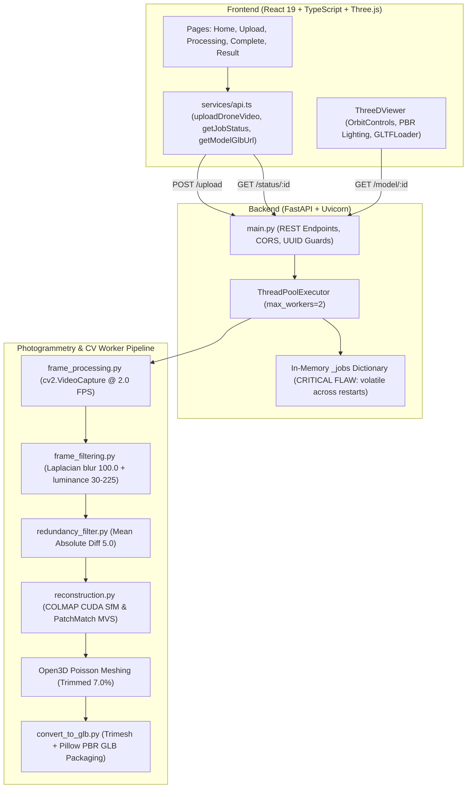

# GeoForge — Implementation Baseline & Technical Gap Analysis

> **Document:** `docs/IMPLEMENTATION_BASELINE.md`  
> **Status:** Code-Verified Technical Baseline (Phase 1 Complete)  
> **Last Verified:** 2026-11-11  
> **Target Audience:** Engineering Team, System Architects, AI Pair Programmers

---

## 1. Existing System Architecture

GeoForge is an end-to-end aerial photogrammetry system converting continuous drone/phone video into interactive 3D WebGL models.

---

## 2. Existing Verified Features

1. **Video Ingestion & Security:**
   - Container whitelisting (`.mp4, .mov, .avi, .mkv`).
   - File size ceiling: 4 GiB (`MAX_UPLOAD_BYTES`).
   - Filename sanitization (`Path(file.filename).name`).
   - UUID validation on all route parameters.
2. **Video Frame Extraction:**
   - OpenCV `cv2.VideoCapture` extraction at 2.0 FPS (`backend/frame_processing.py`).
3. **Computer Vision Quality Filtering:**
   - Laplacian variance blur detection with adaptive threshold lowering (`backend/frame_filtering.py`).
   - Luminance thresholding (rejecting frames with mean luminance $< 30$ or $> 225$).
   - Inter-frame redundancy reduction (`backend/redundancy_filter.py`).
4. **Photogrammetry & Point Cloud:**
   - COLMAP 3.9.1 (CUDA enabled) execution (`backend/reconstruction.py`).
   - Sequential feature matcher with 15-frame overlap and 32K visual words vocabulary tree.
   - PatchMatch stereo dense depth estimation.
   - Stereo fusion generating dense `fused.ply`.
   - Open3D statistical outlier removal and multi-threaded Poisson surface reconstruction with density trimming (7.0%).
5. **GLB Packaging:**
   - Trimesh and Pillow PBR GLB packager (`backend/convert_to_glb.py`).
6. **Frontend UI & WebGL Viewer:**
   - React 19 single-page UI (`Home`, `Upload`, `Processing`, `Complete`, `Result`).
   - Three.js WebGL canvas (`components/ThreeDViewer.tsx`) with OrbitControls and responsive bounding-box camera centering.

---

## 3. Partially Implemented Features

1. **Pipeline Stage Reporting:**
   - Backend pipeline executes 11 discrete internal steps, but status reporting to the frontend is coarse (`queued`, `processing`, `complete`, `failed`). Fine-grained stage names (`extracting_frames`, `filtering`, `sfm_matching`, `dense_stereo`, `meshing`, `exporting_glb`) are logged but not persisted in the status payload.
2. **Health Monitoring:**
   - `GET /health` returns static `{"status": "healthy"}` without probing COLMAP, GPU VRAM, disk space, or dependency health.
3. **Model Download:**
   - Users can retrieve models via `GET /model/{job_id}`, but an explicit `GET /download/{job_id}` endpoint with `Content-Disposition: attachment; filename="{job_id}_model.glb"` is missing.

---

## 4. Broken & High-Risk Features (Critical Technical Gaps)

### Bug 1: Non-Existent COLMAP Command `mesh_texturer`
- **Location:** `backend/reconstruction.py:1461`
- **Issue:** The script calls `run_colmap("mesh_texturer", ...)`. Standard COLMAP CLI 3.9.1 does not contain a `mesh_texturer` subcommand (it returns `Command mesh_texturer not recognized. Exit code 1`).
- **Consequence:** Reconstruction crashes at Step 10 before generating textured output.
- **Resolution:** Implement a fallback colorization and texturing routine that transfers dense point cloud RGB vertex colors to the Poisson mesh vertices using KDTree interpolation and/or synthesizes UV atlas textures, guaranteeing a valid `.ply` and texture for `convert_to_glb.py`.

### Bug 2: In-Memory Volatile Job Storage (`_jobs = {}`)
- **Location:** `backend/main.py:103`
- **Issue:** All job state is stored in a Python dictionary. Any backend crash, restart, or worker cycle wipes out all job history.
- **Consequence:** Users lose access to completed models after a server restart, violating Acceptance Criterion 14.
- **Resolution:** Implement a lightweight, zero-dependency persistent SQLite database (`backend/jobs.db`) with tables for job status, active stage, input filename, paths, diagnostics, and timestamps.

### Bug 3: Lack of Frontend Page Refresh Persistence
- **Location:** `frontend/src/App.tsx:40-75`
- **Issue:** `currentJob` and `currentRoute` are stored strictly in React component state. When a user presses F5 or navigates away, state reverts to `'home'`.
- **Consequence:** Users cannot inspect completed models upon refresh, violating Acceptance Criterion 13.
- **Resolution:** Store `currentJobId` in `localStorage` and support `?job_id=UUID` in URL parameters; automatically query `GET /status/{job_id}` on mount and restore state if complete.

### Bug 4: Rigid Texture Requirement in `convert_to_glb.py`
- **Location:** `backend/convert_to_glb.py:66-71`
- **Issue:** `convert_to_glb` raises a fatal `RuntimeError` if an external texture image file is not found, even if the mesh has high-quality vertex colors.
- **Resolution:** Allow `convert_to_glb` to package both UV textured meshes and vertex-colored meshes cleanly into GLB.

---

## 5. Existing Dependencies Inventory

### Backend (Python 3.12 64-bit `.venv`)
- `fastapi==0.162.4`, `uvicorn==0.54.0`, `python-multipart==0.0.33`
- `opencv-python==4.11.0.86`, `numpy==1.26.4` (`<2.0.0`)
- `open3d==0.20.0`, `trimesh==5.2.0`, `pillow==13.0.0`, `scipy==1.17.1`, `httpx==0.28.1`
- External Binaries: `COLMAP 3.9.1 (CUDA)`, `FFmpeg 9.0.2`, `MinGit 2.47.1`

### Frontend (Node.js v22.14.0 LTS)
- `react==^19.0.1`, `react-dom==^19.0.1`, `three==^0.185.1`, `@types/three==^0.185.4`
- `lucide-react==^0.546.0`, `motion==^12.23.24`, `tailwindcss==^4.1.14`, `vite==^6.2.3`

---

## 6. Existing vs. Required API Endpoints

| Method | Endpoint | Existing State | Required Action / Enhancement |
|---|---|---|---|
| `GET` | `/` | Implemented | Return service name, version, status. |
| `GET` | `/health` | Static `{"status": "healthy"}` | Enhance to probe COLMAP, GPU, disk space, and worker queue. |
| `POST` | `/upload` | Functional | Stream upload, validate video content via OpenCV, persist in SQLite. |
| `GET` | `/status/{job_id}` | Functional (Volatile) | Connect to SQLite; include granular `stage`, `progress_percent`, `details`. |
| `GET` | `/model/{job_id}` | Functional | Serve GLB model with proper caching headers. |
| `GET` | `/download/{job_id}` | Missing | Implement file attachment download (`Content-Disposition`). |
| `DELETE` | `/jobs/{job_id}` | Missing | Implement safe job cancellation and workspace cleanup. |

---

## 7. Known Technical Risks & Mitigation

| Technical Risk | Root Cause | Impact | Mitigation Strategy |
|---|---|---|---|
| **Out-of-Memory (GPU VRAM)** | Dense PatchMatch stereo on 4K imagery. | CUDA OOM error (code 1). | Enforce `PATCHMATCH_MAX_IMAGE_SIZE = 2000` and limit concurrent reconstructions to 2. |
| **Sparse Reconstruction Failure** | Low-texture drone video (water, snow, sky). | `< MIN_REGISTRATION_RATIO`. | Adaptive frame selection + clear diagnostic error reporting. |
| **Disk Saturation** | Multiple dense reconstructions ($> 5$ GB per run). | `ENOSPC` disk write failure. | Background cleanup job deleting intermediate dense files after retention period. |

---

## 8. Exact Files Requiring Modification

1. `backend/main.py`: Add SQLite job persistence, enhance `/health`, add `/download/{job_id}` and `/jobs/{job_id}`, wire detailed stage updates.
2. `backend/database.py`: **NEW** — Lightweight SQLite manager for job lifecycle and persistence.
3. `backend/reconstruction.py`: Fix step 10 texturing/colorization (replace unsupported `mesh_texturer` with Open3D/Trimesh color transfer & atlas mapping), add stage progress callback.
4. `backend/convert_to_glb.py`: Support vertex colors seamlessly when separate texture image is absent.
5. `frontend/src/App.tsx`: Add URL/localStorage job recovery on page refresh.
6. `frontend/src/services/api.ts`: Add `getHealth()`, `cancelJob()`, `downloadModel()`.
7. `frontend/src/components/ThreeDViewer.tsx`: Enhance model bounding box calculation, reset camera, and error handling.

---

## 9. Recommended Implementation Order

1. **Step 1:** Implement SQLite Job Persistence (`backend/database.py`).
2. **Step 2:** Refactor `backend/main.py` with persistent jobs, detailed `/health`, `/download/{id}`, `/jobs/{id}`.
3. **Step 3:** Repair `backend/reconstruction.py` (fix `mesh_texturer`, add KDTree color transfer and stage reporting).
4. **Step 4:** Enhance `backend/convert_to_glb.py` for flexible material/color packaging.
5. **Step 5:** Enhance `frontend/src/App.tsx` and `services/api.ts` for page refresh recovery and granular progress display.
6. **Step 6:** Run live test suite and synthetic/real video reconstruction end-to-end.
7. **Step 7:** Document outcomes in `docs/TEST_RESULTS.md` and `docs/DEPLOYMENT_READINESS.md`.

