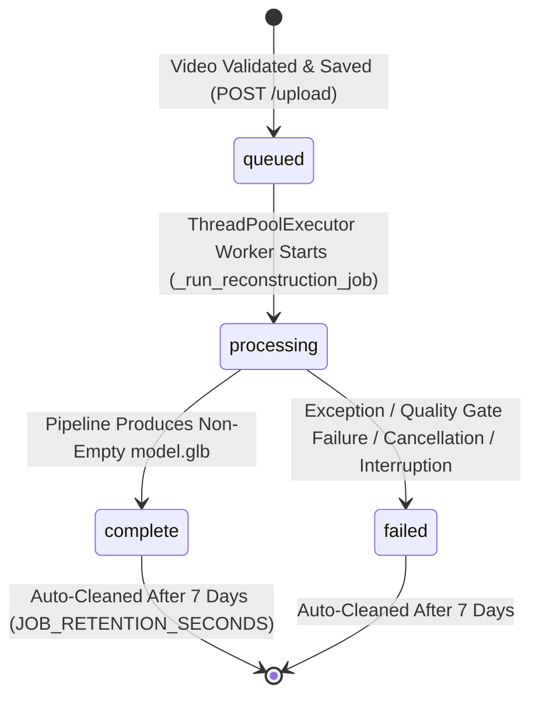

# Job Management & Worker Lifecycle Specification — GeoForge

> **Document:** `docs/JOB_MANAGEMENT.md`  
> **Status:** Code-Verified Job Management Specification (Phase 3 Verified)  
> **Target Version:** GeoForge v1.0.0 (SIH 2026 / NTRO Edition)  
> **Source Verification Date:** 2026-11-11  
> **Related Documents:** [`docs/API.md`](file:///c:/Users/adity/Downloads/geoforge-main/geoforge-main/docs/API.md), [`docs/BACKEND.md`](file:///c:/Users/adity/Downloads/geoforge-main/geoforge-main/docs/BACKEND.md), [`docs/ARCHITECTURE.md`](file:///c:/Users/adity/Downloads/geoforge-main/geoforge-main/docs/ARCHITECTURE.md)

---

## 1. Job State Model (`backend/main.py:101-105`)

Jobs are governed by the `JobStatus` string enum:

```python
class JobStatus(str, Enum):
    QUEUED      = "queued"
    PROCESSING  = "processing"
    COMPLETE    = "complete"
    FAILED      = "failed"
```



---

## 2. Persistent SQLite Job Store (`backend/database.py`)

All job state is tracked persistently in SQLite at `backend/jobs.db`. An in-memory cache (`_jobs`) is retained for rapid lookups, but the SQLite database is the primary source of truth.

### 2.1 Table Schema (`backend/database.py:33-57`)

```sql
CREATE TABLE IF NOT EXISTS jobs (
    job_id TEXT PRIMARY KEY,
    filename TEXT NOT NULL,
    status TEXT NOT NULL,
    stage TEXT NOT NULL,
    progress_percent INTEGER NOT NULL DEFAULT 0,
    stage_message TEXT,
    video_path TEXT,
    job_dir TEXT,
    model_path TEXT,
    result_json TEXT,
    error_message TEXT,
    created_at TEXT NOT NULL,
    updated_at TEXT NOT NULL,
    completed_at TEXT
);

CREATE INDEX IF NOT EXISTS idx_jobs_status ON jobs(status);
CREATE INDEX IF NOT EXISTS idx_jobs_created_at ON jobs(created_at);
```

### 2.2 Database Operations

| Function | Signature | Purpose |
|---|---|---|
| `init_db()` | `() -> None` | Creates table, indices, and executes auto-migrations. |
| `check_db_connectivity()` | `() -> bool` | Probes SQLite health via `SELECT 1` for `/ready` endpoint. |
| `create_job()` | `(job_id, filename, video_path, job_dir) -> dict` | Inserts initial record with `status="queued"`. |
| `get_job()` | `(job_id) -> Optional[dict]` | Reads complete job record and deserializes `result_json`. |
| `list_jobs()` | `(limit=50) -> List[dict]` | Returns most recent jobs ordered by `created_at DESC`. |
| `update_job_progress()` | `(job_id, status, stage, progress_percent, ...) -> Optional[dict]` | Updates progress, stage message, error details, and `completed_at`. |
| `cancel_job()` | `(job_id) -> bool` | Flags job as cancelled and records cancellation reason. |
| `recover_interrupted_jobs()` | `() -> int` | Flags any lingering `"processing"` jobs as `"failed"` upon startup. |
| `delete_job()` | `(job_id) -> bool` | Cleans up job record after retention expiration. |

---

## 3. Worker Concurrency & Capacity Protection (`backend/main.py:90-95, 586-603`)

- **Hardware Sizing Constraint:** GeoForge runs on a Dell G15 with 16 GB RAM and an NVIDIA RTX 3050 Laptop GPU (6 GB VRAM).
- **Concurrency Limit:** `MAX_CONCURRENT_RECONSTRUCTIONS = 1`.
- **Worker Execution:** Dedicated thread pool `_executor = ThreadPoolExecutor(max_workers=MAX_CONCURRENT_RECONSTRUCTIONS)`.
- **Pre-Execution Capacity Guard:** In `POST /upload`, before dispatching a worker:
  ```python
  active_jobs = [j for j in database.list_jobs(20) if j.get("status") == "processing"]
  if len(active_jobs) >= MAX_CONCURRENT_RECONSTRUCTIONS:
      raise HTTPException(
          status_code=503,
          detail=f"Reconstruction server is at capacity ({MAX_CONCURRENT_RECONSTRUCTIONS} jobs running). Please try again in a few minutes."
      )
  ```
  This strictly prevents simultaneous COLMAP or Open3D executions that would cause CUDA Out-of-Memory (OOM) crashes or host RAM paging lockups.

---

## 4. Pipeline Stages and Progress Mapping

During worker execution, the job transitions through structured stages tracked in `database.py`:

| Stage Identifier | Progress % | Stage Description |
|---|---|---|
| `queued` | 0% | Video uploaded and queued for processing |
| `extracting_frames` | 10% | Extracting frames at 2.0 FPS via OpenCV |
| `filtering_images` | 15% | Filtering blurry frames via Laplacian variance |
| `redundancy_filter`| 20% | Removing redundant frames via mean absolute difference |
| `feature_extraction`| 35% | COLMAP SIFT feature extraction on GPU |
| `feature_matching` | 50% | COLMAP exhaustive feature matching |
| `sparse_reconstruction` | 60% | COLMAP sparse structure-from-motion mapper |
| `dense_stereo` | 75% | COLMAP PatchMatch dense MVS stereo |
| `dense_fusion` | 85% | COLMAP depth map fusion into point cloud |
| `meshing` | 92% | Open3D Screened Poisson surface reconstruction |
| `texturing` | 96% | Point cloud KDTree color transfer & UV texturing |
| `exporting_glb` | 98% | Trimesh packaging into binary glTF v2 (.glb) |
| `completed` | 100% | Model verified and ready for visualization and download |
| `failed` | Current % | Pipeline halted due to error or quality gate rejection |

---

## 5. Server Crash & Interruption Recovery

When the backend restarts:
1. `main.py` invokes `database.recover_interrupted_jobs()` during the `@app.on_event("startup")` lifecycle.
2. Any job with `status = "processing"` is transitioned to `status = "failed"` with:
   `error_message = "Reconstruction was interrupted by a server restart. Please upload again."`
3. When the frontend polls `GET /status/{job_id}`, it receives `status: "failed"` and displays a clear explanation with a restart prompt, halting the polling timer cleanly.
