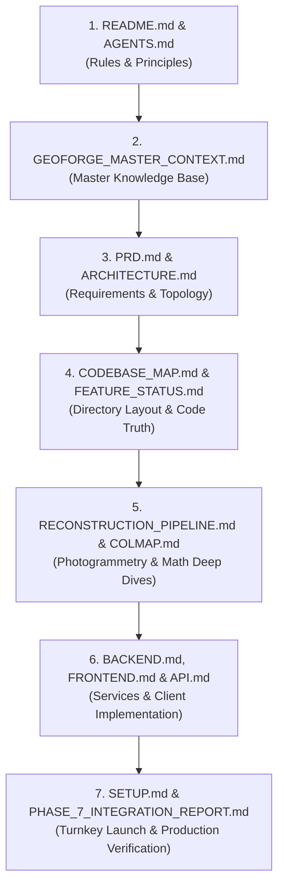

# Master Documentation Index — GeoForge

> **Document:** `docs/MASTER_DOCUMENTATION_INDEX.md`  
> **Status:** Canonical Master Documentation Catalog (Phase 7 Integration Verified)  
> **Target Version:** GeoForge v1.0.0 (SIH 2026 / NTRO Edition)  
> **Total Active Master Documents:** 42

---

## 1. Documentation Map & Navigation

The `docs/` directory is the single authoritative, code-verified technical documentation system for GeoForge. All historical documents from `doc old/` have been consolidated into these master files.

### 1.1 Core Specifications & Strategy
| Document | File Path | Scope & Purpose |
|---|---|---|
| **Master Technical Context** | [`GEOFORGE_MASTER_CONTEXT.md`](GEOFORGE_MASTER_CONTEXT.md) | 20-section master reference knowledge base for SIH 2026 / NTRO problem statement SIH26158. |
| **Project Overview** | [`PROJECT_OVERVIEW.md`](PROJECT_OVERVIEW.md) | Project identity, problem statement, target users, deliverables, and user journey. |
| **Product Requirements (PRD)**| [`PRD.md`](PRD.md) | Complete 15 Functional Requirements (`FR-001`–`FR-015`) and 8 Non-Functional Requirements. |
| **Feature Status Register** | [`FEATURE_STATUS.md`](FEATURE_STATUS.md) | Code-verified feature inventory mapping features to exact source files and line ranges. |
| **Implementation Progress** | [`IMPLEMENTATION_PROGRESS.md`](IMPLEMENTATION_PROGRESS.md) | Traceability register tracking implementation state, tests, results, and limitations. |
| **System Architecture** | [`ARCHITECTURE.md`](ARCHITECTURE.md) | Multi-tier architecture diagram, verified filesystem layout (`backend/uploads/` and `temp/`), trust boundaries. |
| **UI/UX Design Specification**| [`UI_UX_DESIGN.md`](UI_UX_DESIGN.md) | Visual design system, page states, interaction patterns, accessibility standards. |
| **Architecture Decision Records**| [`DECISIONS.md`](DECISIONS.md) | Architectural Decision Records (ADRs) and trade-off rationale. |
| **Development Roadmap** | [`ROADMAP.md`](ROADMAP.md) | Prioritized milestones (Phase 1 Prototype, Phase 2 Robustness, Phase 3 Scaling). |

### 1.2 Reconstruction & Computer Vision Pipeline Deep Dives
| Document | File Path | Scope & Purpose |
|---|---|---|
| **Reconstruction Pipeline** | [`RECONSTRUCTION_PIPELINE.md`](RECONSTRUCTION_PIPELINE.md) | 8-stage photogrammetric pipeline, Laplacian blur, luminance, and redundancy math. |
| **Photogrammetry Fundamentals**| [`PHOTOGRAMMETRY_FUNDAMENTALS.md`](PHOTOGRAMMETRY_FUNDAMENTALS.md) | Optical principles, baseline/parallax constraints, flight capture recommendations. |
| **COLMAP Integration Guide** | [`COLMAP.md`](COLMAP.md) | SIFT extraction, sequential matching, single-model SfM flag, binary model quality gates. |
| **Open3D Processing Guide** | [`OPEN3D.md`](OPEN3D.md) | Statistical outlier removal (`nb=20, std=2.0`), normal estimation, Screened Poisson meshing. |
| **Mesh, Texture & GLB Output** | [`MESH_AND_GLB.md`](MESH_AND_GLB.md) | COLMAP texture projection, Trimesh & Pillow PBR material attachment, Three.js viewer. |

### 1.3 Engineering & Implementation Reference
| Document | File Path | Scope & Purpose |
|---|---|---|
| **Backend Architecture** | [`BACKEND.md`](BACKEND.md) | FastAPI service layout, module responsibilities, configuration constants. |
| **Frontend Architecture** | [`FRONTEND.md`](FRONTEND.md) | React 19/Vite/Three.js client, state machine, npm scripts, unified SPA mount. |
| **REST API Specification** | [`API.md`](API.md) | Verified REST API endpoints, JSON request/response schemas, status enums. |
| **Job Management & Lifecycle** | [`JOB_MANAGEMENT.md`](JOB_MANAGEMENT.md) | ThreadPool concurrency (max 1), SQLite persistence, 7-day retention delay. |
| **Configuration Reference** | [`CONFIGURATION.md`](CONFIGURATION.md) | Pipeline constants, environment variables (`COLMAP_EXE`, `ALLOWED_ORIGINS`). |
| **Local Development Setup** | [`SETUP.md`](SETUP.md) | Step-by-step setup guide, pip commands, and turnkey `start_geoforge.bat` launcher. |
| **Technology Stack** | [`TECH_STACK.md`](TECH_STACK.md) | Exact verified package versions from `package.json` and backend dependencies. |
| **Software Inventory** | [`SOFTWARE_INVENTORY.md`](SOFTWARE_INVENTORY.md) | Complete inventory of runtimes, packages, and external CLI binaries. |
| **Dependency & Installation Guide** | [`DEPENDENCY_AND_SOFTWARE_INSTALLATION_GUIDE.md`](DEPENDENCY_AND_SOFTWARE_INSTALLATION_GUIDE.md) | Workstation dependency audit, Python 3.12 vs 3.15 analysis, Windows 11 installation manual. |
| **Installation & Verification Report** | [`INSTALLATION_AND_ENVIRONMENT_REPORT.md`](INSTALLATION_AND_ENVIRONMENT_REPORT.md) | Code-verified installation audit report of Python 3.12, CUDA, COLMAP, Node 22, and 15 validation checks. |
| **Deployment Guide** | [`DEPLOYMENT.md`](DEPLOYMENT.md) | Turnkey single-port deployment (`http://localhost:8000`) and decoupled enterprise scaling. |

### 1.4 Quality Assurance, Governance & Tooling
| Document | File Path | Scope & Purpose |
|---|---|---|
| **Codebase Map** | [`CODEBASE_MAP.md`](CODEBASE_MAP.md) | Full repository directory tree and active `backend/` vs. legacy `src/` demarcation. |
| **Development Workflow** | [`DEVELOPMENT_WORKFLOW.md`](DEVELOPMENT_WORKFLOW.md) | 11-step coding protocol and Pull Request acceptance checklist. |
| **Code & Feature Matrix** | [`CODE_AND_FEATURE_MATRIX.md`](CODE_AND_FEATURE_MATRIX.md) | Function-level verification matrix mapping features to backend/frontend code symbols. |
| **Testing & Acceptance Matrix**| [`TESTING.md`](TESTING.md) | 10-scenario end-to-end acceptance test matrix and quality commands. |
| **Troubleshooting Guide** | [`TROUBLESHOOTING.md`](TROUBLESHOOTING.md) | Root cause analysis and step-by-step fixes for common failures. |
| **Security Architecture** | [`SECURITY.md`](SECURITY.md) | Threat models, upload safety, subprocess isolation, CORS controls. |
| **Security & Accuracy Notes** | [`SECURITY_AND_ACCURACY_NOTES.md`](SECURITY_AND_ACCURACY_NOTES.md) | Metric accuracy disclaimers and operational safety guidelines. |
| **Glossary of Terms** | [`GLOSSARY.md`](GLOSSARY.md) | Definitions for photogrammetry, computer vision, and systems terminology. |
| **Changelog** | [`CHANGELOG.md`](CHANGELOG.md) | Chronological development and documentation change history. |
| **Documentation Migration Plan**| [`DOCUMENTATION_MIGRATION_PLAN.md`](DOCUMENTATION_MIGRATION_PLAN.md)| Approved Phase 1 file-by-file consolidation blueprint. |
| **Documentation Migration Report**| [`DOCUMENTATION_MIGRATION_REPORT.md`](DOCUMENTATION_MIGRATION_REPORT.md)| Detailed audit report comparing `doc old/` vs `docs/` against source code. |
| **Final Quality Audit Report** | [`DOCUMENTATION_FINAL_AUDIT.md`](DOCUMENTATION_FINAL_AUDIT.md) | Authoritative final quality audit and verification verdict across all documentation. |

### 1.5 Phase 7 Production Consolidation & Integration Reports
| Document | File Path | Scope & Purpose |
|---|---|---|
| **Pre-Implementation Progress Audit** | [`GEOFORGE_COMPLETE_DEVELOPMENT_PROGRESS_REPORT.md`](GEOFORGE_COMPLETE_DEVELOPMENT_PROGRESS_REPORT.md) | Complete pre-implementation architectural audit assessing baseline completion (~85%). |
| **Gate 1 Backup & Verification Report** | [`BACKUP_REPORT.md`](BACKUP_REPORT.md) | Cryptographic snapshot report verifying 1,122 backed up files, SQLite consistency, and zip archive. |
| **Gate 2 Integration & Verification Report**| [`INTEGRATION_VERIFICATION_REPORT.md`](INTEGRATION_VERIFICATION_REPORT.md) | Application integration report: HistoryPage routing, single-server SPA mount, package pruning. |
| **Gate 3 Asset Migration Report** | [`MIGRATION_REPORT.md`](MIGRATION_REPORT.md) | Zero-deletion asset migration report verifying 6 uploads and 4 workspaces into root repository. |
| **Gate 4 Cleanup & Consolidation Report** | [`CLEANUP_AUDIT_REPORT.md`](CLEANUP_AUDIT_REPORT.md) | Structural consolidation audit verifying deletion of nested clone and reclamation of 1,217.95 MB. |
| **Master Phase 7 Integration Report** | [`PHASE_7_INTEGRATION_REPORT.md`](PHASE_7_INTEGRATION_REPORT.md) | Canonical Phase 7 synthesis certifying GeoForge v1.0.0 production readiness for SIH 2026 and NTRO. |
| **Phase 7 Final Acceptance Report** | [`PHASE_7_FINAL_ACCEPTANCE_REPORT.md`](PHASE_7_FINAL_ACCEPTANCE_REPORT.md) | Authoritative final end-to-end acceptance testing report certifying complete pipeline execution. |

### 1.6 Phase 8 Cloud Deployment Planning Documents
| Document | File Path | Scope & Purpose |
|---|---|---|
| **Phase 8 Deployment Strategy** | [`PHASE_8_DEPLOYMENT_STRATEGY.md`](PHASE_8_DEPLOYMENT_STRATEGY.md) | Authoritative strategy blueprint for public internet accessibility and decoupled architecture. |
| **Cloud Architecture Specification** | [`CLOUD_ARCHITECTURE.md`](CLOUD_ARCHITECTURE.md) | Detailed topology, component specs, sequence flows, and self-healing protocols. |
| **Deployment Provider Comparison** | [`DEPLOYMENT_PROVIDER_COMPARISON.md`](DEPLOYMENT_PROVIDER_COMPARISON.md) | In-depth benchmarking of 14 cloud services across frontend, API, database, storage, and GPU. |
| **Cloud Cost Estimates (USD & INR)** | [`CLOUD_COST_ESTIMATES.md`](CLOUD_COST_ESTIMATES.md) | Unit economics, 3 usage scenarios, fixed vs variable models, and hard spending limits. |
| **Deployment Implementation Roadmap** | [`DEPLOYMENT_IMPLEMENTATION_ROADMAP.md`](DEPLOYMENT_IMPLEMENTATION_ROADMAP.md) | Staged 9-step execution plan with effort, dependencies, risks, criteria, and rollback gates. |
| **Production Environment Configuration**| [`PRODUCTION_ENVIRONMENT_CONFIGURATION.md`](PRODUCTION_ENVIRONMENT_CONFIGURATION.md)| Complete `.env.production` contracts, multi-stage Dockerfiles, and reverse proxy rules. |

---

## 2. Recommended Reading Sequence for Developers

---

## 3. Maintenance Principles

- **Single Source of Truth:** Never maintain parallel documentation files for the same feature. Update the canonical master document in `docs/`.
- **Code Truth First:** Documentation must always reflect the actual, verified source code. Never document aspirational features as implemented.
- **Synchronized Updates:** When modifying backend or frontend APIs, immediately update [`API.md`](API.md), [`CODE_AND_FEATURE_MATRIX.md`](CODE_AND_FEATURE_MATRIX.md), and [`CHANGELOG.md`](CHANGELOG.md).
