# Mesh Generation, Texturing, and GLB Output Specification — GeoForge

> **Document:** `docs/MESH_AND_GLB.md`  
> **Status:** Code-Verified Mesh & GLB Specification (Phase 3 Verified)  
> **Target Version:** GeoForge v1.0.0 (SIH 2026 / NTRO Edition)  
> **Source Verification Date:** 2026-11-11  
> **Related Documents:** [`docs/OPEN3D.md`](file:///c:/Users/adity/Downloads/geoforge-main/geoforge-main/docs/OPEN3D.md), [`docs/RECONSTRUCTION_PIPELINE.md`](file:///c:/Users/adity/Downloads/geoforge-main/geoforge-main/docs/RECONSTRUCTION_PIPELINE.md), [`docs/FRONTEND.md`](file:///c:/Users/adity/Downloads/geoforge-main/geoforge-main/docs/FRONTEND.md)

---

## 1. Overview & Conversion Architecture

The final stages of the GeoForge pipeline convert untextured surface geometry into an interactive, photorealistic binary 3D model (GLB) suitable for streaming and rendering in WebGL browsers:

```mermaid
flowchart LR
    CleanCloud["Cleaned Cloud<br/>(fused_cleaned.ply)"] --> Poisson["Open3D Poisson Meshing<br/>(depth=11, trim=7%)"]
    Poisson --> MeshPly["Surface Mesh<br/>(colmap/mesh/poisson_mesh.ply)"]
    MeshPly --> ColmapTex["COLMAP mesh_texturer<br/>(Undistorted Images)"]
    ColmapTex --> TexturedObj["Textured Assets<br/>(model.ply / model.obj + model.png)"]
    TexturedObj --> TrimeshConv["Trimesh & Pillow PBR<br/>(convert_to_glb.py)"]
    TrimeshConv --> FinalGLB["Binary GLTF 2.0<br/>(colmap/textured/model.glb)"]
    FinalGLB --> ThreeJS["Three.js GLTFLoader<br/>(ThreeDViewer.tsx)"]
```



---

## 2. Texturing via COLMAP `mesh_texturer` (`backend/reconstruction.py:1441-1531`)

Once `colmap/mesh/poisson_mesh.ply` is created:
1. **Invocation:** The worker executes `colmap mesh_texturer`:
   ```bash
   colmap mesh_texturer \
     --workspace_path backend/temp/{job_id}/colmap/dense \
     --input_path backend/temp/{job_id}/colmap/mesh/poisson_mesh.ply \
     --output_path backend/temp/{job_id}/colmap/textured
   ```
2. **Artifacts Emitted in `colmap/textured/`:**
   - `model.ply`: Stanford PLY mesh with vertex color information.
   - `model.obj`: Wavefront OBJ with explicit `vt` UV texture coordinates.
   - `model.mtl`: Wavefront material file.
   - `model.png`: High-resolution composite diffuse texture atlas.
3. **Texture Image Discovery:**
   `backend/main.py:273-281` scans `colmap/textured/` for `*.png` and `*.jpg` candidates, selecting the primary diffuse atlas.

---

## 3. GLB Packaging Implementation (`backend/convert_to_glb.py`)

WebGL runtimes require compressed, self-contained 3D assets. GeoForge standardizes on **glTF 2.0 Binary (`.glb`)**.

### 3.1 Conversion Pipeline (`convert_to_glb`)
```python
def convert_to_glb(ply_file: Path, texture_file: Path, glb_file: Path) -> Path:
    # 1. Load geometry
    mesh = trimesh.load(ply_file, force="mesh", process=False)

    # 2. Flatten scene if OBJ/PLY loaded as multi-part scene
    if isinstance(mesh, trimesh.Scene):
        meshes = [g for g in mesh.geometry.values() if isinstance(g, trimesh.Trimesh)]
        if not meshes:
            raise RuntimeError("No valid mesh geometry found inside the PLY.")
        mesh = trimesh.util.concatenate(meshes)

    # 3. Check vertices and faces
    if len(mesh.vertices) == 0 or len(mesh.faces) == 0:
        raise RuntimeError("PLY mesh contains no vertices or faces.")

    # 4. Load texture image with Pillow
    texture = Image.open(texture_file)
    texture.load()

    # 5. Bind PBR Material with UVs
    uv = getattr(mesh.visual, "uv", None)
    if uv is not None:
        material = trimesh.visual.material.PBRMaterial(baseColorTexture=texture)
        mesh.visual = trimesh.visual.TextureVisuals(uv=uv, image=texture, material=material)
    else:
        logger.warning("Exporting geometry without UV texture mapping.")

    # 6. Export binary GLB
    glb_file.parent.mkdir(parents=True, exist_ok=True)
    mesh.export(glb_file, file_type="glb")

    # 7. Validate non-empty output
    if not glb_file.exists() or glb_file.stat().st_size == 0:
        raise RuntimeError("GLB file was not created or is empty.")

    return glb_file
```

---

## 4. Serving & WebGL Viewport Integration

### 4.1 Backend Resolution (`backend/main.py:547-550`)
The helper `_resolve_glb(job_id)` resolves the final model path to:
```python
TEMP_DIR / job_id / "colmap" / "textured" / "model.glb"
```
Served over `GET /model/{job_id}` as `FileResponse(media_type="model/gltf-binary", filename="model.glb", headers={"Cache-Control": "no-cache"})`.

### 4.2 Three.js Viewer Features (`frontend/src/components/ThreeDViewer.tsx`)
- **Loader:** Three.js `GLTFLoader`.
- **Lighting Setup:**
  - Ambient Light: Hex `#ffffff`, intensity `0.6`.
  - Directional Sun Light: Hex `#ffffff`, intensity `0.8` at $(10, 20, 15)$.
  - Secondary Fill Light: Hex `#ffffff`, intensity `0.3` at $(-10, -10, -10)$.
- **Dynamic Bounding:** Auto-centers geometry at origin via `THREE.Box3().setFromObject(model)` and sets camera distance to $1.5 \times$ bounding radius.
- **Controls & Helpers:** OrbitControls, Wireframe toggle, Ground Grid (`THREE.GridHelper`), and Coordinate Axes (`THREE.AxesHelper`).
- **Memory Management:** Traverses scene graph on unmount, disposing of geometries, materials, and textures to prevent WebGL context leaks.
