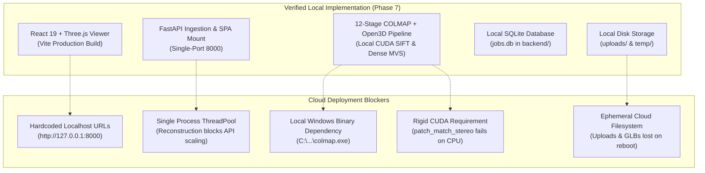
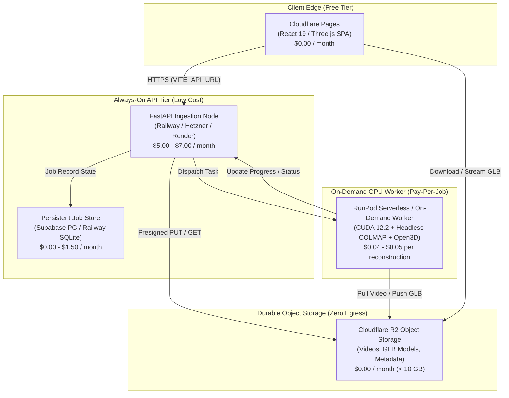

# GeoForge Phase 8 — Cloud Deployment Strategy & Production Blueprint

> **Document:** `PHASE_8_DEPLOYMENT_STRATEGY.md`  
> **Status:** Authoritative Architectural Strategy (Planning Stage — Pre-Implementation)  
> **Target Version:** GeoForge v1.1.0 Cloud Architecture  
> **Scope:** Cloud Deployment Planning & Internet Accessibility  
> **Author:** Antigravity Engineering Team  
> **Last Verified:** 2026-11-14  
> **Related Documents:** [`docs/CLOUD_ARCHITECTURE.md`](CLOUD_ARCHITECTURE.md), [`docs/DEPLOYMENT_PROVIDER_COMPARISON.md`](DEPLOYMENT_PROVIDER_COMPARISON.md), [`docs/CLOUD_COST_ESTIMATES.md`](CLOUD_COST_ESTIMATES.md), [`docs/DEPLOYMENT_IMPLEMENTATION_ROADMAP.md`](DEPLOYMENT_IMPLEMENTATION_ROADMAP.md), [`docs/PRODUCTION_ENVIRONMENT_CONFIGURATION.md`](PRODUCTION_ENVIRONMENT_CONFIGURATION.md)

---

## 1. Project Context & Direction

GeoForge is being developed as an independent software application dedicated to single-pass drone video to 3D model reconstruction.

### 1.1 The Primary Objective
The immediate goal is straightforward and focused: **Make GeoForge accessible over the public internet** via a standard browser URL so that users can:
1. Open the application in any modern web browser without needing local software installation.
2. Upload a drone or handheld camera video (.mp4, .mov, .avi, .mkv).
3. Submit the flight video for automated 3D photogrammetric reconstruction.
4. Track real-time reconstruction progress across all processing stages.
5. Inspect the synthesized 3D model directly in the interactive Three.js WebGL viewer.
6. Download the resulting textured 3D binary model (`.glb`) and telemetry metadata.
7. Access previously completed reconstructions from persistent job history.

### 1.2 Pragmatic Non-Commercial Discipline
> [!IMPORTANT]
> **No Premature Commercialization or Enterprise Bloat:**  
> GeoForge is **not** currently being launched as a startup or commercial enterprise. At this stage, the project will **deliberately avoid**:
> - Payment gateways (Stripe, Razorpay, LemonSqueezy).
> - Subscription tiers, metered credit wallets, or paywalls.
> - Multi-tenant team billing, enterprise IAM, and complex organization hierarchies.
> - Multi-region Kubernetes clusters, service meshes (Istio), or heavy orchestration.
> 
> The architecture must remain simple, lightweight, and maintainable, while avoiding design decisions that would make future expansion difficult.

---

## 2. Codebase Audit: Code Truth vs. Cloud Readiness

The Phase 7 acceptance test proved that the local pipeline on a Windows 11 workstation with an NVIDIA RTX 3050 Laptop GPU functions reliably. However, **local operational verification does not equal public cloud readiness**.

The following audit explicitly separates what is verified code truth from what currently blocks internet deployment:



### 2.1 Component-by-Component Reality Assessment

| Component | Verified Implementation in Codebase | Cloud Deployment Blocker | Cloud Readiness Verdict |
|---|---|---|:---:|
| **Frontend Client** | React 19, Vite, Three.js, Tailwind v4. Compiles clean static assets to `frontend/dist/`. | `VITE_API_URL` defaults to `http://127.0.0.1:8000` if not set at build time. | **HIGH (Needs build env flag)** |
| **Backend API** | FastAPI 0.162.4, Uvicorn 0.54.0. Clean REST endpoints: `/upload`, `/status/{id}`, `/model/{id}`, `/download/{id}`, `/jobs`, `/metadata/{id}`. | Concurrency limit `MAX_CONCURRENT_RECONSTRUCTIONS=1` tightly coupled to host RAM/VRAM. Long jobs run in in-process `ThreadPoolExecutor`. | **MEDIUM (Needs process decoupling)** |
| **Database** | SQLite `jobs.db` via `backend/database.py`. Tracks 14 columns across job lifecycle. Recovers interrupted jobs on startup. | SQLite stored on local filesystem. On ephemeral cloud containers (e.g. Render/Heroku/K8s pods), restarts wipe the `.db` file. | **MEDIUM (Needs persistent volume or hosted DB)** |
| **File Storage** | Local NTFS filesystem: `backend/uploads/` (videos) and `backend/temp/{job_id}/` (COLMAP workspace & `model.glb`). | Ephemeral cloud containers destroy all uploaded videos and generated GLBs upon redeployment or instance spin-down. | **BLOCKER (Requires Object Storage)** |
| **Reconstruction Engine** | 12-stage pipeline in `backend/reconstruction.py`. Invokes external `colmap.exe` CLI, OpenCV, Open3D Poisson mesher, and Trimesh. | Hardcoded to Windows paths (`colmap.exe`, `windows_path()`). **COLMAP `patch_match_stereo` strictly requires an NVIDIA CUDA GPU**; fails immediately on CPU-only VMs. | **BLOCKER (Requires Linux CUDA Container & GPU worker)** |

---

## 3. The Core Compute Challenge: CPU vs. GPU Photogrammetry

A central architectural decision for cloud deployment is determining where and how the photogrammetry worker executes.

### 3.1 Can GeoForge Run on CPU-Only Cloud Instances?
To answer this definitively, we audited every stage of `backend/reconstruction.py`:

1. **Video Ingestion & Frame Extraction (`cv2.VideoCapture`):** Runs purely on CPU. Fast (1–3 seconds).
2. **Laplacian Blur & Redundancy Filtering (`frame_filtering.py`):** Runs purely on CPU. Fast (1–2 seconds).
3. **SIFT Feature Extraction (`colmap feature_extractor`):** Supports CPU fallback via `--SiftExtraction.use_gpu 0`. CPU SIFT takes ~45 seconds for 30 frames on 8 cores.
4. **Sequential Feature Matching (`colmap sequential_matcher`):** Supports CPU fallback via `--SiftMatching.use_gpu 0`. Takes ~15 seconds on CPU.
5. **Sparse SfM Mapper (`colmap mapper`):** Runs on CPU via Ceres Solver multi-threaded bundle adjustment. Takes ~60–90 seconds.
6. **Image Undistortion (`colmap image_undistorter`):** Runs purely on CPU. Takes ~5 seconds.
7. **Dense Stereo Matching (`colmap patch_match_stereo`):** **CRITICAL HARD BLOCKER.**  
   COLMAP's PatchMatch stereo matching is implemented strictly in NVIDIA CUDA C++ kernels (`src/colmap/mvs/patch_match_cuda.cu`). **COLMAP has no native CPU implementation for dense stereo**. Invocations on a machine lacking an active NVIDIA CUDA driver abort with an immediate fatal exception: `ERROR: Feature requires CUDA`.
8. **Stereo Fusion (`colmap stereo_fusion`):** Runs on CPU. Takes ~10 seconds.
9. **Point Cloud Cleaning (`open3d.geometry.PointCloud`):** Runs on CPU. Takes ~2 seconds.
10. **Poisson Surface Meshing (`open3d.geometry.TriangleMesh`):** Runs on CPU. Takes ~5 seconds.
11. **Texturing & Color Transfer (`scipy.spatial.cKDTree`):** Runs on CPU. Takes ~2 seconds.
12. **Binary GLB Conversion (`trimesh` + `PIL`):** Runs on CPU. Takes ~1 second.

> [!CAUTION]
> **Definitive Finding:**  
> **A GPU is non-negotiable for GeoForge's dense photogrammetry pipeline.** Without an NVIDIA GPU supporting CUDA Compute Capability $\ge 6.0$, the current dense reconstruction pipeline cannot complete. A cloud deployment must provide access to an NVIDIA GPU for the worker.

### 3.2 The Economics of Cloud GPUs: Always-Running vs. On-Demand
Running a dedicated GPU virtual machine continuously 24 hours a day, 7 days a week, is financially wasteful when reconstructions are performed intermittently:

- **24/7 Dedicated GPU Instance (e.g. AWS `g4dn.xlarge` or GCP `g2`):**  
  Costs **$0.53 to $0.75 per hour** = **$380 to $540 per month** ($\approx ₹32,000\text{--}₹46,000\text{/month}$), even if 0 reconstructions are performed.
- **On-Demand / Serverless GPU Worker (e.g. RunPod Serverless or On-Demand Pods):**  
  Costs **$0.0002 to $0.0004 per second** ($0.58 to $0.74/active hour). For an average 4.4-minute (265-second) reconstruction, the actual compute cost is **$0.04 to $0.06 per reconstruction** ($\approx ₹3.50\text{--}₹5.00$ per model). When no jobs are running, compute cost is **$0.00**.

**Conclusion:** The recommended cloud strategy is to decouple the API from the worker, maintaining an ultra-cheap, always-on CPU tier for the web interface ($5–$7/mo) while running the heavy GPU reconstruction worker strictly on-demand.

---

## 4. Architectural Strategy & Phased Deployment Path

To keep deployment manageable and maintain continuous system verifiability, GeoForge will follow a two-tier architectural strategy:



### 4.1 Phase 8A: Staged Monolithic Staging / Prototype Deployment
*Purpose:* Rapidly prove cloud functionality with minimal code disruption.
- Deploy unified Docker container (Linux + CUDA + COLMAP + FastAPI + Frontend) on an on-demand GPU cloud VM (e.g., RunPod persistent pod or TensorDock).
- The instance is manually or programmatically powered on for testing/demonstrations and stopped when idle.
- Validates Linux/container execution without altering database or storage abstraction layers.

### 4.2 Phase 8B: Decoupled Production Architecture
*Purpose:* Sustainable, internet-accessible public deployment that runs 24/7 at near-zero baseline cost.
- **Frontend:** Hosted on **Cloudflare Pages** (Global Edge CDN, unlimited free bandwidth, automated git deploy).
- **Backend API:** Hosted on **Railway** or **Hetzner Cloud** ($5–$7/month).
- **Storage:** **Cloudflare R2** (S3-compatible API, 10 GB free, **$0.00 data egress fees**).
- **Database:** **Supabase PostgreSQL** (Free tier 500 MB) or Railway persistent SQLite.
- **Worker:** **RunPod Serverless GPU** (Auto-scales from 0 instances, boots in 30s, costs ~$0.04/job).

---

## 5. Security & Boundary Defense for Public Exposure

Prior to exposing any public URL to the internet, the following baseline defenses must be configured:

1. **Strict Transport Security (HTTPS):** Enforce SSL/TLS across frontend and API endpoints via automated Cloudflare/Let's Encrypt certificates.
2. **CORS Whitelisting:** Replace `allow_origins=["*"]` with the exact registered frontend domain:
   ```python
   allow_origins=[os.environ.get("FRONTEND_URL", "https://geoforge.pages.dev")]
   ```
3. **Upload Boundary Enforcement:**
   - Max file size: Enforce `MAX_UPLOAD_BYTES = 500 * 1024 * 1024` (500 MB) for public web access to prevent disk exhaustion (adjust from local 4 GB baseline).
   - Container whitelist: Reject files failing strict `.mp4`, `.mov`, `.avi`, `.mkv` extension and magic byte validation.
4. **Rate Limiting & Concurrency Throttling:**
   - Limit `POST /upload` requests per IP (e.g. 3 uploads per hour via FastAPI limiter).
   - Queue ceiling: Maximum 5 jobs pending execution before returning HTTP 503.
5. **No Telemetry & Air-Gap Compliance:** Retain GeoForge's core principle of zero third-party telemetry or external data leakage.

---

## 6. Planning Documentation Deliverables

To provide complete, auditable specifications for Phase 8, the following companion documents are provided:

1. [`docs/CLOUD_ARCHITECTURE.md`](CLOUD_ARCHITECTURE.md) — Comprehensive technical architecture, data flows, and component specs.
2. [`docs/DEPLOYMENT_PROVIDER_COMPARISON.md`](DEPLOYMENT_PROVIDER_COMPARISON.md) — Systematic comparison of 12 cloud providers across 5 tiers.
3. [`docs/CLOUD_COST_ESTIMATES.md`](CLOUD_COST_ESTIMATES.md) — Detailed financial models in USD and INR for 3 usage scenarios.
4. [`docs/DEPLOYMENT_IMPLEMENTATION_ROADMAP.md`](DEPLOYMENT_IMPLEMENTATION_ROADMAP.md) — Staged, 9-step implementation roadmap with acceptance criteria.
5. [`docs/PRODUCTION_ENVIRONMENT_CONFIGURATION.md`](PRODUCTION_ENVIRONMENT_CONFIGURATION.md) — Production environment variables, Dockerfiles, and reverse proxy configs.

