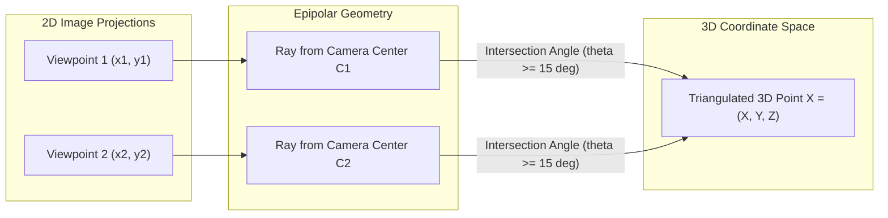
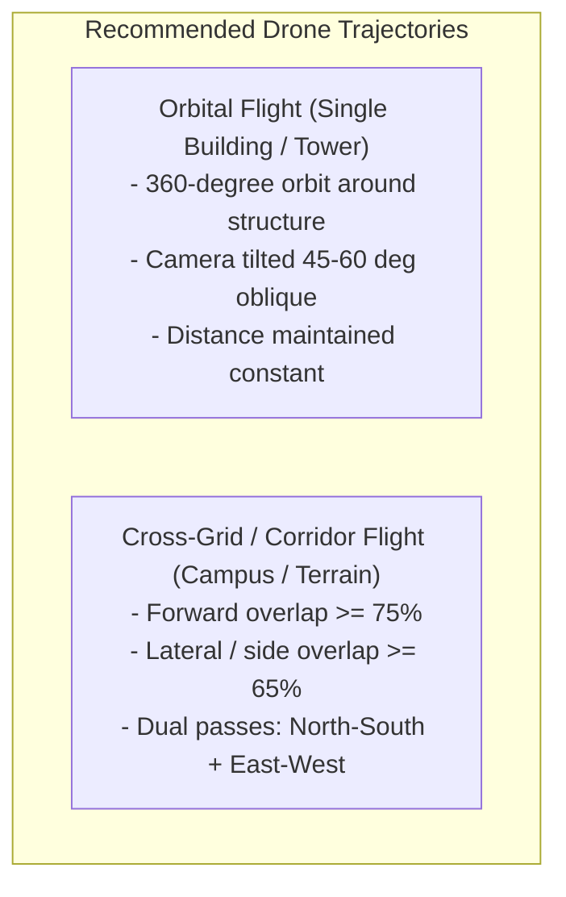
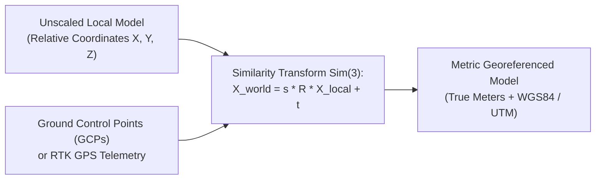

# Photogrammetry Fundamentals & Drone Capture Engineering — GeoForge

> **Document:** `docs/PHOTOGRAMMETRY_FUNDAMENTALS.md`  
> **Status:** Code-Verified Photogrammetric Science & Capture Specification  
> **Target Version:** GeoForge v1.0.0 (SIH 2026 / NTRO Edition)  
> **Last Verified:** 2026-11-11  
> **Related Documents:** [`docs/RECONSTRUCTION_PIPELINE.md`](file:///c:/Users/adity/Downloads/geoforge-main/geoforge-main/docs/RECONSTRUCTION_PIPELINE.md), [`docs/COLMAP.md`](file:///c:/Users/adity/Downloads/geoforge-main/geoforge-main/docs/COLMAP.md), [`docs/SECURITY_AND_ACCURACY_NOTES.md`](file:///c:/Users/adity/Downloads/geoforge-main/geoforge-main/docs/SECURITY_AND_ACCURACY_NOTES.md)

---

## 1. Mathematical Foundations of Photogrammetry

Photogrammetry is the science of extracting reliable 3D geometric measurements from overlapping 2D photographic images. GeoForge implements monocular Structure-from-Motion (SfM) and dense Multi-View Stereo (MVS).

### 1.1 The Pinhole Camera Model & Projection Equation
A 3D world point $\mathbf{X} = [X, Y, Z, 1]^T$ in homogeneous coordinates projects to an image pixel $\mathbf{x} = [u, v, 1]^T$ via:

$$\mathbf{x} \sim \mathbf{K} [\mathbf{R} \mid \mathbf{t}] \mathbf{X}$$

Where:
- $\mathbf{K}$ is the $3 \times 3$ intrinsic camera calibration matrix:
  $$\mathbf{K} = \begin{bmatrix} f_x & 0 & c_x \\ 0 & f_y & c_y \\ 0 & 0 & 1 \end{bmatrix}$$
  $f_x, f_y$ represent focal lengths in pixel units, and $(c_x, c_y)$ is the principal point.
- $\mathbf{R} \in SO(3)$ is the $3 \times 3$ rotation matrix representing camera orientation.
- $\mathbf{t} \in \mathbb{R}^3$ is the translation vector representing camera position.

### 1.2 Lens Distortion Modeling (OPENCV 8-Parameter Model)
Consumer drone cameras feature wide-angle lenses exhibiting significant non-linear radial and tangential distortion. GeoForge configures COLMAP with the **`OPENCV` camera model** (`backend/reconstruction.py:27`), modeling distortion via 8 parameters ($f_x, f_y, c_x, c_y, k_1, k_2, p_1, p_2$):

$$\begin{aligned}
x' &= x (1 + k_1 r^2 + k_2 r^4) + 2 p_1 x y + p_2 (r^2 + 2 x^2) \\
y' &= y (1 + k_1 r^2 + k_2 r^4) + p_1 (r^2 + 2 y^2) + 2 p_2 x y
\end{aligned}$$

Where $r^2 = x^2 + y^2$. Unmodeled radial distortion ($k_1, k_2$) causes planar surfaces to bend into bowl-like shapes ("bowl effect") during bundle adjustment.

### 1.3 Epipolar Geometry & The Fundamental Matrix
For any two overlapping camera views observing the same physical 3D point:

$$\mathbf{x}_2^T \mathbf{F} \mathbf{x}_1 = 0$$

Where $\mathbf{F} = \mathbf{K}_2^{-T} [\mathbf{t}]_\times \mathbf{R} \mathbf{K}_1^{-1}$ is the $3 \times 3$ Fundamental Matrix. The vector $\mathbf{l}_2 = \mathbf{F} \mathbf{x}_1$ defines the epipolar line in the second image. Corresponding features must lie along this line, reducing a 2D feature search to a 1D line search during stereo matching.

### 1.4 Triangulation & The Baseline-to-Depth ($B/D$) Ratio
The precision of a triangulated 3D point depends fundamentally on the **baseline-to-depth ratio** ($B/D$), where $B = \|\mathbf{c}_1 - \mathbf{c}_2\|$ is the distance between camera centers and $D$ is the distance to the target surface:

$$\sigma_Z \approx \frac{D^2}{f \cdot B} \sigma_x$$

- **Too Small Baseline ($B/D < 0.1$):** Rays intersect at a very shallow angle ($\theta < 10^\circ$). Depth uncertainty $\sigma_Z$ explodes quadratically, producing noisy, smeared point clouds.
- **Too Large Baseline ($B/D > 0.8$):** Perspective foreshortening and occlusion between views prevent SIFT descriptors from matching reliably.
- **Optimal Photogrammetric Envelope:** **$0.25 \le B/D \le 0.50$** (corresponding to an intersection angle $15^\circ \le \theta \le 30^\circ$).

---

## 2. Ground Sample Distance (GSD) & Resolution Limits

Ground Sample Distance (GSD) represents the physical distance on the ground represented by the distance between two consecutive pixel centers. It determines the ultimate geometric resolution achievable:

$$\text{GSD} = \frac{S_w \cdot H \cdot 100}{F \cdot I_w} \quad (\text{in cm/pixel})$$

Where:
- $S_w$: Physical sensor width ($\text{mm}$)
- $H$: Flight altitude Above Ground Level ($\text{m}$)
- $F$: Lens focal length ($\text{mm}$)
- $I_w$: Image width ($\text{pixels}$)

### GSD vs. Flight Altitude Benchmark (Typical Drone 1/2.3" Sensor, 24mm Eqv):
| Altitude (AGL) | GSD (Resolution) | Minimum Reconstructable Feature Size ($3 \times \text{GSD}$) |
|---|---|---|
| **$20\text{ meters}$** | $\sim 0.8\text{ cm/px}$ | $2.4\text{ cm}$ (Individual bricks, roof tiles, small vents) |
| **$50\text{ meters}$** | $\sim 2.1\text{ cm/px}$ | $6.3\text{ cm}$ (Window frames, structural pillars, curbs) |
| **$100\text{ meters}$** | $\sim 4.2\text{ cm/px}$ | $12.6\text{ cm}$ (Building outlines, major roof contours) |

---

## 3. Flight Capture Principles for Optimal Reconstruction

High-quality 3D models require disciplined flight planning. The table below outlines mandatory capture protocols:

| Parameter | Recommended Operational Setting | Photogrammetric Rationale |
|---|---|---|
| **Forward Overlap** | **$75\% – 85\%$** | Guarantees that every ground point appears in at least $4\text{--}6$ consecutive video frames. |
| **Side (Lateral) Overlap**| **$65\% – 75\%$** | Connects adjacent parallel flight swaths, preventing model fracture into multiple disjoint sub-models. |
| **Camera Pitch Angle** | **$45^\circ – 60^\circ$ Oblique** | Pure Nadir ($90^\circ$ straight down) captures only roofs and misses vertical building facades. Oblique angles capture both vertical walls and horizontal surfaces. |
| **Flight Speed** | **$3 – 5\text{ m/s}$ (Smooth, constant)** | Minimizes motion blur during frame capture. Avoid abrupt acceleration or yaw rotations. |
| **Shutter Speed** | $\ge 1/1000\text{ s}$ (Fast shutter) | Eliminates rolling shutter distortion and per-pixel motion blur. |
| **Lighting Conditions** | Uniform overcast or high diffuse sun | Deep cast shadows or changing sun angles confuse photometric stereo matching and create dark voids in dense clouds. |

---

## 4. Photogrammetric Degeneracy & Failure Modes

Understanding failure modes prevents wasted compute and guides capture remediation:

### 4.1 Pure In-Place Rotation (Zero Translation Baseline)
- **Problem:** When a drone hovers in a stationary position and simply rotates its camera yaw, the baseline between views is zero ($B = 0$).
- **Consequence:** Epipolar triangulation fails completely because all camera rays originate from the same optical center. COLMAP's two-view geometry estimator detects a homography (pure rotation) rather than essential matrix translation, triggering the **30% registration gate failure** (`MIN_REGISTRATION_RATIO = 0.30`).
- **Remediation:** The drone must physically translate through space along an orbit or linear path.

### 4.2 Repetitive Patterns & Feature Ambiguity
- **Problem:** Architectures with uniform brickwork, corrugated sheet metal roofs, chain-link fences, or regular window arrays produce identical SIFT feature descriptors.
- **Consequence:** Feature matchers establish incorrect cross-image pairings, leading to phantom duplicate walls or twisted geometry.
- **GeoForge Mitigation:** Sequential matching with limited overlap window (`SEQUENTIAL_OVERLAP = 15`) restricts feature matching to chronologically adjacent frames, preventing false matches across distant areas.

### 4.3 Low-Texture & Specular Surfaces
- **Problem:** Uniform painted drywall, open calm water, asphalt roads, and reflective glass windows lack high-frequency luminance gradients.
- **Consequence:** OpenCV Laplacian blur variance drops below threshold ($< 20.0$), or SIFT extracts fewer than 1,000 features. Dense MVS produces large holes or floating noise points.
- **GeoForge Mitigation:** Open3D statistical outlier removal (`nb=20, std=2.0`) denoises unconstrained points, and Screened Poisson meshing smoothly interpolates across moderate texture gaps.

### 4.4 Dynamic Motion (Moving Objects)
- **Problem:** Vehicles driving on roads, pedestrians walking, or trees swaying vigorously in the wind.
- **Consequence:** SfM assumes a strictly static, rigid scene. Non-rigid points violate epipolar constraints and produce phantom floating geometry or are rejected as outliers.

---

## 5. Metric Scale Ambiguity & Georeferencing Recovery

Monocular Structure-from-Motion suffers from a fundamental mathematical limitation: **scale ambiguity**.

### 5.1 The Scale Ambiguity Principle
If camera positions $\mathbf{C}_i$ and 3D points $\mathbf{X}_j$ satisfy the projection equations, then for any arbitrary scalar $s > 0$:

$$\mathbf{x}_{ij} \sim \mathbf{K} \left[ \mathbf{R}_i \;\middle|\; \frac{1}{s} \mathbf{t}_i \right] (s \mathbf{X}_j)$$

The projected pixel coordinates $\mathbf{x}_{ij}$ remain **100% identical**. Therefore, monocular video photogrammetry cannot determine whether an object is a $10\text{ cm}$ miniature toy or a $100\text{ m}$ commercial building without external metric scale information.

### 5.2 Recovering Absolute Metric Scale
GeoForge models are generated in an unscaled local Cartesian frame. To recover true metric scale:
1. **Camera Altitude & Baseline Method:** Extract flight altitude Above Ground Level (AGL) and GPS velocity from companion `.srt` subtitle metadata tracks.
2. **Ground Control Points (GCPs):** Identify at least 3 physical markers with known real-world RTK-surveyed coordinates $(X, Y, Z)_{\text{world}}$ and solve the 7-parameter similarity transformation $\text{Sim}(3)$ (rotation $\mathbf{R}$, translation $\mathbf{t}$, scale $s$).
3. **Scale Bar Constraint:** Place a rigid reference target of known length (e.g. a $2.000\text{ m}$ calibrated bar) within the capture scene.

---

## 6. Field Quality Checklist for Drone Pilots

Before executing a flight mission intended for GeoForge 3D reconstruction, verify the following field checklist:

- [ ] **1. Sensor Settings:** Set camera to 4K or 1080p, fixed manual focus (infinity), fast shutter speed ($\ge 1/1000\text{ s}$), and ISO 100–200.
- [ ] **2. Capture Path:** Fly in an orbital circle around the target building or a cross-grid with $\ge 75\%$ forward and $\ge 65\%$ lateral overlap.
- [ ] **3. Camera Angle:** Tilt gimbal between $45^\circ$ and $60^\circ$ oblique to capture both facades and roof structures.
- [ ] **4. Parallax Assurance:** Drone continuously translates through space; never hover in place and rotate the camera yaw.
- [ ] **5. Weather & Light:** Fly under diffuse overcast lighting or high noon; avoid low morning/evening sun that casts long moving shadows.
- [ ] **6. Airspace & Safety:** Ensure flight operations comply with civil aviation rules, maintaining visual line of sight and avoiding restricted airspace.
