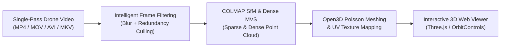
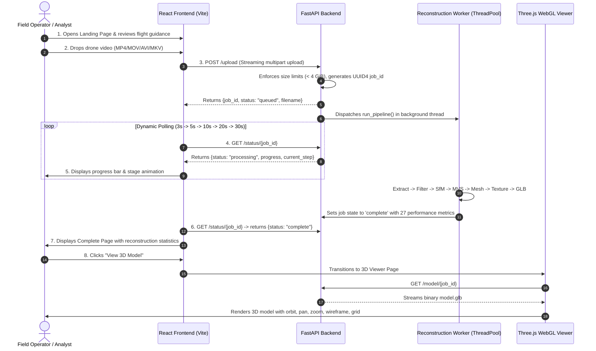
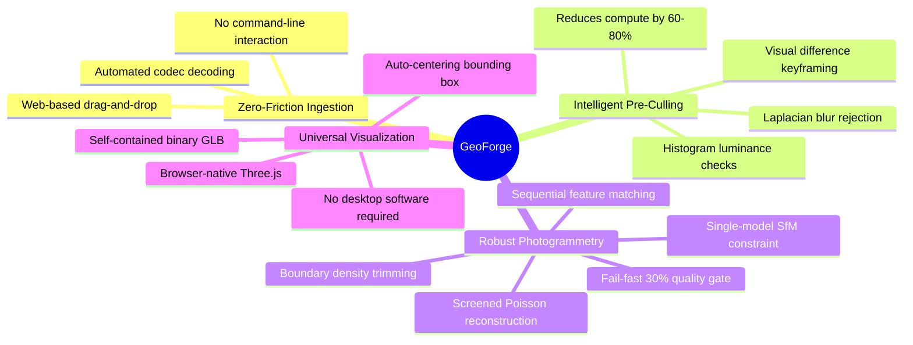

# Project Overview — GeoForge

> **Document:** `docs/PROJECT_OVERVIEW.md`  
> **Status:** Canonical Project Overview  
> **Target Version:** GeoForge v1.0.0 (SIH 2026 / NTRO Edition)  
> **Related Documents:** [`docs/PRD.md`](file:///c:/Users/adity/Downloads/geoforge-main/geoforge-main/docs/PRD.md), [`docs/UI_UX_DESIGN.md`](file:///c:/Users/adity/Downloads/geoforge-main/geoforge-main/docs/UI_UX_DESIGN.md), [`docs/FEATURE_STATUS.md`](file:///c:/Users/adity/Downloads/geoforge-main/geoforge-main/docs/FEATURE_STATUS.md), [`docs/ARCHITECTURE.md`](file:///c:/Users/adity/Downloads/geoforge-main/geoforge-main/docs/ARCHITECTURE.md), [`docs/RECONSTRUCTION_PIPELINE.md`](file:///c:/Users/adity/Downloads/geoforge-main/geoforge-main/docs/RECONSTRUCTION_PIPELINE.md), [`docs/ROADMAP.md`](file:///c:/Users/adity/Downloads/geoforge-main/geoforge-main/docs/ROADMAP.md)

---

## 1. Project Identity & Purpose

**GeoForge** is an end-to-end photogrammetric 3D reconstruction system designed to convert single-pass aerial drone or mobile video into interactive, web-viewable 3D models.

### Problem Statement Context
- **Hackathon:** Smart India Hackathon (SIH) 2026
- **Problem Statement ID:** `SIH26158`
- **Problem Statement Title:** Single-Pass Drone Video to Accurate 3D Model Generation System
- **Organization:** National Technical Research Organisation (NTRO)
- **Category:** Software
- **Theme:** Robotics and Drones

### Core Mission
Traditional photogrammetry software (e.g., manual command-line COLMAP, Agisoft Metashape, RealityCapture, WebODM) demands steep operational overhead: manual frame extraction, CLI parameter tuning, heavy workstation licensing, and complex desktop installation. 

GeoForge bridges the gap between field capture and actionable 3D situational intelligence by delivering an **automated, browser-accessible photogrammetry pipeline**:
1. **Automated Pre-Processing:** Eliminates the manual burden of selecting frames by automatically discarding blurry and redundant video frames.
2. **Robust SfM/MVS Processing:** Orchestrates structure-from-motion, dense point-cloud fusion, and surface meshing in an automated background pipeline.
3. **Frictionless Web Delivery:** Generates self-contained, lightweight binary GLTF (`.glb`) models that render immediately in modern web browsers without plugins or desktop installs.

---

## 2. End-to-End User Journey

The GeoForge interface implements an 8-stage user workflow centered on simplicity and immediate feedback:

### Detailed Journey Steps:
1. **Landing & Guidance:** Operator accesses the application at `http://localhost:3000/` and reviews critical capture requirements: $\ge 70\%$ forward/lateral overlap, nadir or $45^\circ\text{--}60^\circ$ oblique camera angle, consistent daylight illumination, and smooth flight speed ($3\text{--}5\text{ m/s}$).
2. **Video Ingestion:** Operator drags and drops the flight footage into the dropzone. The UI validates video extensions client-side (`.mp4`, `.mov`, `.avi`, `.mkv`) and enforces the $4\text{ GiB}$ payload ceiling.
3. **Upload & Enqueueing:** The file is streamed via `XMLHttpRequest` with real-time percentage tracking to `POST /upload`. Backend saves the video to `backend/uploads/{job_id}_{filename}` and spawns a background thread via `ThreadPoolExecutor(max_workers=2)`.
4. **Adaptive Status Polling:** Frontend polls `GET /status/{job_id}` using an exponential back-off strategy (`[3000, 5000, 10000, 20000, 30000]` ms) to avoid overwhelming the server during long photogrammetry stages.
5. **Processing Visualization:** While the pipeline executes, the UI presents active stage indicators, progress milestones, and estimated processing timelines.
6. **Completion & Health Validation:** Backend marks the job as `complete`, storing execution metadata (keyframe counts, dense points, mesh face counts, processing elapsed time).
7. **Result Review:** Operator examines the summary card: total points reconstructed, mesh triangles, processing duration, and input video properties.
8. **Interactive 3D Inspection:** Operator launches the WebGL viewport. The Three.js engine fetches `GET /model/{job_id}`, auto-centers the geometry via bounding box calculation, applies three-point lighting, and provides orbit/pan/zoom inspection tools, wireframe mode, and ground reference grid.

---

## 3. Verifiable Intermediate & Terminal Artifacts

Every reconstruction run operates inside an isolated workspace directory at `backend/temp/{job_id}/`. The following verifiable artifacts are produced:

| Pipeline Stage | Artifact Location | File Format | Technical Description |
|---|---|---|---|
| **Video Storage** | `backend/uploads/{job_id}_{name}` | Container (`.mp4`, etc.) | Original raw uploaded video payload. |
| **Frame Extraction** | `temp/{job_id}/frames/` | JPEG (`frame_XXXXXX.jpg`) | Raw video frames extracted at $2.0\text{ FPS}$ target rate. |
| **Sharpness Filter** | `temp/{job_id}/selected_frames/` | JPEG | Frames passing Laplacian variance blur threshold ($\ge 100$) and luminance bounds ($[30, 240]$). |
| **Redundancy Filter** | `temp/{job_id}/final_frames/` | JPEG | Final keyframe set passing grayscale visual difference filter ($\Delta \ge 5.0$, with 50% safety floor). |
| **Sparse Reconstruction** | `temp/{job_id}/colmap/sparse/0/` | COLMAP Binary | `cameras.bin` (intrinsics), `images.bin` (extrinsics), `points3D.bin` (sparse tie points). |
| **Dense Point Cloud** | `temp/{job_id}/colmap/dense/fused.ply` | Stanford PLY | Dense point cloud produced by COLMAP PatchMatch MVS stereo fusion. |
| **Cleaned Point Cloud** | `temp/{job_id}/colmap/dense/fused_cleaned.ply` | Stanford PLY | Denoised point cloud following Open3D statistical outlier removal ($nb=20, \sigma=2.0$). |
| **Surface Mesh** | `temp/{job_id}/colmap/dense/poisson_mesh.ply` | Stanford PLY | Watertight surface mesh generated via Screened Poisson reconstruction (`depth=11`) with $7.0\%$ low-density boundary trimming. |
| **Textured Mesh** | `temp/{job_id}/colmap/textured/model.ply` | Stanford PLY | Vertex-colored or surface-mapped mesh generated by COLMAP `mesh_texturer`. |
| **Textured Wavefront OBJ**| `temp/{job_id}/colmap/textured/model.obj` + `model.png` | OBJ + PNG | UV-unwrapped polygonal geometry and accompanying texture atlas image. |
| **Final Deliverable** | `temp/{job_id}/colmap/textured/model.glb` | Binary GLTF (`.glb`) | Self-contained, compressed binary 3D model with embedded PBR materials served at `GET /model/{job_id}`. |

> [!NOTE]
> In earlier documentation drafts, the final model was erroneously described as residing in `backend/output/model.glb`. In the actual running codebase, `backend/main.py:_resolve_glb()` explicitly resolves the model from `TEMP_DIR / job_id / "colmap" / "textured" / "model.glb"`.

---

## 4. Value Proposition & Key Differentiators

1. **Massive Compute Savings via Intelligent Culling:** Drone video contains massive frame redundancy (e.g., $30\text{--}60\text{ FPS}$). Feeding all frames to COLMAP results in combinatorial explosion during feature matching. GeoForge samples at $2\text{ FPS}$, filters out motion blur, and eliminates redundant stationary frames, reducing input images by $60\text{--}80\%$ while preserving full geometric coverage.
2. **Early Fail-Fast Quality Gate:** If video flight lacked sufficient parallax or texture, COLMAP sparse reconstruction registers few cameras. GeoForge evaluates registered cameras against total keyframes: if registration is $< 30\%$, the job aborts immediately with an actionable diagnostic message, preventing hours of wasted GPU compute on corrupted geometry.
3. **Artifact-Free Mesh Boundary Trimming:** Standard Screened Poisson reconstruction constructs an octree bounding box that inflates unobserved regions into bulbous "bubble" artifacts. GeoForge computes local vertex support densities and trims the lowest $7.0\%$ unconstrained boundary triangles, leaving clean, physically faithful surfaces.
4. **Zero-Client Installation Footprint:** Reconstructed models are compiled directly into binary GLTF (`.glb`) format, embedding geometry, vertex normals, UV mappings, and texture atlases into a single file readable by Three.js on laptops, tablets, and smartphones.

---

## 5. Engineering Boundaries & Realistic Interpretation

To maintain rigorous technical integrity and fulfill defense evaluation requirements, the following operational boundaries must be understood:

- **Photogrammetric Dependencies:** Geometry reconstruction relies on Structure-from-Motion (SfM) and Multi-View Stereo (MVS). The pipeline requires textured physical surfaces, diffuse ambient lighting, and rigid scenes. Featureless surfaces (open water, uniform asphalt, glass facades, heavy forest canopies) or rapid dynamic motion (moving vehicles, swaying vegetation) will degrade reconstruction completeness.
- **Arbitrary Local Coordinate System:** The current prototype reconstructs geometry in an arbitrary relative coordinate frame. Without companion RTK-GPS flight telemetry (`.srt` tracks or flight logs) or Ground Control Points (GCPs), absolute real-world metric scale and geodetic positioning (latitude/longitude/WGS84 altitude) cannot be guaranteed.
- **Non-Survey Grade Assurance:** The v0.5 prototype is engineered for **rapid visual situational awareness, reconnaissance, volumetric estimation, and structural asset inspection**. It is not certified for legal cadastral boundary surveying or engineering-tolerance metrology without calibrated GCP integration.
- **Single-Node Hardware Constraints:** The default development configuration uses an in-memory job store (`_jobs`) and local `ThreadPoolExecutor(max_workers=2)`. Server restarts will reset job history, and concurrent processing of more than 2 jobs requires horizontal scaling via distributed message queues (detailed in [`docs/ROADMAP.md`](file:///c:/Users/adity/Downloads/geoforge-main/geoforge-main/docs/ROADMAP.md)).
