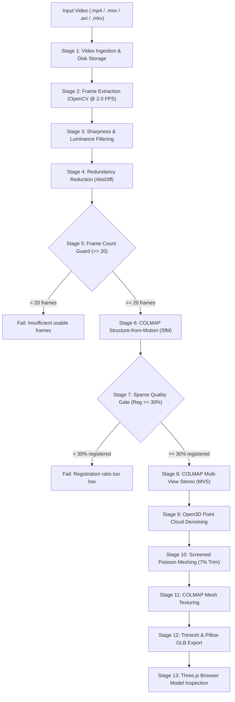

# Reconstruction Pipeline Specification — GeoForge

> **Document:** `docs/RECONSTRUCTION_PIPELINE.md`  
> **Status:** Code-Verified Pipeline Specification (Phase 3 Verified)  
> **Target Version:** GeoForge v1.0.0 (SIH 2026 / NTRO Edition)  
> **Source Verification Date:** 2026-11-11  
> **Related Documents:** [`docs/COLMAP.md`](file:///c:/Users/adity/Downloads/geoforge-main/geoforge-main/docs/COLMAP.md), [`docs/OPEN3D.md`](file:///c:/Users/adity/Downloads/geoforge-main/geoforge-main/docs/OPEN3D.md), [`docs/MESH_AND_GLB.md`](file:///c:/Users/adity/Downloads/geoforge-main/geoforge-main/docs/MESH_AND_GLB.md), [`docs/CODEBASE_MAP.md`](file:///c:/Users/adity/Downloads/geoforge-main/geoforge-main/docs/CODEBASE_MAP.md)

---

## 1. End-to-End Processing Flow

The GeoForge reconstruction pipeline transforms raw drone video into an interactive WebGL 3D model through the following verified sequence:

---

## 2. Detailed Stage-by-Stage Verification

### Stage 1: Video Ingestion & Storage
- **Source Files Responsible:** `backend/main.py:356-425` (`upload_video`).
- **Input:** Multipart form upload stream (`file: UploadFile`) from client.
- **Output:** Stored raw video file at `backend/uploads/{job_id}_{original_filename}`.
- **Processing Method:** Inspects `Content-Length` header; verifies extension against `{".mp4", ".mov", ".avi", ".mkv"}`; streams binary chunks directly to disk using `shutil.copyfileobj`.
- **Dependencies:** FastAPI, Starlette, Python standard library (`shutil`, `pathlib`, `uuid`).
- **Current Limitations:** In-memory queue guard rejects uploads with HTTP 503 if 2 background jobs are running. Uploads are stored on the local filesystem rather than object storage.
- **Error Conditions:**
  - `Content-Length > 4 GiB` $\to$ HTTP 413 `Payload Too Large`.
  - Empty filename or unlisted extension $\to$ HTTP 400 `Bad Request`.
  - Disk full or write error $\to$ HTTP 500 `Internal Server Error`.

---

### Stage 2: Video Frame Extraction
- **Source Files Responsible:** `backend/frame_processing.py:23-118` (`extract_frames`), orchestrated in `backend/main.py:193-198`.
- **Input:** Stored video file path `backend/uploads/{job_id}_{original_filename}`.
- **Output:** Raw JPEG images `frame_000000.jpg`, `frame_000001.jpg`, etc., in `backend/temp/{job_id}/frames/`.
- **Processing Method:** Opens video using OpenCV `cv2.VideoCapture`. Computes sampling interval dynamically:
  $$\text{effective\_interval} = \max\left(1, \text{round}\left(\frac{\text{fps}}{\text{target\_fps}}\right)\right), \quad \text{target\_fps} = 2.0$$
  Encodes extracted frames as high-quality JPEGs (`cv2.IMWRITE_JPEG_QUALITY = 95`). Returns metadata dictionary (total frames, source FPS, width, height, duration).
- **Dependencies:** OpenCV (`cv2`), Python standard library (`pathlib`, `logging`).
- **Current Limitations:** Fixed target sampling rate (2.0 FPS); does not adapt sampling frequency based on drone flight velocity or rotational speed.
- **Error Conditions:**
  - Corrupted video container or missing video stream $\to$ `RuntimeError("Could not open video: ...")`.

---

### Stage 3: Sharpness & Illumination Filtering
- **Source Files Responsible:** `backend/frame_filtering.py:69-207` (`filter_sharp_frames`), called in `backend/main.py:207-212`.
- **Input:** Extracted raw JPEGs in `backend/temp/{job_id}/frames/`.
- **Output:** Selected sharp JPEGs in `backend/temp/{job_id}/selected_frames/`.
- **Processing Method:**
  1. Convolves grayscale frame with discrete Laplacian kernel to compute sharpness variance:
     $$\text{Sharpness} = \text{Var}(\nabla^2 I) = \frac{1}{N} \sum_{x,y} \left( \nabla^2 I(x,y) - \mu \right)^2$$
  2. Computes mean grayscale illumination $\bar{I} = \frac{1}{N} \sum I(x,y)$. Rejects frames outside $[30.0, 240.0]$.
  3. **Adaptive Threshold Lowering:** If strict filtering ($\text{Sharpness} \ge 100.0$) rejects $>40\%$ of frames, automatically lowers threshold to the 40th percentile of observed sharpness scores across the video, bounded by `ABSOLUTE_MIN_SHARPNESS = 20.0`.
- **Dependencies:** OpenCV (`cv2`), NumPy, Python standard library.
- **Current Limitations:** Evaluates global image sharpness; localized motion blur on specific foreground objects can pass if background is textured.
- **Error Conditions:**
  - Empty input directory $\to$ `RuntimeError("No image frames found in: ...")`.

---

### Stage 4: Redundancy Reduction
- **Source Files Responsible:** `backend/redundancy_filter.py:42-171` (`remove_redundant_frames`), called in `backend/main.py:219-224`.
- **Input:** Filtered JPEGs in `backend/temp/{job_id}/selected_frames/`.
- **Output:** Non-redundant keyframes in `backend/temp/{job_id}/final_frames/`.
- **Processing Method:**
  1. Computes mean absolute pixel difference between consecutive frames:
     $$\Delta(I_t, I_{t-1}) = \frac{1}{N} \sum_{x,y} |I_{\text{gray},t}(x,y) - I_{\text{gray},t-1}(x,y)|$$
  2. Discards candidate frame if $\Delta < 5.0$ (`DEFAULT_DIFFERENCE_THRESHOLD`).
  3. **Safety Retention Floor:** Enforces `MAX_REMOVAL_RATIO = 0.50` (never discards more than $50\%$ of incoming frames), restoring frames with highest relative differences if pruning is too aggressive.
- **Dependencies:** OpenCV (`cv2`), NumPy, Python standard library.
- **Current Limitations:** Compares consecutive pairs only ($I_t$ vs $I_{t-1}$); does not check global pairwise visual redundancy if the drone circles back over the same spot.
- **Error Conditions:**
  - Empty input directory $\to$ `RuntimeError("No image frames found...")`.

---

### Stage 5: Minimum Frame Count Quality Guard
- **Source Files Responsible:** `backend/main.py:227-243`.
- **Input:** Final frame set in `backend/temp/{job_id}/final_frames/`.
- **Output:** Permission to proceed with COLMAP, or pipeline termination.
- **Processing Method:** Counts valid image files (`.jpg`, `.jpeg`, `.png`) in `final_frames/`. Compares count against `MIN_FRAMES_FOR_RECONSTRUCTION = 20`.
- **Dependencies:** Python standard library (`pathlib`).
- **Current Limitations:** Fixed integer threshold (20); does not verify camera angular baseline or ground footprint coverage.
- **Error Conditions:**
  - $N_{\text{frames}} < 20 \to$ `RuntimeError("Only X frames passed filtering. At least 20 are needed for a useful reconstruction.")`.

---

### Stage 6: COLMAP Structure-from-Motion (SfM)
- **Source Files Responsible:** `backend/reconstruction.py:858-1048` (`run_reconstruction`).
- **Input:** Images in `backend/temp/{job_id}/final_frames/`.
- **Output:** Initialized database `colmap/database.db` and sparse models in `colmap/sparse/0/` (`cameras.bin`, `images.bin`, `points3D.bin`).
- **Processing Method:**
  1. `colmap feature_extractor`: SIFT extraction (16,384 features, OPENCV camera model, affine shape estimation, domain size pooling, GPU enabled).
  2. `colmap sequential_matcher`: Overlap 15, loop detection via vocabulary tree (checks 5 candidate paths).
  3. `colmap mapper`: Forces unified model via `--Mapper.multiple_models 0`, max global BA iterations 50, BA refinements 5, minimum matches 15.
- **Dependencies:** COLMAP CLI executable (`colmap.exe`), NVIDIA CUDA (recommended) or CPU threads.
- **Current Limitations:** Single-camera calibration assumption (`--ImageReader.single_camera 1`); does not handle multi-lens drones or dual sensors.
- **Error Conditions:**
  - `colmap.exe` missing or unexecutable $\to$ `RuntimeError("COLMAP executable was not found...")`.
  - Non-zero subprocess exit code $\to$ `RuntimeError("COLMAP command failed... Exit code: X")`.

---

### Stage 7: Sparse Reconstruction Quality Gate
- **Source Files Responsible:** `backend/reconstruction.py:248-372, 1060-1122` (`find_best_model`, `read_sparse_model_stats`).
- **Input:** Sparse binary model files `colmap/sparse/0/*.bin`.
- **Output:** Sparse statistics dictionary (`registered_images`, `registration_ratio`, `sparse_points`).
- **Processing Method:** Parses binary headers of `cameras.bin`, `images.bin`, and `points3D.bin` using `struct.unpack("<Q", ...)`. Evaluates:
  $$\text{Registration Ratio} = \frac{N_{\text{registered}}}{N_{\text{input}}}$$
- **Dependencies:** Python standard library (`struct`, `pathlib`).
- **Current Limitations:** Rejection is based purely on registration count; does not measure reprojection error distribution.
- **Error Conditions:**
  - $\text{Registration Ratio} < 0.30 \to$ `RuntimeError("Sparse reconstruction quality is too poor to continue... Only X out of Y registered...")`.

---

### Stage 8: COLMAP Multi-View Stereo (Dense MVS)
- **Source Files Responsible:** `backend/reconstruction.py:1124-1340`.
- **Input:** Best sparse model (`colmap/sparse/0/`) and images (`final_frames/`).
- **Output:** Undistorted images in `colmap/dense/images/`, depth maps in `colmap/dense/stereo/`, dense point cloud in `colmap/dense/fused.ply`.
- **Processing Method:**
  1. `colmap image_undistorter`: Projects images to ideal pinhole planes (`max_image_size = 2400`).
  2. `colmap patch_match_stereo`: PatchMatch stereo depth and normal estimation (`max_image_size = 2400`, `num_iterations = 7`, `geom_consistency = 1`, GPU accelerated).
  3. `colmap stereo_fusion`: Fuses depth maps (`min_num_pixels = 3`, `max_reproj_error = 2.0`, `input_type geometric`) into binary PLY `colmap/dense/fused.ply`.
- **Dependencies:** COLMAP CLI executable, NVIDIA CUDA GPU.
- **Current Limitations:** High GPU VRAM consumption ($>6\text{ GB}$ required for 2400px PatchMatch); slow on CPU fallback.
- **Error Conditions:**
  - PatchMatch CUDA Out-Of-Memory $\to$ Subprocess exit code $\ne 0 \to$ `RuntimeError`.

---

### Stage 9: Open3D Point Cloud Denoising
- **Source Files Responsible:** `backend/reconstruction.py:541-603` (`clean_point_cloud`).
- **Input:** Raw dense point cloud `colmap/dense/fused.ply`.
- **Output:** Outlier-cleaned point cloud `colmap/dense/fused_cleaned.ply`.
- **Processing Method:** Loads point cloud via Open3D. Applies statistical outlier removal:
  `pcd.remove_statistical_outlier(nb_neighbors=20, std_ratio=2.0)`. Prunes isolated sensor artifacts and sky points.
- **Dependencies:** Open3D (`open3d`).
- **Current Limitations:** If Open3D is not installed, gracefully copies `fused.ply` to `fused_cleaned.ply` without filtering.
- **Error Conditions:**
  - Input point cloud has 0 points $\to$ Logs warning, skips filtering.

---

### Stage 10: Screened Poisson Meshing & Density Trimming
- **Source Files Responsible:** `backend/reconstruction.py:609-700` (`poisson_mesh_with_trimming`).
- **Input:** Cleaned dense point cloud `colmap/dense/fused_cleaned.ply`.
- **Output:** Surface mesh `colmap/mesh/poisson_mesh.ply`.
- **Processing Method:**
  1. Estimates normals if absent: `pcd.estimate_normals(KDTreeSearchParamHybrid(radius=0.1, max_nn=30))`.
  2. Orient normals consistently toward tangent plane: `pcd.orient_normals_consistent_tangent_plane(k=15)`.
  3. Screened Poisson reconstruction: `TriangleMesh.create_from_point_cloud_poisson(pcd, depth=11, linear_fit=True)`.
  4. **Boundary Trimming:** Prunes vertices in the lowest 7.0% density quantile (`POISSON_TRIM = 7.0`) using NumPy percentile mask, followed by removing degenerate triangles and unreferenced vertices.
  5. *(Fallback: If Open3D is missing, executes `colmap poisson_mesher`).*
- **Dependencies:** Open3D, NumPy.
- **Current Limitations:** Poisson reconstruction generates closed watertight geometry, which can close open windows or hollow structures.
- **Error Conditions:**
  - Input cloud is empty $\to$ `RuntimeError("Cannot create mesh from empty point cloud.")`.

---

### Stage 11: COLMAP Mesh Texturing
- **Source Files Responsible:** `backend/reconstruction.py:1441-1531`.
- **Input:** Poisson surface mesh `colmap/mesh/poisson_mesh.ply` and undistorted camera frames `colmap/dense/images/`.
- **Output:** Vertex-colored mesh `colmap/textured/model.ply`, UV-mapped `colmap/textured/model.obj`, and diffuse atlas `colmap/textured/model.png`.
- **Processing Method:** Invokes `colmap mesh_texturer` with workspace set to `colmap/dense`. Projects radiance from calibrated camera poses onto mesh polygons.
- **Dependencies:** COLMAP CLI executable.
- **Current Limitations:** Ghosting or blurred textures can occur in regions where lighting changed significantly during flight.
- **Error Conditions:**
  - Subprocess non-zero return code $\to$ `RuntimeError`.
  - No model files found in `colmap/textured/` $\to$ `RuntimeError("Texture mapping completed but no final model was found...")`.

---

### Stage 12: Binary GLB Packaging & PBR Material Binding
- **Source Files Responsible:** `backend/convert_to_glb.py:29-200` (`convert_to_glb`), called in `backend/main.py:285-290`.
- **Input:** Textured model `colmap/textured/model.ply` and diffuse atlas `colmap/textured/model.png`.
- **Output:** Self-contained binary 3D model `backend/temp/{job_id}/colmap/textured/model.glb`.
- **Processing Method:**
  1. Trimesh loads geometry (`trimesh.load(force="mesh", process=False)`). Concatenates sub-meshes if Scene.
  2. Pillow loads texture image (`Image.open(texture_file)`).
  3. Attaches PBR Material (`trimesh.visual.material.PBRMaterial(baseColorTexture=texture)`) and `TextureVisuals`.
  4. Exports binary glTF 2.0 (`mesh.export(glb_file, file_type="glb")`).
  5. Validates `glb_file.exists()` and `glb_file.stat().st_size > 0`.
- **Dependencies:** Trimesh, Pillow (`PIL`).
- **Current Limitations:** Exports diffuse color map only; normal maps and roughness maps from photogrammetry are not baked into the GLB.
- **Error Conditions:**
  - Missing or 0-byte input PLY or PNG $\to$ `RuntimeError`.
  - Empty output GLB $\to$ `RuntimeError("GLB file was not created or is empty.")`.

---

### Stage 13: Delivery & Three.js WebGL Visualization
- **Source Files Responsible:** `backend/main.py:553-580` (`get_model`), `frontend/src/components/ThreeDViewer.tsx:1-2243`.
- **Input:** Binary stream over HTTP `GET /model/{job_id}`.
- **Output:** Interactive WebGL viewport in operator's browser.
- **Processing Method:** Streams binary payload with `media_type="model/gltf-binary"`. Three.js `GLTFLoader` parses buffer, auto-centers bounding box, sets ambient/directional lights, and enables OrbitControls.
- **Dependencies:** FastAPI FileResponse, Three.js (`three`), WebGL browser canvas.
- **Current Limitations:** Large models ($>50\text{ MB}$) can cause momentary browser UI lag during JSON chunk parsing.
- **Error Conditions:**
  - Network disconnection or 404 $\to$ `onModelLoadError` triggers UI `ErrorView`.
