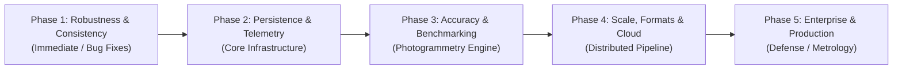
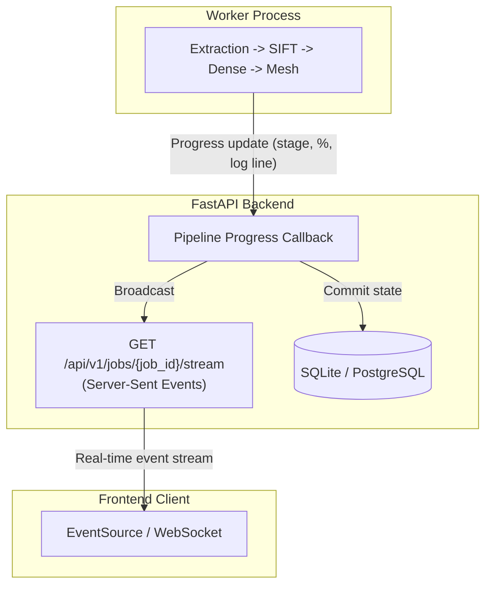
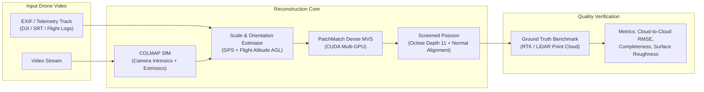
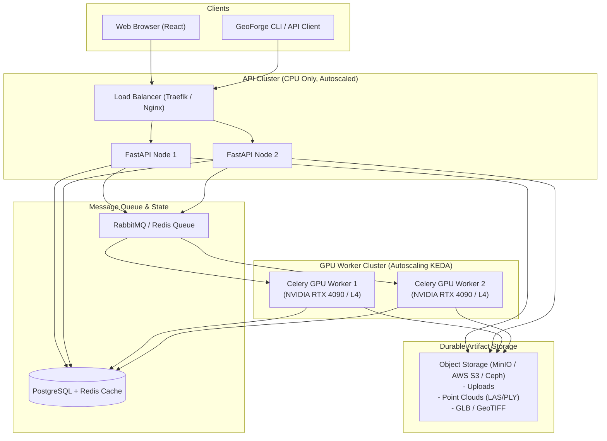
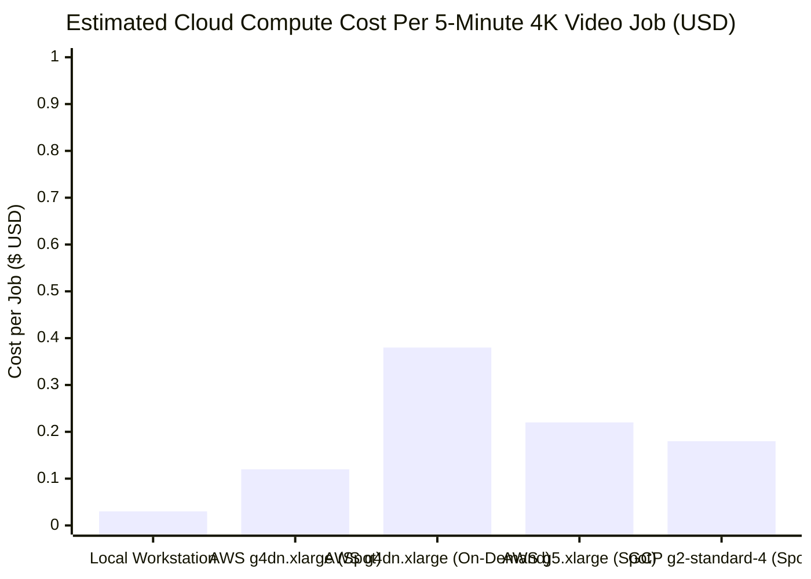

# GeoForge Engineering & Product Roadmap

> **Document:** `docs/ROADMAP.md`  
> **Status:** Canonical Engineering Roadmap  
> **Target Horizon:** SIH 2026 Evaluation $\rightarrow$ v1.0 Production $\rightarrow$ Enterprise Defense/Commercial Scalability  
> **Related Documents:** [`docs/PRD.md`](file:///c:/Users/adity/Downloads/geoforge-main/geoforge-main/docs/PRD.md), [`docs/FEATURE_STATUS.md`](file:///c:/Users/adity/Downloads/geoforge-main/geoforge-main/docs/FEATURE_STATUS.md), [`docs/ARCHITECTURE.md`](file:///c:/Users/adity/Downloads/geoforge-main/geoforge-main/docs/ARCHITECTURE.md), [`docs/RECONSTRUCTION_PIPELINE.md`](file:///c:/Users/adity/Downloads/geoforge-main/geoforge-main/docs/RECONSTRUCTION_PIPELINE.md)

---

## 1. Roadmap Strategy & Architectural Principles

The GeoForge roadmap is structured by **technical risk, pipeline dependencies, and hardware constraints**, rather than speculative UI features. The development plan advances through five distinct phases:

### Core Design Rules
1. **Never Compromise Verifiable Truth:** Prototype limitations must be documented transparently. Theoretical accuracy claims must be backed by repeatable ground-truth laser/RTK benchmarks.
2. **Decouple Ingestion from Compute:** Heavy photogrammetry pipelines (SIFT, PatchMatch MVS, Poisson meshing) must not block API web servers.
3. **Graceful Degradation:** Hardware-constrained environments (e.g., GPUs with $\le 6\text{ GB}$ VRAM) must automatically scale down image dimensions or fall back to CPU stereo rather than crashing with out-of-memory (OOM) errors.
4. **Air-Gapped & Self-Contained:** NTRO and defense deployment scenarios demand complete functionality in air-gapped networks without external cloud dependencies.

---

## 2. Comprehensive Development Phases

### Phase 1: Prototype Robustness, Contract Reconciliation & Defect Remediation
*Target: Immediate (Sprint 1–2 / Hackathon Finalization)*

The primary objective is eliminating UI/backend contract mismatches, resolving UI false promises, and hardening local execution against crashes.

| Work Item ID | Domain | Description | Technical Action & Files | Priority |
|---|---|---|---|---|
| **P1-01** | Frontend / API | Reconcile video format acceptance. Backend supports `.mp4, .mov, .avi, .mkv`; frontend currently restricts picker to `.mp4, .mov, .avi`. | Update `frontend/src/pages/UploadPage.tsx:22` to accept `.mkv`. | High |
| **P1-02** | Frontend / UI | Fix misleading "READY" badges on ungenerated formats. Complete view displays LAS, GeoTIFF, and OBJ as downloadable, but backend only produces GLB and PLY. | Update `frontend/src/pages/CompletePage.tsx:78-100` to mark LAS, GeoTIFF, and OBJ as *"Planned / Not Available in Prototype"* or conditionally disable buttons unless files exist. | Critical |
| **P1-03** | Frontend / UX | Replace simulated timer stages with actual coarse backend state. Frontend `ProcessingPage.tsx` runs an artificial 10-stage countdown that desynchronizes from real COLMAP runtimes. | Map `ProcessingPage.tsx` display directly to backend `status` (`queued`, `processing`, `complete`, `failed`). | High |
| **P1-04** | Backend / Stability | Implement disk space pre-check before upload ingestion. High-resolution drone videos require $15\text{--}25\times$ their size in intermediate scratch storage. | In `backend/main.py:upload_video`, verify at least $20\text{ GB}$ free space exists on `TEMP_DIR` volume before accepting upload; return HTTP 507 (Insufficient Storage) otherwise. | High |
| **P1-05** | Backend / Pipeline | Prevent orphan sub-processes on server shutdown. When FastAPI stops, background threads running COLMAP CLI may continue as zombie processes. | Add signal handler (`SIGTERM`/`SIGINT`) and process tracking in `backend/colmap_runner.py` to terminate child subprocesses cleanly. | High |
| **P1-06** | DevOps | Fix Windows build script `npm run clean`. Script uses Unix `rm -rf` which fails on native Windows PowerShell/CMD. | Update `frontend/package.json` with cross-env or Node-based rimraf script. | Medium |

**Phase 1 Exit Criteria:**
- Zero contract discrepancies between API schemas and frontend components.
- Complete page accurately reflects available download artifacts.
- Zero orphan COLMAP processes on cancelled or interrupted jobs.

---

### Phase 2: Persistence, Recovery & Real-Time Telemetry
*Target: Near-Term (Sprint 3–4 / Post-Prototype Foundation)*

Eliminates volatile memory storage, provides job recovery across server restarts, and transitions from blind polling to live streaming telemetry.

| Work Item ID | Dimension | Description | Technical Implementation |
|---|---|---|---|
| **P2-01** | **Job Persistence** | Transition from in-memory `_jobs = {}` dictionary to durable relational database. | Introduce **SQLite** (local development) and **PostgreSQL** (production) using SQLAlchemy 2.0 ORM or SQLModel. Persist `JobModel` with created timestamp, updated timestamp, error message, execution metrics, and artifact paths. |
| **P2-02** | **Crash Recovery** | Re-hydrate in-progress or completed jobs following backend restart. | On startup, scan database for jobs in `processing` state; mark as `failed` with *"Interrupted by server restart"* or attempt pipeline checkpoint resumption. Serve completed jobs without relying on volatile memory. |
| **P2-03** | **Real-Time Telemetry** | Stream granular reconstruction stage updates, progress percentages, and log output. | Implement Server-Sent Events (SSE) via `sgevents` at `GET /status/{job_id}/events` or WebSockets. Inject a progress callback into `extract_frames`, `colmap_runner`, and `mesh_generator` that pipes stdout lines directly to connected clients. |
| **P2-04** | **Job Checkpointing** | Cache intermediate stages to allow resuming failed runs. | Check for pre-existing artifacts (`colmap/sparse/0/cameras.bin`, `colmap/dense/fused.ply`). If a job fails at meshing, operator can retry meshing without repeating expensive SIFT feature extraction and dense matching. |
| **P2-05** | **Storage Retention Engine** | Automated background reaper for expired jobs and scratch data. | Implement a scheduled daily task (via APScheduler or Celery Beat) enforcing strict retention tiers: purge raw extracted frames (`frames/`) after 24 hours; retain final GLB and summary metrics for 30 days. |

**Phase 2 Exit Criteria:**
- Backend restart preserves full job history and access to generated GLB models.
- Frontend displays live, sub-second COLMAP progress lines without artificial timers.
- Storage disk consumption is bounded by automated TTL cleanup.

---

### Phase 3: Reconstruction Quality, Accuracy & Benchmarking
*Target: Medium-Term (Sprint 5–6 / Engineering Hardening)*

Transitions GeoForge from an unscaled visual mesher into a photogrammetrically accurate, empirically benchmarked 3D reconstruction system.

#### Key Technical Upgrades:
1. **Camera Calibration & Distortion Modeling:**
   - Detect sensor aspect ratio and initial focal length estimate from video metadata.
   - Upgrade camera model from simple `RADIAL` to `OPENCV` (8-parameter model including tangential distortion $p_1, p_2$ and radial $k_1, k_2$) for wide-angle drone lenses.
2. **Metadata & Telemetry Ingestion (Scale Recovery):**
   - Ingest companion `.srt` subtitle files or embedded MP4 quicktime tracks (`format.tags`) containing timestamped GPS coordinates, altitude Above Ground Level (AGL), and gimbal pitch/yaw.
   - Run COLMAP `model_aligner` using GPS coordinates to transform arbitrary local coordinates into real-world geographic coordinates (EPSG:4326 / UTM).
3. **Point Cloud & Mesh Quality Tuning:**
   - Implement normal estimation with k-nearest neighbors ($k=30$) and minimum spanning tree orientation before Screened Poisson meshing.
   - Expose configurable Poisson octree depth (`depth=9` for rapid draft, `depth=11` for production balance, `depth=12` for high-fidelity facades).
4. **Empirical Benchmarking Protocol:**
   - Establish a standard dataset of 5 benchmark flights (Campus Building, Industrial Tower, Open Quarry, Residential Block, Vehicle Fleet).
   - Measure registration percentage, Mean Reprojection Error (target $< 0.8\text{ px}$), Cloud-to-Cloud distance against ground-truth terrestrial laser scanner (TLS) data.

| Benchmark Metric | Current Prototype Baseline | Target Production Threshold | Measurement Method |
|---|---|---|---|
| **Frame Registration Rate** | $\ge 30\%$ (Hard threshold) | $\ge 85\%$ of selected frames | COLMAP `images.bin` registered count / input keyframes |
| **Mean Reprojection Error** | Unreported in UI (~$1.2\text{--}1.8\text{ px}$) | $< 0.85\text{ px}$ | COLMAP bundle adjustment residual |
| **Point Density** | $\sim 50\text{--}200\text{ pts/m}^2$ (unscaled) | $> 500\text{ pts/m}^2$ (metric scale) | CloudCompare density inspection |
| **Mesh Watertightness** | Manifold open surface | 2-manifold closed surface (or clean trimmed border) | Open3D `is_edge_manifold()`, `is_vertex_manifold()` |

**Phase 3 Exit Criteria:**
- Models possess real-world metric scale ($\pm 5\%$ linear dimension accuracy without GCPs, $\pm 1\%$ with GPS telemetry).
- Automated test suite executes reconstruction on standard sample video and verifies reprojection error $\le 1.0\text{ px}$.

---

### Phase 4: Scalability, Compute Architecture & Format Ecosystem
*Target: Long-Term (Sprint 7–9 / Enterprise Architecture)*

Transforms the single-machine proof-of-concept into a cloud-native, horizontally scalable processing cluster supporting professional GIS and defense export formats.

#### 1. Hardware, Memory & GPU Optimization:
- **VRAM Boundary Management:**
  - PatchMatch Stereo consumes heavy VRAM ($> 6\text{ GB}$ for $2400\text{ px}$ images).
  - Implement dynamic downsampling: if GPU VRAM $< 8\text{ GB}$, automatically cap `--PatchMatchStereo.max_image_size` to $1600\text{ px}$; if $< 4\text{ GB}$ or CPU-only, switch to sparse meshing or downsample to $1200\text{ px}$.
- **Host RAM Protection:**
  - Large Poisson reconstructions can trigger host OOM when octree depth exceeds 11. Implement voxel grid downsampling (`voxel_size = bounding_box_diag / 500`) on dense clouds exceeding $10\text{M}$ points before surface meshing.

#### 2. Large Video Uploads & Resumability:
- **Chunked Resumable Ingestion:** Replace single-request multipart upload with the **Tus.io protocol** or S3 Presigned Multipart Uploads.
- Supports multi-gigabyte 4K/60fps video files ($2\text{--}10\text{ GB}$) over unstable field mobile/satellite connections without timeout or corruption.
- In-browser client checksum calculation (SHA-256) before upload to eliminate duplicate processing.

#### 3. Real Multi-Format GIS Deliverables:
Implement actual background exporters for the full deliverable catalog:
- **LAS / LAZ (ASPRS):** Georeferenced, classified point cloud export using `laspy` with embedded RGB color channels.
- **GeoTIFF Orthomosaic:** Top-down orthorectified true-color raster generated by projecting textured mesh onto a regular horizontal grid.
- **Wavefront OBJ + MTL:** Native UV-unwrapped polygonal mesh with multi-resolution JPEG texture atlas for CAD/BIM import (Autodesk, Blender).
- **Optimized Binary GLB:** Draco geometry compression and KTX2 texture compression via `gltf-transform` reducing download payload by $70\text{--}85\%$ for fast mobile WebGL viewing.

**Phase 4 Exit Criteria:**
- Backend API decoupled from GPU processing workers via Celery and RabbitMQ.
- Support for concurrent job execution across multi-GPU cluster.
- All 4 download formats (GLB, PLY, OBJ, LAS) fully generated, downloadable, and verified.

---

### Phase 5: Security, Enterprise Governance & Defense Integration
*Target: Extended Horizon (Production / NTRO Field Readiness)*

Hardens GeoForge for sensitive defense, intelligence, and commercial surveying deployments.

| Pillar | Requirement | Engineering Implementation |
|---|---|---|
| **Security & Isolation** | **Job Sandbox Isolation** | Execute each reconstruction job inside an ephemeral Docker container or gVisor sandbox with restricted compute, memory, and disk quotas. Eliminates privilege escalation or host corruption from malformed media codecs. |
| **Authentication & RBAC** | **Multi-Tenant Access Control** | Implement OAuth2 / OpenID Connect (Keycloak, Authentik) with Role-Based Access Control: *Viewer* (inspect 3D outputs), *Operator* (upload videos and run reconstructions), *Admin* (manage compute nodes, retention, and system configs). |
| **Air-Gap Capability** | **100% Offline Standalone Stack** | Package complete GeoForge stack (Frontend, API, Worker, Redis, MinIO, PostgreSQL, CUDA drivers, pre-compiled COLMAP and vocabulary trees) into portable Helm charts and Docker Compose bundles for air-gapped field workstations. |
| **Audit & Forensics** | **Cryptographic Chain of Custody** | Sign reconstruction outputs with SHA-256 hashes linked to the source video hash, pipeline parameter manifests, and software commit revisions to maintain forensic admissibility for defense/legal applications. |
| **Data Privacy** | **Zero-Telemetry Assurance** | Guaranteed zero outbound telemetry, cloud pings, or external font/library CDN calls. All fonts, icons, Three.js assets, and maps served strictly from local origin. |

---

## 3. Financial & Operational Cost Analysis

To guide scalable production deployment, estimated infrastructure costs per reconstruction run are modeled across standard hardware profiles:

### Cost Drivers Breakdown:
1. **Compute Execution (GPU Time):**
   - A representative 5-minute 4K video generates $\sim 600$ raw frames $\rightarrow \sim 150$ keyframes.
   - SIFT extraction + sequential matching + dense PatchMatch MVS runs in $\sim 15\text{--}25\text{ minutes}$ on an NVIDIA T4/A10G GPU.
   - On AWS `g4dn.xlarge` Spot instance ($\sim \$0.16/\text{hour}$), compute cost per job is approximately **\$0.08 – \$0.15**.
2. **Storage Footprint:**
   - Scratch storage: $15\text{ GB}$ temporary NVMe disk per active job for $\sim 1\text{ hour}$ ($\approx \$0.002$).
   - Permanent model storage: $50\text{ MB}$ GLB + $200\text{ MB}$ LAS in S3 Standard ($\approx \$0.006/\text{month}$).
3. **Egress & Bandwidth:**
   - 3D Model viewing via WebGL streams $\sim 30\text{--}50\text{ MB}$ compressed GLB. Cloudflare CDN caching reduces egress charges to near zero.

---

## 4. Development Non-Goals & Anti-Priorities

To ensure disciplined execution and avoid scope creep, the engineering team explicitly **will not prioritize** the following items:

- ❌ **Real-Time Video Stream Reconstruction (SLAM):** Attempting real-time continuous video SLAM inside a web browser. Structure-from-Motion and dense Multi-View Stereo are inherently batch-oriented algorithms requiring multi-view global bundle adjustment.
- ❌ **Autonomous Drone Flight Control:** GeoForge is strictly a post-flight software reconstruction platform. Developing drone navigation, autopilot, or MAVLink flight controller software is outside project scope.
- ❌ **Unverified Generative AI Hallucinations:** Generative NeRF/3D Gaussian diffusion that invents textures or geometry where sensor data was missing is prohibited for defense and photogrammetric survey workflows where physical fidelity is mandatory.
- ❌ **Complex Microservice Sprawl Before Single-Node Saturation:** Do not decompose backend into 10 separate microservices until single-node multi-threading, worker pooling, and GPU memory saturation are thoroughly profiled and benchmarked.

---

## 5. Summary Milestone Roadmap Table

| Target Milestone | Primary Focus | Key Deliverables | Expected Delivery |
|---|---|---|---|
| **v0.5 Prototype** *(Current)* | Functional Proof-of-Concept | Single-pass pipeline, in-memory job runner, basic Three.js viewer, coarse status polling. | SIH 2026 Submission |
| **v0.8 Hardened** | Stability & Honest UI | Contract reconciliation, `.mkv` support, accurate download badges, disk space validation, process reaper. | Post-Hackathon M1 |
| **v1.0 Production** | Persistence & Streaming | PostgreSQL/SQLite persistence, Server-Sent Events live telemetry, job resume, auto-cleanup. | Quarter 1 |
| **v1.5 Survey Grade** | Metric Scale & Calibration | Telemetry/GPS extraction, OPENCV camera calibration, Ground Control Points, real-world metric scaling. | Quarter 2 |
| **v2.0 Enterprise** | Distributed Cloud & GIS | Celery/RabbitMQ GPU workers, Tus chunked upload, LAS/GeoTIFF export, Dockerized sandbox, RBAC. | Quarter 3–4 |
