# Operational Notes: Security, Privacy & Metric Accuracy — GeoForge

> **Document:** `docs/SECURITY_AND_ACCURACY_NOTES.md`  
> **Status:** Code-Verified Accuracy & Operational Guidelines  
> **Target Version:** GeoForge v1.0.0 (SIH 2026 / NTRO Edition)  
> **Last Verified:** 2026-11-11  
> **Related Documents:** [`docs/PRD.md`](file:///c:/Users/adity/Downloads/geoforge-main/geoforge-main/docs/PRD.md), [`docs/SECURITY.md`](file:///c:/Users/adity/Downloads/geoforge-main/geoforge-main/docs/SECURITY.md), [`docs/PHOTOGRAMMETRY_FUNDAMENTALS.md`](file:///c:/Users/adity/Downloads/geoforge-main/geoforge-main/docs/PHOTOGRAMMETRY_FUNDAMENTALS.md)

---

## 1. Visual Photorealism vs. True Metric Accuracy

In 3D computer graphics and photogrammetry, **visual plausibility must never be confused with metric precision**:

```mermaid
graph LR
    subgraph Visual_Fidelity["Visual Plausibility (What Looks Good)"]
        V1["Smooth shaded surfaces"]
        V2["High-resolution texture mapping"]
        V3["Pleasing Three.js lighting & orbit"]
        V4["Plausible building shapes"]
    end

    subgraph Metric_Precision["Metric Accuracy (Engineering Reality)"]
        M1["Millimeter/Centimeter dimensional scale"]
        M2["Flatness of planar facades (no 'bowl effect')"]
        M3["True geodetic position (WGS84 / UTM)"]
        M4["Known, bounded Mean Reprojection Error"]
    end

    Visual_Fidelity -.->|"DOES NOT GUARANTEE"| Metric_Precision
```

### Why Plausible Models Contain Hidden Errors:
1. **Scale Ambiguity:** Monocular Structure-from-Motion (SfM) recovers camera poses and 3D tie points only up to an **unknown global scale factor** $\lambda$. Without Ground Control Points (GCPs) or known laser baselines, a reconstructed building might measure $10\text{ meters}$ or $100\text{ units}$ in local coordinates.
2. **Texture Masking Geometric Deficits:** COLMAP texture projection drapes high-resolution photographic pixels over polygonal faces. A severely distorted or warped wall can look crisp and realistic because the texture atlas aligns with camera projections.
3. **The "Bowl Effect" (Radial Distortion Creep):** Drone video captured with wide-angle lenses possesses non-linear lens distortion. If camera focal length and radial distortion parameters ($k_1, k_2$) drift during bundle adjustment, flat ground planes bend into spherical or bowl-like curvatures.
4. **Boundary Bloating:** Poisson surface reconstruction creates a continuous mathematical indicator function across space. In unobserved areas, it interpolates spherical "bubbles" or webbed artifacts, which GeoForge trims by $7.0\%$ but does not eliminate entirely.

---

## 2. Coordinate Systems & Geodetic Boundaries

In its current prototype configuration (v0.5), GeoForge operates under the following geometric constraints:

### What GeoForge v0.5 DOES NOT Provide:
- ❌ **Exact Metric Dimensions:** Do not use the prototype model to measure real-world building heights, door widths, or room volumes without external scale calibration.
- ❌ **Georeferenced WGS84 Positioning:** The output GLB model is defined in an arbitrary local Cartesian space centered at the origin $(0, 0, 0)$. It contains no geodetic CRS (Coordinate Reference System) metadata (e.g. EPSG:4326 or UTM).
- ❌ **Survey-Grade Cadastral Guarantees:** The prototype is not certified for legal boundary demarcation, architectural construction tolerances, or civil engineering earthwork sign-offs.

### Permissible Operational Use Cases:
- ✔️ **Rapid Situational Awareness:** Inspecting building layout, roof morphology, perimeter fences, and entrance access points.
- ✔️ **Tactical Asset Visualization:** Providing field operators and command centers with 3D spatial context of target structures.
- ✔️ **Structural Damage Reconnaissance:** Identifying collapsed roofs, wall breaches, earthquake damage, or flood encroachment.
- ✔️ **Volumetric Proportions:** Qualitative assessment of relative heights and spatial proximity between adjacent buildings.

---

## 3. Drone Video Privacy & Defense Compliance

Drone video footage often captures sensitive personal identifiable information (PII) or restricted government/defense facilities:

### 3.1 PII & Civilian Privacy Safeguards
- **Inadvertent Civilian Surveillance:** Aerial footage often records pedestrians, private residential backyards, vehicle license plates, and private interior spaces visible through windows.
- **Data Minimization:** Only footage essential for the target structure should be uploaded. Field pilots should frame the camera specifically on the target asset, avoiding wide-angle captures of neighboring private residences.
- **Retention & Purging:** Establish strict data retention policies. Source videos should be automatically purged after keyframes are extracted and verified.

### 3.2 Defense & NTRO Air-Gapped Operation
In compliance with National Technical Research Organisation (NTRO) and defense cybersecurity standards:
- **Zero Cloud Transmission:** The GeoForge stack is capable of running **100% offline** on an air-gapped workstation or local mobile command center.
- **No Third-Party Telemetry:** Code inspection verifies that GeoForge makes **zero outbound network pings**, analytics calls, or cloud telemetry uploads during operation.
- **Local Asset Hosting:** All Three.js libraries, CSS styles, and UI fonts are bundled locally within the repository; none are fetched from external public CDNs (e.g. Google Fonts, unpkg, cdnjs).

---

## 4. Responsible Demonstration Protocols (SIH 2026)

When demonstrating GeoForge during the Smart India Hackathon 2026 evaluation, adhere to the following principles of technical honesty:

1. **State Input Flight Parameters Upfront:**
   - Clearly explain the flight trajectory (orbital vs. linear corridor), altitude Above Ground Level (AGL), camera tilt angle, and overlap percentage.
2. **Acknowledge Pipeline Limitations:**
   - If featureless asphalt, reflective glass, or swaying trees produce sparse point cloud holes, explain the photogrammetric physics behind it rather than attempting to conceal it.
3. **Disclose Reconstruction Hardware & Runtimes:**
   - Display real execution elapsed times and GPU hardware specifications (e.g. "Reconstruction completed in 14 minutes on an NVIDIA RTX 4060 with 8 GB VRAM").
4. **Never Claim Implemented Georeferencing Before Integration:**
   - Acknowledge that real-world GPS alignment and LAS/GeoTIFF export are scheduled engineering roadmap items (Phase 4 of [`docs/ROADMAP.md`](file:///c:/Users/adity/Downloads/geoforge-main/geoforge-main/docs/ROADMAP.md)).

---

## 5. Empirical Accuracy Validation Checklist

Before asserting any quantitative accuracy claims in public competitions or defense presentations, verify the following checklist:

| Verification Item | Requirement | Verification Method |
|---|---|---|
| **Known Baseline Object** | Scene must include an object of known physical dimensions (e.g., a $1.0\text{ m}$ calibration bar or surveyed curb). | Measure pixel/model distance against known ground truth. |
| **Ground-Truth Comparison** | Compare GeoForge point cloud against a terrestrial laser scan (TLS) or RTK-GPS survey. | Calculate Cloud-to-Cloud Mean Absolute Error (MAE) and Root Mean Square Error (RMSE) in CloudCompare. |
| **Reprojection Residual** | Mean bundle adjustment reprojection error must be reported. | Inspect COLMAP `images.bin` bundle adjustment log (Target $< 1.0\text{ px}$). |
| **Planar Residual Analysis** | Measure variance of 3D points fitted to a known planar wall. | Fit plane using RANSAC in Open3D; verify standard deviation $< 5\text{ cm}$. |
| **Watertightness & Manifold Check** | Mesh must be topologically sound without non-manifold edges. | Run `backend/check_3d.py` or inspect `mesh.is_watertight` and `mesh.is_winding_consistent`. |
