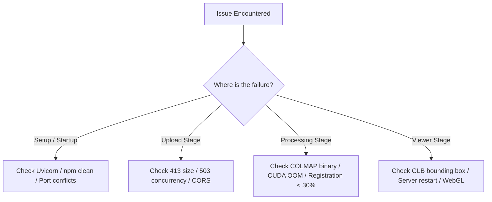

# Comprehensive Troubleshooting & Diagnostic Guide — GeoForge

> **Document:** `docs/TROUBLESHOOTING.md`  
> **Status:** Code-Verified Troubleshooting Specification  
> **Target Version:** GeoForge v1.0.0 (SIH 2026 / NTRO Edition)  
> **Last Verified:** 2026-11-11  
> **Related Documents:** [`docs/SETUP.md`](file:///c:/Users/adity/Downloads/geoforge-main/geoforge-main/docs/SETUP.md), [`docs/CONFIGURATION.md`](file:///c:/Users/adity/Downloads/geoforge-main/geoforge-main/docs/CONFIGURATION.md), [`docs/BACKEND.md`](file:///c:/Users/adity/Downloads/geoforge-main/geoforge-main/docs/BACKEND.md)

---

## 1. Diagnostic Decision Tree

When encountering a failure during installation or execution, identify the fault domain using this decision tree:



---

## 2. Common Setup & Server Startup Issues

### 2.1 Backend: `uvicorn` is not recognized as an internal or external command
- **Symptom:** Running `uvicorn main:app --reload` outputs:
  ```text
  uvicorn : The term 'uvicorn' is not recognized as the name of a cmdlet, function, script file...
  ```
- **Root Cause:** Python Scripts directory is not present in the user or system `PATH` variable, or the virtual environment is not activated.
- **Verified Solution:**
  1. Ensure your virtual environment is activated:
     ```powershell
     cd backend
     .\.venv\Scripts\Activate.ps1
     ```
  2. Invoke Uvicorn as a Python module directly, which bypasses PATH lookup:
     ```powershell
     python -m uvicorn main:app --reload --port 8000
     ```

---

### 2.2 Frontend: `npm run clean` fails with `'rm' is not recognized` on Windows
- **Symptom:** Running `npm run clean` in PowerShell or CMD fails with:
  ```text
  'rm' is not recognized as an internal or external command, operable program or batch file.
  ```
- **Root Cause:** `frontend/package.json` contains `"clean": "rm -rf dist node_modules"`, which uses Unix-specific syntax incompatible with native Windows command interpreters.
- **Verified Solution:**
  Do not run `npm run clean` directly on Windows. Use native PowerShell commands instead:
  ```powershell
  # Powershell clean command
  Remove-Item -Recurse -Force dist, node_modules
  ```

---

### 2.3 Port Conflicts: Address already in use (`Errno 10048` or `EADDRINUSE`)
- **Symptom:** Backend fails with `[Errno 10048] error while attempting to bind on address ('127.0.0.1', 8000)` or Vite warns `Port 3000 is in use, trying another one...`.
- **Root Cause:** A prior instance of Uvicorn or another local web server is already bound to port 8000 or 3000.
- **Verified Solution:**
  1. Identify the process ID (PID) occupying the port in PowerShell:
     ```powershell
     # Find process using port 8000
     Get-NetTCPConnection -LocalPort 8000 | Select-Object OwningProcess
     ```
  2. Terminate the blocking process:
     ```powershell
     Stop-Process -Id <PID> -Force
     ```
  3. Restart the server.

---

## 3. Network, API & Ingestion Issues

### 3.1 Frontend Displays "Network Error" or Cannot Reach Backend
- **Symptom:** Clicking upload immediately turns red with: `"Reconstruction server is unavailable or network error occurred."`
- **Root Cause & Diagnostic Steps:**
  1. **Is Backend Running?** Open browser to `http://127.0.0.1:8000/health`. If connection refused, start the backend terminal.
  2. **CORS Rejection:** Open browser Developer Tools (`F12` $\to$ Console). If you see `CORS header 'Access-Control-Allow-Origin' missing`, verify that the frontend URL is listed in `backend/main.py:ALLOWED_ORIGINS`.
     - In PowerShell, set custom origins before launching backend:
       ```powershell
       $env:ALLOWED_ORIGINS = "http://localhost:3000,http://127.0.0.1:3000"
       ```
  3. **VITE_API_URL Mismatch:** If backend runs on a custom port (e.g. 8080), create `frontend/.env.local`:
     ```bash
     VITE_API_URL="http://127.0.0.1:8080"
     ```

---

### 3.2 Upload Rejected with HTTP 413: "File is too large"
- **Symptom:** Upload fails instantly with HTTP 413 `Payload Too Large`.
- **Root Cause:** The video file exceeds `MAX_UPLOAD_BYTES = 4 * 1024 * 1024 * 1024` ($4\text{ GiB}$) defined in `backend/main.py:76`.
- **Solution:**
  1. Compress or trim the video using FFmpeg before uploading:
     ```powershell
     # Re-encode video to high-efficiency H.264
     ffmpeg -i input_4k.mp4 -c:v libx264 -crf 20 -preset fast output_flight.mp4
     ```
  2. If hardware supports larger files, adjust `MAX_UPLOAD_BYTES` in `backend/main.py`.

---

### 3.3 Upload Rejected with HTTP 503: "Maximum concurrent reconstructions reached"
- **Symptom:** Upload returns HTTP 503: `"Server is busy. Maximum concurrent reconstructions reached."`
- **Root Cause:** GeoForge enforces a hard capacity ceiling of `MAX_CONCURRENT_RECONSTRUCTIONS = 2` (`backend/main.py:89`) to protect host VRAM and CPU from exhaustion.
- **Solution:**
  Wait for active jobs to complete before submitting another video, or monitor progress in the backend terminal.

---

## 4. Photogrammetry & Processing Pipeline Failures

### 4.1 "COLMAP executable not found at..."
- **Symptom:** Job fails during Step 5 with:
  ```text
  RuntimeError: COLMAP executable not found at: C:\bin\colmap.exe
  ```
- **Root Cause:** The binary is missing from `C:\bin\colmap.exe`, or the path contains spaces and failed when invoked through a batch wrapper.
- **Solution:**
  1. Verify the exact path to `colmap.exe`:
     ```powershell
     Test-Path "C:\bin\colmap.exe"
     ```
  2. If installed elsewhere (e.g., `D:\tools\colmap\colmap.exe`), set the environment variable:
     ```powershell
     $env:COLMAP_EXE = "D:\tools\colmap\colmap.exe"
     ```
  3. Test invoking the binary directly from terminal:
     ```powershell
     & $env:COLMAP_EXE -h
     ```

---

### 4.2 "Sparse reconstruction failed quality gate: only X% of images registered"
- **Symptom:** Job fails after SfM with error:
  ```text
  Sparse reconstruction failed quality gate: only 12.5% of images registered (4/32). At least 30.0% required.
  ```
- **Root Cause:** Insufficient visual parallax or texture. Common in stationary hovering flights, featureless surfaces (open grass/water), or high motion blur.
- **Remediation & Capture Guidance:**
  - **Increase Overlap:** Ensure drone flight trajectory maintains $\ge 70\%$ forward and lateral overlap.
  - **Avoid Pure Hovering:** A drone rotating in place around its own sensor center lacks translation baseline, causing SfM triangulation to degenerate. Move in an orbit or linear path around the object.
  - **Check Lighting:** Avoid severe backlight, glare, or deep shadows where SIFT feature extraction fails to find distinctive keypoints.

---

### 4.3 CUDA Out-Of-Memory (OOM) During Dense PatchMatch Stereo
- **Symptom:** COLMAP dense stereo crashes with:
  ```text
  CUDA error: out of memory / std::bad_alloc
  ```
- **Root Cause:** `PATCHMATCH_MAX_IMAGE_SIZE = 2400` requires $\ge 6\text{ GB}$ of dedicated GPU VRAM. On GPUs with 4 GB VRAM or integrated graphics, stereo depth maps exceed physical memory.
- **Solution:**
  In `backend/reconstruction.py:65`, lower the image dimension ceiling:
  ```python
  # Lower from 2400 to 1600 or 1200 for lower-VRAM GPUs
  PATCHMATCH_MAX_IMAGE_SIZE = 1600
  ```

---

### 4.4 Open3D Screened Poisson Meshing Memory Spike / Crash
- **Symptom:** Backend process silently terminates or raises `std::bad_alloc` during Step 7 (`mesh_generator`).
- **Root Cause:** Screened Poisson octree depth (`POISSON_DEPTH = 11`) constructs an octree of $2^{11} \times 2^{11} \times 2^{11}$ cells. If the dense point cloud has $> 8\text{M}$ points, host RAM usage can exceed 16 GB.
- **Solution:**
  In `backend/reconstruction.py:75`, reduce octree depth to 9 or 10:
  ```python
  POISSON_DEPTH = 10  # Lowers RAM usage significantly while preserving good geometry
  ```

---

## 5. 3D Viewer & Model Inspection Issues

### 5.1 Three.js 3D Viewer Displays a Blank Screen
- **Symptom:** Complete page shows success, but Viewer shows a black/dark grey empty canvas with coordinate grid only.
- **Diagnostic Steps:**
  1. **Check HTTP Status:** Open Developer Tools (`F12` $\to$ Network tab). Check request to `/model/{job_id}`.
     - If HTTP 404: The GLB file was not created or was removed.
     - If HTTP 200: Check file size. If size is $< 1\text{ KB}$, the GLB has empty geometry.
  2. **Camera Bounds Auto-Fitting:** The Three.js viewer auto-centers models using `THREE.Box3().setFromObject(gltf.scene)`. If geometry coordinates are extreme (e.g. coordinates at $10^7$ units), the camera may be zoomed out excessively. Click the **Reset View** button.
  3. **Inspect with Independent Viewer:** Open the model in an external tool like [glTF Viewer (Don McCurdy)](https://gltf-viewer.donmccurdy.com/) or Blender to verify whether triangles and textures exist.

---

### 5.2 Server Restart "Job Not Found" Error
- **Symptom:** After refreshing or reopening the browser, status polling shows:
  ```text
  "Job not found. The server may have been restarted and lost its in-memory job state. Please upload your video again."
  ```
- **Root Cause:** GeoForge prototype stores active jobs in an in-memory dictionary `_jobs = {}` (`backend/main.py:68`). Restarting Uvicorn resets this dictionary.
- **Solution:**
  - This is a documented prototype architectural boundary (see [`docs/ROADMAP.md`](file:///c:/Users/adity/Downloads/geoforge-main/geoforge-main/docs/ROADMAP.md) Phase 2).
  - To view the previously generated model without re-running the reconstruction, the GLB remains on disk at `backend/temp/{job_id}/colmap/textured/model.glb` and can be opened in any desktop 3D viewer (Windows 3D Viewer, Blender).
