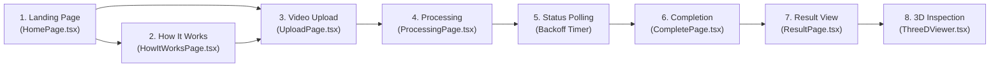

# UI/UX Design Specification & User Journey — GeoForge

> **Document:** `docs/UI_UX_DESIGN.md`  
> **Status:** Code-Verified UI/UX Specification (Phase 4 Verified)  
> **Target Version:** GeoForge v1.0.0 (SIH 2026 / NTRO Edition)  
> **Source Verification Date:** 2026-11-11  
> **Related Documents:** [`docs/FRONTEND.md`](file:///c:/Users/adity/Downloads/geoforge-main/geoforge-main/docs/FRONTEND.md), [`docs/PRD.md`](file:///c:/Users/adity/Downloads/geoforge-main/geoforge-main/docs/PRD.md), [`docs/FEATURE_STATUS.md`](file:///c:/Users/adity/Downloads/geoforge-main/geoforge-main/docs/FEATURE_STATUS.md)

---

## 1. Design System & Theme Foundations

The GeoForge interface is designed for defense, intelligence, and surveying professionals who require high data density, clear visual feedback, and reliable technical operations.

- **Color Palette:**
  - Background Base: Dark CAD palette (`#090909`, `#020617`, `#101415`).
  - Accent / Primary Amber: `#f59e0b` (Pulsing badge, hero highlights, CTA gradients).
  - Accent / Tech Blue: `#2563EB` (Viewer action buttons, progress indicators).
  - Success Emerald: `#10b981`, `#34d399` (Complete badges, checkmarks).
  - Border Grays: `#434655`, `#1E293B`, `rgba(255,255,255,0.08)`.
  - Text: High-contrast white (`#ffffff`, `#e0e3e5`) with muted metadata gray (`#888888`, `#8d90a0`).
- **Typography:** Modern clean sans-serif paired with monospace fonts for technical telemetry (Job IDs, timestamps, frame counters, metrics).
- **Iconography:** Google Material Symbols Outlined and Lucide React icons.

---

## 2. The 8-Stage User Journey

---

## 3. Screen-by-Screen Specifications

### Screen 1: Landing Page (`HomePage.tsx`)
- **Purpose:** Introduce GeoForge's capabilities, set clear expectations for automated photogrammetry, and provide a single-click entry point to start reconstruction.
- **Layout:** Hero section with CAD background grid, radial amber illumination glow, two-column responsive split (copy on the left, interactive terrain preview mockup on the right), followed by a 3-card feature overview grid.
- **Main Components:**
  - Pulsing Status Pill: `"Photogrammetry · Structure from Motion"`.
  - Main Headline: `"Drone footage. 3D model. No work."`
  - Dual CTAs: Primary `"Upload a video"` (`onNavigate('upload')`) and Secondary `"How it works"` (`onNavigate('how-it-works')`).
  - Feature highlights: Supported formats (`MP4 · MOV · AVI`), local processing disclosure (`"Runs on the server — not your laptop"`).
- **User Actions:** Click primary CTA to open upload view; click secondary CTA to read capture guidance.
- **Loading / Empty States:** Static page; immediate zero-latency render.
- **Responsive Behaviour:** Stacks vertically on mobile/tablet viewports ($<768\text{px}$); copy and preview card expand to 100% width.
- **Accessibility:** Semantic heading hierarchy (`h1`, `h2`); high contrast buttons ($>7:1$ contrast ratio).

---

### Screen 2: How It Works (`HowItWorksPage.tsx`)
- **Purpose:** Educate operators on drone capture techniques to prevent low-overlap or blurry footage before filming or uploading.
- **Layout:** Centered single-column editorial layout with vertical numbered timeline connected by amber step nodes.
- **Main Components:**
  - Back Navigation Link: Returns to `'home'`.
  - 5-Step Process Timeline:
    1. *Drop your video* (Resolution & format guidance).
    2. *Bad frames get cut* (Laplacian sharpness explanation).
    3. *Camera positions are solved* (SIFT feature matching & bundle adjustment).
    4. *Depth maps become a mesh* (Dense MVS & Screened Poisson meshing).
    5. *Interactive model* (In-browser WebGL inspection).
  - Practical Capture Tips: Emphasizes slow, overlapping flight tracks ($70-80\%$) and lighting consistency.
- **User Actions:** Click "Back" to return to landing view; click footer CTA to start upload.
- **Loading / Empty States:** Static view; immediate render.
- **Responsive Behaviour:** Step timeline left-padding scales dynamically; node connectors hide gracefully on small screens.
- **Accessibility:** Ordered list structure with screen-reader accessible step indicators.

---

### Screen 3: Video Upload (`UploadPage.tsx`)
- **Purpose:** Allow drag-and-drop or file picker selection of drone flight video, enforce client-side format checks, and initiate upload.
- **Layout:** Centered modal-style card container with dashed drag-over boundary and file drop targets.
- **Main Components:**
  - Hidden native file input element (`id="drone-video-file-input"`, accepting `.mp4,.mov,.avi`).
  - Drag-and-Drop Dropzone: Visual state changes on hover and drag-over.
  - Selected File Card: Shows filename, formatted file size (KB/MB/GB), and remove/replace button.
  - Primary Action Button: `"Generate 3D Model"` with loading spinner state.
  - Guidance Checklist: Format badges and capture recommendations.
- **User Actions:**
  - Drag and drop video file onto dropzone.
  - Click dropzone to open OS file browser.
  - Remove file or click "Generate 3D Model".
- **Loading States:** When `isUploading === true`, displays animated upload progress bar with live percentage and disabled buttons.
- **Empty States:** Displays cloud upload vector icon and `"Drop your drone flight video here"`.
- **Error States:** If user drops unsupported file type (e.g., `.wmv`, `.exe`), triggers `onUnsupportedFormat` and opens `ErrorView.tsx`.
- **Responsive Behaviour:** Padding scales from `p-5` (mobile) to `p-10` (desktop); dropzone maintains minimum touch targets $\ge 48\text{px}$.
- **Accessibility:** Full keyboard navigation support (Enter/Space triggers file picker); ARIA role `region`.

---

### Screen 4 & 5: Processing Interface & Status Polling (`ProcessingPage.tsx` & `App.tsx`)
- **Purpose:** Reassure the user during long-running photogrammetry compute, display live logs, and track execution status via exponential back-off polling.
- **Layout:** Dark technical dashboard container (`#101415`) with top metadata bar, active stage indicator, animated progress track, and 10-stage vertical milestone list.
- **Main Components:**
  - Top Metadata Header: Displays server Job ID (`JOB: GF-XXXXXX`), elapsed timer (`ELAPSED: MM:SS`), and source video details.
  - 10-Stage Milestone List (`PIPELINE_STAGES`):
    1. Video uploaded
    2. Extracting frames
    3. Filtering blurry frames
    4. Removing redundant frames
    5. Feature extraction
    6. Feature matching
    7. Camera reconstruction
    8. Dense reconstruction
    9. Generating mesh
    10. Preparing 3D model
  - Status Indicators: Completed (green check), Active (amber pulse spinner), Pending (muted gray circle), Failed (red cross).
  - Live Diagnostic Message Box: Displays current backend status strings and telemetry.
- **User Actions:**
  - Monitor stage progression.
  - Click `"Cancel Job"` or view results when complete.
- **Loading States:** Smooth progress bar interpolation; ticking elapsed seconds timer (`setInterval`).
- **Empty States:** If no job is active, displays placeholder message prompting upload.
- **Error States:** If `/status/{job_id}` returns status `failed`, status badge turns red and button shifts to `"Retry Reconstruction"`.
- **Responsive Behaviour:** Header metadata wraps gracefully; milestone list scrolls independently if viewport height is restricted.
- **Accessibility:** Live region (`aria-live="polite"`) announces stage transitions to screen readers.

---

### Screen 6: Reconstruction Completion (`CompletePage.tsx`)
- **Purpose:** Celebrate successful pipeline completion, present high-level reconstruction metrics, and provide direct actions to inspect or download the model.
- **Layout:** Centered success card featuring an emerald badge, dual primary CTAs, a 2-column deliverable artifact grid, and a technical metrics table.
- **Main Components:**
  - Large Success Icon: Pulsing emerald checkmark badge.
  - Primary Action Button: `"Open Interactive 3D Viewer"` (Transitions to `ResultPage`).
  - Secondary Action Button: `"Download GLB Asset"` (Triggers browser download of `model.glb`).
  - Deliverables Grid: Cards showcasing GLB, Point Cloud, and Mesh deliverables with "READY" badges.
  - Reconstruction Metrics Card: Registered images, sparse points, dense point cloud points, mesh faces, and final GLB size.
- **User Actions:**
  - Click "Open Interactive 3D Viewer" to enter 3D inspection mode.
  - Click "Download GLB Asset" to save model locally.
  - Click "Upload Another Video" to start a new job.
- **Loading States:** Immediate render once status reaches `'complete'`.
- **Responsive Behaviour:** 2-column deliverable grid collapses into a single column on mobile screens ($<768\text{px}$).
- **Accessibility:** High-contrast buttons, explicit download attributes, and keyboard-tabbable action cards.

---

### Screen 7 & 8: Result Page & 3D Model Viewport (`ResultPage.tsx` & `ThreeDViewer.tsx`)
- **Purpose:** Deliver an immersive, high-performance browser inspection environment where operators can orbit, zoom, pan, and analyze the reconstructed 3D geometry.
- **Layout:** Full-height application view (`h-[calc(100vh-56px)]`) composed of a top sub-navigation bar, a central WebGL canvas, and a collapsible right-hand Model Inspector Drawer.
- **Main Components:**
  - Top Sub-Header:
    - Back to Summary button.
    - Model Title (`job.filename`) with green `"3D MODEL LOADED"` status badge.
    - Quick Actions: `"Download GLB"` and `"New Reconstruction"`.
  - Central 3D Canvas (`ThreeDViewer.tsx`):
    - WebGL Three.js viewport with OrbitControls.
    - Floating Viewport Control Toolbar: Tool selector (Rotate, Pan, Zoom), Wireframe Toggle, Ground Grid Helper Toggle, Coordinate Axes Toggle, Reset Camera button, Fullscreen toggle.
  - Right Inspector Drawer (Tabbed):
    - Tab 1 (`Model Info`): File size, polygon face count, vertex count, registration ratio.
    - Tab 2 (`Layers`): Geometry and texture visibility toggles.
    - Tab 3 (`Camera`): Camera field-of-view (FOV) slider and projection settings.
- **User Actions:**
  - Left-click drag to orbit scene.
  - Right-click drag to pan camera.
  - Scroll wheel to zoom in/out.
  - Toggle wireframe mode to inspect polygon topology.
  - Adjust FOV slider to change perspective.
  - Click fullscreen button for distraction-free analysis.
- **Loading States:** Displays animated amber loading ring and text `"Loading 3D Model..."` while Three.js `GLTFLoader` buffers the GLB file.
- **Empty States:** If model URL is missing, displays `"No 3D Model Available"` with upload link.
- **Error States:** If GLB parsing fails or WebGL context crashes, invokes `onModelLoadError` and renders error fallback card with diagnostics.
- **Responsive Behaviour:** Right inspector drawer docks to the bottom on mobile devices or collapses into an accordion overlay; WebGL canvas dynamically resizes on window resize events (`resize` event listener).
- **Accessibility:** Visual control buttons carry explicit `title` attributes and `aria-label` tags; keyboard shortcuts supported for camera reset.
